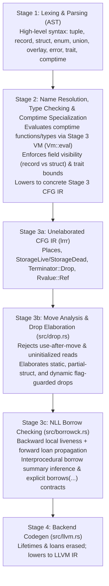

# Language & Stage 3 IR (`lrrr`) Design Document

## 1. Core Philosophy
The goal of the language is to combine:
1. **Rust-level memory safety** (ownership, move semantics, RAII destructors, and Non-Lexical Lifetimes borrow checking).
2. **Zig-level `comptime` metaprogramming** (first-class `type` values, functions that compute types, and compile-time evaluation in place of angle-bracket generics `<T>` and AST/procedural macros).
3. **Clear, orthogonal type taxonomy** (distinct keywords for distinct memory/lifecycle semantics rather than overloading a single keyword).

---

## 2. Compiler Pipeline Architecture



### Why `comptime` Specialization Happens *Before* Borrow Checking
In Rust, borrow checking happens before monomorphization on abstract generic types `<T>`, requiring complex type-system machinery (`T: 'a`, `PhantomData<T>`, `#[may_dangle]`, variance annotations).

By evaluating `comptime` parameters and type-constructing functions **first** (via [`Vm::eval`](file:///home/adam/git/lrrr/src/vm.rs#L123)) and running [`elaborate_drops`](file:///home/adam/git/lrrr/src/drop.rs#L62) and [`check_borrows`](file:///home/adam/git/lrrr/src/borrowck.rs#L30) on the resulting concrete Stage 3 functions:
- **No `PhantomData<T>` is needed**: Concrete field types and destructors (`drop tyX = fnY`) are directly visible.
- **No `T: 'a` bounds are needed**: Concrete structs containing references are tracked directly by the borrow checker.
- **`comptime` parameters are already folded** into concrete [`TypeId`](file:///home/adam/git/lrrr/src/ir.rs#L4)s and [`ConstValue`](file:///home/adam/git/lrrr/src/ir.rs#L75)s before borrow checking begins.

---

## 3. High-Level Type Taxonomy

### 3.0 Primitive Scalar Types, Arbitrary-Width Integers (`i1`..`i512` / `u1`..`u512`), `simd[T; N]`, `rune`, and Scalar Pattern Types (`Int in ...`)
The primitive scalar and vector types are:
- **Unit & Boolean**: `void` (0 bytes), `bool` (1 byte: `true` / `false`)
- **Arbitrary-Width Signed & Unsigned Integers**: **`i1`..`i512`** and **`u1`..`u512`** (any bit width from 1 to 512 bits, represented uniformly by [`Type::Int { signed, bits }`](file:///home/adam/git/lrrr/src/ir.rs#L21) in Stage 3 and lowered directly to LLVM `iN`), plus pointer-sized `isize` and `usize`
- **Floating-Point**: `f32`, `f64`
- **First-Class SIMD Vectors**: **`simd[T; N]`** (hardware vector of `N` scalar lanes of integer or float type `T`, represented by [`Type::Simd { elem, len }`](file:///home/adam/git/lrrr/src/ir.rs#L31) in Stage 3 and lowered directly to LLVM `<N x T>`)
- **Unicode Scalar Value**: **`rune`** (4 bytes; represents a single validated Unicode scalar value in `0x0000..=0xD7FF` or `0xE000..=0x10FFFF`)
- **Scalar Pattern / Range Types**: **`Int in Lo..=Hi | ...`** (an integer type constrained to a compile-time union of inclusive ranges)
- **Compile-Time Meta-Type**: `type` ([`Type::MetaType`](file:///home/adam/git/lrrr/src/ir.rs#L25); 0 runtime bytes, exists only at `comptime`)

#### Arbitrary-Width Integers (`i1`..`i512`, `u1`..`u512`) & `packed` Bit-Level Layouts
1. **Unified Representation (`Type::Int { signed: bool, bits: u16 }`)**:
   - Instead of hardcoding only power-of-two integer widths (`8, 16, 32, 64, 128`), any signed (`i1`..`i512`) or unsigned (`u1`..`u512`) integer width up to 512 bits is a first-class primitive type.
   - Standard standalone memory layout rounds `(bits + 7) / 8` up to the next power-of-two byte size (with alignment capped at 16 bytes), while arithmetic (`+`, `+%`, `+|`), comparisons, and casts operate at the exact `N`-bit precision (`[-2^(N-1), 2^(N-1) - 1]` or `[0, 2^N - 1]`).
   - Wide integers (`u256`, `u512`) support 256-bit/512-bit cryptography, hashes (SHA-256, SHA-512), and wide bitsets (`u256` character-class tables or 512-bit AVX-512 bitmasks).
2. **Eliminating C Bitfield Undefined Behavior (`packed record` / `packed struct` & `enum(uN)`)**:
   - When placed inside a `packed record` or `packed struct` (which lowers to an `iN` backing integer with automatic shift/mask field extraction), arbitrary-width integers (`u1`, `u3`, `u4`, `u12`, `u24`, `u48`) and sub-byte enums (`enum(u3)`) pack bit-tightly with deterministic layout—completely replacing C's implementation-defined `: 3` bitfield syntax and procedural bitfield macros:
     ```rust
     pub packed record Ipv4Header {
         version:  u4 = 4,
         ihl:      u4 = 5,
         dscp:     u6,
         ecn:      u2,
         total_len: u16,
     } // Guaranteed exact 32-bit (4-byte) layout
     ```
3. **Computed `comptime` Integer Widths (`@Int`)**:
   - `comptime` functions can compute exact-width integer types dynamically (e.g., `@Int(.unsigned, a.bits + b.bits)` for lossless widening multiplication without overflow).

#### First-Class SIMD Vector Types (`simd[T; N]`)
While `u256` and `u512` represent single 256-bit or 512-bit scalar integers (with carry propagation across all 256/512 bits), **`simd[T; N]`** represents a parallel SIMD vector of `N` independent lanes of scalar element type `T` (`i8`..`i128`, `u8`..`u128`, `f32`, `f64`):
- **Stage 3 & LLVM Lowering**: `simd[ty0; 16]` ([`Type::Simd { elem, len }`](file:///home/adam/git/lrrr/src/ir.rs#L31)) lowers directly to LLVM's first-class vector type `<16 x i32>` (targeting SSE/AVX2/AVX-512/NEON vector registers).
- **Splat & Lane-Wise Construction**: `aggregate ty_simd(copy _scalar)` splats a single scalar across all `N` lanes, while `aggregate ty_simd(op0, op1, ...)` constructs each lane explicitly.
- **Parallel Lane-Wise Operations**: Arithmetic (`add`, `sub`, `mul`, `add_wrap`, `sub_wrap`, `mul_wrap`, `add_sat`, `sub_sat`, `mul_sat`, `div`, `rem`) and bitwise operations (`and`, `or`, `xor`, `shl`, `shr`, `neg`, `not`) operate in parallel across all `N` lanes, lowering to LLVM vector instructions and vector intrinsics (`@llvm.sadd.sat.v16i8`, `@llvm.sadd.with.overflow.v4i32`).
- **Lane Indexing & `comptime` Construction**: Individual lanes can be indexed via `_vec[_idx]`, and `comptime` type functions can construct SIMD types dynamically via `simd[copy _elem; copy _len]` ([`Rvalue::SimdType`](file:///home/adam/git/lrrr/src/ir.rs#L179-L182)).

#### Why `rune` Instead of `char`
- **`char` is historically ambiguous**: In C/C++ `char` is a 1-byte integer (`u8` / `i8`), in Java/C#/UTF-16 it is a 16-bit code unit (`u16`), in Rust it is a 32-bit Unicode scalar value, and in human prose a "character" usually means a user-perceived Unicode Extended Grapheme Cluster (which has variable byte length).
- **`rune` (borrowed from Go/Plan 9) is unambiguous**: A `rune` is always a 32-bit Unicode scalar value, while raw bytes are always `u8`.
- **Distinct Type Identity from `u32`**: Unlike Go (where `rune` is merely a type alias for `int32`), `rune` is a **distinct primitive type** ([`Type::Rune`](file:///home/adam/git/lrrr/src/ir.rs#L22) in Stage 3):
  - **Formatting & Display**: Printing or formatting a `rune` outputs the UTF-8 character (`'🦀'`), whereas printing a `u32` outputs the decimal number (`129408`).
  - **`comptime` Type Reflection & `map[type, V]`**: Because `Type::Rune` (`rune`) is distinct from `Type::U32` (`u32`) in Stage 3, `comptime` functions and `map[type, V]` tables can distinguish text characters from 32-bit numbers.
  - **No Nonsense Arithmetic**: Multiplying or dividing two `rune`s (`'a' * 'b'`) is a compile error; explicit casts (`r as u32`) are always zero-cost, and `u8 as rune` is always safe and lossless because ASCII/Latin-1 (`0x00..=0xFF`) is a valid subset of Unicode scalar values.
  - **Literals**: `'a'`, `'\n'`, `'\u{1F980}'` have type `rune`; `b'a'`, `b'\n'`, `b'\x7F'` have type `u8`.

#### Scalar Pattern / Range Types (`Int in Lo..=Hi | ...`)
Rather than embedding an unpredictable SMT solver for arbitrary predicate refinement types (`x % 2 == 0`), the type system directly supports **Scalar Pattern Types**—constraining any integer type `Int` to a disjoint union of compile-time ranges:

```rust
// 1. `rune` has the exact same range constraint as:
//    u32 in 0x0000..=0xD7FF | 0xE000..=0x10FFFF

// 2. Non-zero integers via a 3-line comptime function (replaces NonZeroU8..NonZeroU64)
fn NonZero(comptime Int: type) -> type {
    return Int in 1..=Int::MAX;
}

// 3. Domain-specific bounded scalars & proven-in-bounds array indices
type Ascii   = u8  in 0x00..=0x7F;
type Percent = u8  in 0..=100;
type PosixFd = i32 in 0..=i32::MAX; // Valid POSIX file descriptors are >= 0

fn Index(comptime len: usize) -> type {
    return usize in 0..(len - 1);
}
```

1. **Automatic Niche Optimization (`?T` and `union`)**:
   - Any bit pattern outside a pattern type's valid interval set is a **niche** that the compiler can use to store tags for `?T` and `union` with zero space overhead:
     - **`?NonZero(u32)` is 4 bytes** (`0` represents `null`).
     - **`?rune` is 4 bytes** (`0x110000` / `0xFFFFFFFF` represents `null`).
     - **`?Ascii` is 1 byte** (`0x80` represents `null`).
     - **`?PosixFd` is 4 bytes** (`-1` represents `null`, matching POSIX C FFI return conventions directly).
2. **Conversion, Widening, Narrowing & Arithmetic Rules**:
   - **Compile-Time Verified Literals**: Assigning a constant or literal to a pattern type is verified at `comptime` (`let p: Percent = 50;` succeeds; `let p: Percent = 150;` is a compile error).
   - **Lossless Subset-to-Superset Widening**: A pattern type `A` can be cast (`x as B`) or widened without a runtime check into its base integer type or any pattern type `B` whose valid intervals are a superset of `A`'s intervals (e.g., `Ascii as u8`, `Ascii as rune`, `NonZero(u32) as u32`).
   - **Arithmetic Operates on the Base Integer Type**: To avoid Ada-style intermediate overflow traps or interval-type explosion across loops, arithmetic (`a + b`) operates on the base integer type (`u8`, `u32`, etc.).
   - **Checked vs. Unchecked Runtime Narrowing**: Converting an unconstrained runtime integer `x` into a pattern type `P` requires either:
     - **Checked narrowing (`x as ?P`)**: Performs the range check and returns `?P` (`null` if out of range), composing naturally with `orelse` and `try` (`let p = (raw as ?Percent) orelse return Error::OutOfRange;`).
     - **Unchecked `unsafe` narrowing**: Inside `unsafe`, `unsafe @transmute(P, x)` (or `P::new_unchecked(x)`) constructs `P` without a branch when the caller has already established the invariant.
3. **Bounds-Check Elimination & LLVM `!range` Metadata**:
   - Indexing an array `[T; N]` with a value of type `usize in Lo..=Hi` where `Hi < N` elides the runtime bounds check completely at compile time.
   - When lowering to Stage 4 LLVM IR ([`src/llvm.rs`](file:///home/adam/git/lrrr/src/llvm.rs)), loads of pattern-typed values attach LLVM `!range` metadata, enabling LLVM to eliminate redundant comparisons and dead branches downstream.

#### Integer Overflow & Arithmetic Operator Taxonomy
Following Zig's philosophy, standard integer arithmetic (`+`, `-`, `*`) **never silently wraps**. Instead, distinct operator families express exact overflow semantics:

| Operator Family | High-Level Syntax | Stage 3 (`lrrr`) [`BinOp`](file:///home/adam/git/lrrr/src/ir.rs#L118-L144) | Overflow Behavior (`comptime` & Runtime) | Stage 4 LLVM Lowering ([`src/llvm.rs`](file:///home/adam/git/lrrr/src/llvm.rs#L612-L775)) |
| :--- | :--- | :--- | :--- | :--- |
| **Default (Checked)** | `a + b`, `a - b`, `a * b` | `add`, `sub`, `mul` | **Compile error** at `comptime`; **traps** at runtime | `@llvm.[s\|u][add\|sub\|mul].with.overflow` + branch to `@llvm.trap()` |
| **Wrapping (Modular)** | `a +% b`, `a -% b`, `a *% b` | `add_wrap`, `sub_wrap`, `mul_wrap` | Wraps modulo $2^N$ at both `comptime` and runtime | Plain two's-complement `add`, `sub`, `mul` |
| **Saturating (Clamping)** | `a +\| b`, `a -\| b`, `a *\| b` | `add_sat`, `sub_sat`, `mul_sat` | Clamps to `[T::MIN, T::MAX]` | `@llvm.[s\|u][add\|sub].sat` / overflow-clamped `select` |
| **Fallible (`-> ?T`)** | `a +? b`, `a -? b`, `a *? b` | Lowers to overflow check returning `?T` | Returns **`?T`** (`null` on overflow); chains with `orelse` / `try` | `@llvm.[s\|u][add\|sub\|mul].with.overflow` -> `?T` |
| **Unchecked (`nsw`/`nuw`)** | `unsafe @add_unchecked(a, b)` (or proven by Pattern Type) | `add_unchecked`, `sub_unchecked`, `mul_unchecked` | **Compile error** at `comptime`; assumed no-wrap at runtime | `add nsw` / `add nuw`, `sub nsw` / `sub nuw`, `mul nsw` / `mul nuw` |

- **Memory Safety vs. `ReleaseFast` UB**:
  - Unlike C or Zig's `ReleaseFast` mode (where unexpected overflow in safe code triggers Undefined Behavior and can corrupt memory by bypassing bounds checks), safe code traps on overflow by default and only emits `add_unchecked` (`nsw`/`nuw`) when **statically proven** not to overflow by Scalar Pattern Type interval analysis (e.g., adding two `u32 in 0..=1000` values) or inside an explicit `unsafe` block.

### 3.1 Product Types: `tuple` vs `record` vs `struct`
All three product types (`tuple`, `record`, and `struct`) are inline value types (no implicit heap allocation or OOP inheritance) and all three lower to [`Type::Struct`](file:///home/adam/git/lrrr/src/ir.rs#L35) (`{ ty0, ty1, ... }`) in Stage 3, but they form a clear progression of high-level contracts:

| Feature | `tuple` (Anonymous Positional Data) | `record` (Named Transparent Data) | `struct` (Encapsulated Invariant / Resource) |
| :--- | :--- | :--- | :--- |
| **Type & Literal Syntax** | `tuple { i32, f64 }` / `{ 10, 3.14 }` | `record { x: i32, y: f64 }` | `struct { ... }` |
| **Intent** | Multi-value returns, ad-hoc pairs/triples, positional variant payloads | Plain transparent bundle of named fields (`Point`, `Config`) | Encapsulated state with invariants or lifecycle (`Vec`, `File`, `MutexGuard`) |
| **Type Identity** | **Structural** (any two `tuple { i32, f64 }` are the exact same type) | Nominal / Structural by field names + types | **Nominal** (distinct type per declaration) |
| **Field Access & Visibility** | Public positional (`t.0`, `t.1`); empty `tuple {}` is forbidden (use `void`) | All fields are **public** (`r.x`, `r.y`; may specify default values `x: T = expr`) | Fields are **private** by default |
| **`comptime` Fields (`comptime C: T = val`)** | **Forbidden** | **Forbidden** (every `record` field is strictly an instance data field) | **Allowed** (serves as associated constants and associated `type`s; 0 runtime bytes) |
| **`static` Fields (`static S: T = val`)** | **Forbidden** | **Forbidden** (no hidden global state on transparent data) | **Allowed** (encapsulated type-scoped global state; lowers to Stage 3 [`Global`](file:///home/adam/git/lrrr/src/ir.rs#L205-L210)) |
| **Methods** | **Forbidden** | Allowed (stateless convenience helpers) | Allowed (invariant-preserving API) |
| **Custom Lifecycle (`default`, `clone`, `drop`)** | **Forbidden** (always auto-synthesized structurally from elements) | **Forbidden** (always auto-synthesized structurally from fields) | **Allowed** (`default() -> Self`, `clone(self: &Self) -> Self`, `drop(self: &mut Self)`) |
| **Partial Moves (`move t.0` / `move r.x`)** | **Always allowed** (remaining elements stay valid and are dropped individually) | **Always allowed** (remaining fields stay valid and are dropped individually) | **Forbidden** (preserves whole-object invariant for `drop`) |
| **Stage 3 Drop Behavior** | Decomposed into leaf elements in [`src/drop.rs`](file:///home/adam/git/lrrr/src/drop.rs#L96-L109) | Decomposed into leaf fields in [`src/drop.rs`](file:///home/adam/git/lrrr/src/drop.rs#L96-L109) | Treated as an atomic drop unit if registered in [`Program::destructors`](file:///home/adam/git/lrrr/src/ir.rs#L215) |

- **Why `tuple { T1, T2 }` and `{ v1, v2 }` instead of `(T1, T2)`**:
  - Avoids overloading parentheses `(...)` for both expression grouping and tuples (eliminating the `(x,)` 1-tuple trailing-comma wart—`tuple { i32 }` and `{ 42 }` are completely unambiguous).
  - Matches `record { ... }`, `struct { ... }`, and Stage 3 (`lrrr`) `{ ty0, ty1 }` syntax directly.
  - Supports clean destructuring (`let { q, r } = div_rem(17, 5);`) and multi-element `union` / `error` variant payloads (`V4: tuple { u8, u8, u8, u8 }`).

### 3.2 Sum, Error & Overlay Types: `enum`, `union`, `error enum` / `error union`, and `overlay`
Rather than overloading `enum` or `union`, distinct keywords represent distinct memory and safety models, with `error` acting as an orthogonal role modifier on `enum` and `union`:

| Keyword | Concept | Stage 3 Representation | Safety & Semantics |
| :--- | :--- | :--- | :--- |
| **`enum` / `enum(Int)`** | Scalar integer enumeration (`enum(u8) { Red = 0, ... }`) | Integer type (`u8`, `u16`, `i32`, etc.) | Safe scalar integer constants; optional explicit backing integer type via `enum(u8)`. |
| **`union` / `union(Enum)`** | Safe tagged union / sum type (Rust `enum` with payloads) | [`Type::Union { tag, variants }`](file:///home/adam/git/lrrr/src/ir.rs#L37) | Safe; always has a discriminant tag in all build modes, tracks active variant `v0`, `v1`, ... via [`Rvalue::Discriminant`](file:///home/adam/git/lrrr/src/ir.rs#L149), borrow-checks variant references, and auto-drops the active variant payload. |
| **`error enum` / `error union`** | First-class error types (`error enum` for pure scalar error codes; `error union` for payload-carrying errors) | Integer type (`error enum`) or [`Type::Union`](file:///home/adam/git/lrrr/src/ir.rs#L37) (`error union`) | Only `error` types (and `E1 \|\| E2` compositions) may appear on the left of `E!T`; supports hierarchical embedding, automatic `try` widening, and auto-synthesized display. |
| **`overlay`** | Unsafe C-style untagged memory overlay | [`Type::Overlay(fields)`](file:///home/adam/git/lrrr/src/ir.rs#L36) | Unsafe field reads (`.0`, `.1`); **never** injects a hidden debug tag (layout is identical in Debug and Release), and never auto-drops. |

#### Explicit `enum(Int)` Backing Types & Linked `union(MyEnum)` Discriminants
1. **Specifying `enum` Backing Width (`enum(u8)`)**:
   - By default, the compiler picks the smallest unsigned integer (`u8`, `u16`, ...) that fits all variants of an `enum`.
   - Writing `enum(u16)` or `enum(i32)` explicitly fixes the backing integer representation for wire protocols, FFI, or hardware registers:
     ```rust
     pub enum(u16) Opcode {
         Ping       = 0x0001,
         Auth       = 0x0010,
         Disconnect = 0xFFFF,
     }
     ```
2. **Automatic `T::Tag` Synthesis & `.tag` Access on `union`**:
   - Every `union` type `T` automatically exposes an associated scalar `enum` **`T::Tag`** with the same variant names, and every instance `v: T` exposes **`v.tag -> T::Tag`** (which lowers directly to Stage 3 [`Rvalue::Discriminant`](file:///home/adam/git/lrrr/src/ir.rs#L149)).
   - This eliminates Rust's `#[derive(EnumDiscriminants)]` proc-macro when passing variant kinds to functions (`parser.expect(Token::Tag::Ident)`), storing tags in SIMD/SoA columns, or using variant tags as keys in `comptime` `map[Token::Tag, V]` lookup tables.
3. **Linking a `union` to an Explicit `enum` (`union(Opcode)`)**:
   - Writing `union(Opcode)` links the `union`'s discriminant directly to `Opcode` (aliasing `Message::Tag` to `Opcode`), enforcing at compile time that both types define the exact same variants and using `Opcode`'s backing integer type (`u16`) and discriminant values (`0x0001`, `0x0010`, `0xFFFF`) in Stage 3 [`Type::Union { tag, variants }`](file:///home/adam/git/lrrr/src/ir.rs#L37):
     ```rust
     pub union(Opcode) Message {
         Ping: u64,
         Auth: AuthCredentials,
         Disconnect,
     }
     ```

### 3.3 The Value Lifecycle Triad: `default`, `clone`, `drop`
Creation (`default`), duplication (`clone`), and destruction (`drop`) are **language-level lifecycle constructs** (always written in **lowercase**), rather than user-implemented traits:

| Lifecycle Hook | On a `tuple` / `record` (Transparent Data) | On a `struct` (Encapsulated Resource / Invariant) |
| :--- | :--- | :--- |
| **`default`** | **Auto-synthesized** if all elements/fields have `default` (or field default values). **Forbidden** to implement manually. | **No default by default.** Allowed to implement `default() -> Self`. |
| **`clone`** | **Auto-synthesized** if all elements/fields have `clone`. **Forbidden** to implement manually. | **Not clonable by default.** Allowed to implement `clone(self: &Self) -> Self`. |
| **`drop`** | **Auto-synthesized** if any element/field has `drop`. **Forbidden** to implement manually. | **No custom drop by default.** Allowed to implement `drop(self: &mut Self)`. |

- **Lowercase Bounds (`comptime T: clone`, `comptime T: default`) & Matching Intrinsics (`@clone(v)`, `@default(T)`, `@drop(v)`)**:
  - Because `default`, `clone`, and `drop` are built-in language lifecycle properties (like `type`), they use lowercase keywords when constraining `comptime` type parameters (`comptime T: clone + default` or `where T: clone`). This visually distinguishes language-level lifecycle properties from user-defined `PascalCase` traits (`Hash`, `Eq`).
  - Each lifecycle hook is invoked uniformly through its matching intrinsic:
    - `@default(T) -> T` (constructs the default value of type `T`)
    - `@clone(v) -> T` (duplicates `v` via `T`'s `clone` hook or structural field-by-field clone)
    - `@drop(v)` (runs `T`'s destructor in-place on `v`)
- **Implicit Copy vs Move Semantics**:
  - Any `tuple` or `record` (or `union` / array) that contains no `struct` with a custom `drop` or `clone` is trivially bitwise-copyable (`copy`).
  - Any `struct` with a custom `drop` or `clone` (and any `tuple` / `record` / `union` containing one) has move semantics by default and requires explicit `@clone(x)` to duplicate.

### 3.4 Language-Level Optionals (`?T`) and Results (`E!T`)
Instead of library-level generic sum types (`Option(T)` and `Result(T, E)`), optionality and fallibility are first-class type modifiers inspired by Zig (`?T` and `E!T`), eliminating verbose `Option(T)::Some(...)` / `Option(T)::None` ceremony in a macro-less language.

#### Non-Null by Default for *Both* References and Raw Pointers
Both safe references (`&T`, `&mut T`) and raw pointers (`*const T`, `*mut T`) are **non-null by default**. Nullability is orthogonal and expressed uniformly with `?`:

| Type | Nullability | Safety / Borrow Checking | Layout (64-bit) |
| :--- | :--- | :--- | :--- |
| `&T` / `&mut T` | **Non-null** (`0` is invalid) | Safe; tracked by [`src/borrowck.rs`](file:///home/adam/git/lrrr/src/borrowck.rs) | 8 bytes |
| `?&T` / `?&mut T` | **Nullable** (`null` is `0`) | Safe; must unwrap before dereferencing; borrow-tracked | 8 bytes (null niche) |
| `*const T` / `*mut T` | **Non-null** (`0` is invalid; replaces `NonNull<T>`) | Unsafe to dereference (`*ptr`) | 8 bytes |
| `?*const T` / `?*mut T` | **Nullable** (`null` is `0`; C FFI pointer) | Must unwrap (`?*mut T -> *mut T`) before unsafe deref | 8 bytes (null niche) |

#### Dedicated Control-Flow Operators
- **`null` literal**: The empty value for any `?T`.
- **`x orelse fallback`**: Unwraps `?T` to `T`, or evaluates `fallback` (a default value, `return`, `break`, `continue`, or `unreachable`).
- **`try expr`**: Unwraps `E!T` to `T` (or `?T` to `T`), returning the error (or `null`) early from the enclosing function and automatically widening embedded/child error types.
- **`if let val = opt_expr { ... }` / `while let val = iter.next() { ... }`**: Safe conditional unwrapping for `?T`.

#### First-Class `error enum` & `error union` Types, Hierarchical Embedding & Ad-Hoc Error Unions (`E1 || E2`)
To eliminate Rust's `impl Display` / `impl Error` / `impl From<ChildError>` boilerplate (and `thiserror` proc-macros) while keeping layout guarantees explicit, the left-hand side `E` of `E!T` must be an **`error enum`**, an **`error union`**, or an ad-hoc union `E1 || E2` of error types:

```rust
// 1. Scalar error-code flavor: `error enum` (guaranteed scalar integer, `copy`, no `drop`)
pub error enum(u8) IoError {
    PermissionDenied = 1,
    ConnectionReset  = 2,
    UnexpectedEof    = 3,
}

// 2. Payload-carrying flavor: `error union` (lowers to Type::Union in Stage 3)
pub error union ParseError {
    InvalidUtf8,
    UnexpectedToken: usize,
}

// 3. Hierarchical embedding in `error union`
pub error union ConfigError {
    IoError,    // Directly embeds IoError without wrapper or `From` boilerplate!
    ParseError, // Directly embeds ParseError!
    MissingHeader,
    SyntaxError: record {
        line: usize,
        col: usize,
    },
}
```

1. **Explicit Layout Protection (`error enum` vs `error union`)**:
   - `error enum` (and `error enum(Int)`) is guaranteed to be a payload-free scalar integer (`copy`, fits in a register, can be used as an exhaustive key in `comptime` `map[IoError, &str]`). It may embed other `error enum`s, but the compiler rejects payload variants or embedding an `error union` inside an `error enum`.
   - `error union` (and `error union(MyErrorEnum)`) is a tagged sum type that can carry payloads, embed both `error enum`s and `error union`s, and automatically exposes `T::Tag` (an `error enum`) and `.tag` just like any `union`.
2. **Zero-Boilerplate Hierarchy & Automatic `try` Widening**:
   - Embedding `IoError` directly inside `ConfigError` declares `IoError` as a subtype of `ConfigError`.
   - When `try read_file(path)` (`IoError!String`) is used inside a function returning `ConfigError!Config`, `try` automatically widens `IoError` into `ConfigError::IoError` without any manual `From` conversion.
   - Callers can pattern-match hierarchically (`ConfigError::IoError::PermissionDenied`).
3. **Ad-Hoc Error Unions (`E1 || E2`)**:
   - Functions can compose error types inline in their signature without declaring a new named wrapper type (`error enum || error enum` produces an anonymous `error enum`; combining with an `error union` produces an anonymous `error union`):
     ```rust
     fn read_and_parse(path: &str) -> (IoError || ParseError)!Data {
         let raw = try read_file(path);   // IoError widens into (IoError || ParseError)
         let data = try parse_data(&raw); // ParseError widens into (IoError || ParseError)
         return data;
     }
     ```
4. **Automatic Display Synthesis**:
   - Every `error enum` and `error union` automatically synthesizes human-readable formatting (`"ConfigError -> IoError::PermissionDenied"`, `"ConfigError::SyntaxError(line: 10, col: 4)"`), so error codes are never opaque numbers.
   - An error type may optionally define a custom `display` hook when custom user-facing prose is desired.

#### Interaction with the Value Lifecycle Triad (`default`, `clone`, `drop`)
| Lifecycle Hook | `?T` (Optional) | `E!T` (Result) |
| :--- | :--- | :--- |
| **`default`** | **Always has `default` (`null`)**, even if `T` does *not* implement `default`. | Does **not** implement `default`. |
| **`clone`** | Implements `clone` if `T: clone` (clones payload if non-null). | Implements `clone` if `T: clone` and `E: clone`. |
| **`drop`** | Automatically drops `T` if active (`!= null`) and `T` has a destructor. | Automatically drops active `T` or `E` if it has a destructor. |
| **Copy vs Move** | Implicitly `copy` if `T` is `copy`; move-only if `T` has custom `drop`/`clone`. | Implicitly `copy` if both `T` and `E` are `copy`. |

#### Stage 3 (`lrrr`) Lowering & Borrow Checking
`?T` and `E!T` require no new Stage 3 IR instructions — they lower directly to [`Type::Union`](file:///home/adam/git/lrrr/src/ir.rs#L37) (`union u8 { void, T }` for `?T` and `union u8 { T, E }` for `E!T`):
- [`src/drop.rs`](file:///home/adam/git/lrrr/src/drop.rs) automatically checks the active discriminant (`Rvalue::Discriminant`) and drops the active variant payload (`_opt.v1`).
- [`src/borrowck.rs`](file:///home/adam/git/lrrr/src/borrowck.rs) propagates loans across variant projections (`.v0`, `.v1`), so functions returning `?&T` or `E!&mut T` work seamlessly with both explicit `borrows(_1)` contracts and automatic interprocedural borrow inference ([`infer_return_origins`](file:///home/adam/git/lrrr/src/borrowck.rs#L68-L246)).

### 3.5 Uninitialized Storage: `uninit T` and `uninit`
Just as `?T` + `null` provide language-level optional values, **`uninit T`** (type modifier) + **`uninit`** (value literal) provide zero-overhead uninitialized inline storage (replacing Rust's `MaybeUninit<T>` wrapper):

| Concept | Optional (`?T`) | Uninitialized Storage (`uninit T`) |
| :--- | :--- | :--- |
| **Type Syntax** | `?T` | `uninit T` |
| **Empty Value Literal** | `null` | `uninit` |
| **Size & Alignment** | `size_of(T) + tag` (or pointer niche) | **Identical to `T`** (`size_of(T)`, `align_of(T)`) |
| **Automatic `drop`** | Drops `T` if active (`!= null`) | **Never auto-drops** (caller manages lifecycle via `@drop`) |
| **Stage 3 (`lrrr`) Lowering** | `union u8 { void, T }` ([`Type::Union`](file:///home/adam/git/lrrr/src/ir.rs#L37)) | `overlay { void, T }` ([`Type::Overlay`](file:///home/adam/git/lrrr/src/ir.rs#L36)) |

- **Array Initialization**: An array `[uninit T; cap]` can be initialized in one shot with `uninit` (which sets field `.0 = const void` in Stage 3 and emits zero memory writes in LLVM).
- **Overwriting Without Drop**: Assigning `slot = uninit(move val)` writes directly into the slot without running a destructor on the prior uninitialized bytes.
- **Unsafe Access & In-Place Drop**: Reading, borrowing, moving out of, or dropping the inner `T` (`slot.assume_init`, which projects `.1` on `overlay { void, T }` in Stage 3) requires `unsafe`.

---

## 4. `comptime` Metaprogramming & Traits (Macro-less Design)

### 4.1 Type-Generating Functions Instead of `<T, const N>`
Generic types are ordinary functions that take `comptime` parameters and return `type` ([`Type::MetaType`](file:///home/adam/git/lrrr/src/ir.rs#L32)):
```rust
fn Array(comptime T: type, comptime len: usize) -> type {
    return record {
        data: [T; len],
    };
}
```
In Stage 3 IR, `comptime` functions can dynamically construct and intern all composite types via [`Vm::eval`](file:///home/adam/git/lrrr/src/vm.rs#L123-L130):
- **Struct / Record / Tuple types**: `aggregate ty_meta(copy _1, copy _2)` ([`Rvalue::Aggregate`](file:///home/adam/git/lrrr/src/ir.rs#L143))
- **Pointer / Reference types**: `&_1` / `&mut _1` ([`Rvalue::Ref`](file:///home/adam/git/lrrr/src/ir.rs#L139-L142))
- **Array types**: `[copy _1; copy _2]` ([`Rvalue::ArrayType`](file:///home/adam/git/lrrr/src/ir.rs#L174-L177))
- **SIMD Vector types**: `simd[copy _1; copy _2]` ([`Rvalue::SimdType`](file:///home/adam/git/lrrr/src/ir.rs#L179-L182))
- **Union (safe tagged sum) types**: `union(const ty_tag, copy _1, copy _2)` ([`Rvalue::UnionType`](file:///home/adam/git/lrrr/src/ir.rs#L186-L189))
- **Overlay (unsafe untagged memory overlay) types**: `overlay(copy _1, copy _2)` ([`Rvalue::OverlayType`](file:///home/adam/git/lrrr/src/ir.rs#L184))
- **Scalar Pattern / Range types**: `copy _1 in const 0..=copy _2` ([`Rvalue::PatternType`](file:///home/adam/git/lrrr/src/ir.rs#L191-L194))

### 4.2 Traits in a `comptime` Language
Traits serve two roles without requiring angle brackets:
1. **Static Constraints on `comptime` Type Parameters**:
   ```rust
   trait Hash {
       fn hash(self: &Self) -> u64;
   }

   fn HashMap(comptime K: Hash + Eq, comptime V: type) -> type { ... }
   ```
   - Checked at the call site; provides full IDE autocomplete inside the body.
   - Generic traits are simply `comptime` functions returning a `trait`:
     ```rust
     fn From(comptime Src: type) -> trait {
         return trait {
             fn from(src: Src) -> Self;
         };
     }
     ```
   - `comptime` reflection replaces `#[derive(...)]` proc-macros.
2. **Dynamic Dispatch (`&dyn Trait` / `&mut dyn Trait`)**:
   - Lowers directly to a Stage 3 2-field fat pointer struct `{ data_ptr: &void, vtable_ptr: &VTable }` where `VTable` is a struct of function pointers ([`Type::FnPtr`](file:///home/adam/git/lrrr/src/ir.rs#L38)).
   - [`src/borrowck.rs`](file:///home/adam/git/lrrr/src/borrowck.rs) automatically propagates the borrow loan of `data_ptr` into the fat pointer struct via [`Rvalue::Cast`](file:///home/adam/git/lrrr/src/ir.rs#L138) and [`Rvalue::Aggregate`](file:///home/adam/git/lrrr/src/ir.rs#L144).

### 4.3 `comptime` Associative Maps (`map[K, V]`)
A `map[K, V]` is an immutable, compile-time-constructed associative lookup table mapping a set of unique keys of type `K` to values of type `V`. Because `type` is a first-class `comptime` value, `K` and `V` can be runtime types *or* `type` itself:

```rust
// 1. Type-to-Type mapping (replaces associated-type helper traits)
comptime UNSIGNED_OF: map[type, type] = {
    i8  => u8,
    i16 => u16,
    i32 => u32,
    i64 => u64,
};

// 2. Enum / Scalar metadata table (with compile-time bidirectional inversion)
comptime HTTP_METHODS: map[Method, &str] = {
    Method::Get    => "GET",
    Method::Post   => "POST",
    Method::Delete => "DELETE",
};
comptime PARSE_METHOD: map[&str, Method] = @invert(HTTP_METHODS);
```

- **Compile-Time Uniqueness & Exhaustiveness**:
  - Duplicate keys in a `map` literal (or duplicate values when calling `@invert(MAP)`) are rejected at compile time.
  - `MAP.get(k) -> ?V` performs a safe lookup for any runtime or `comptime` key.
  - `MAP[k] -> V` is allowed when `k` is a `comptime` key (compile error if absent) *or* when `K` is an `enum` and `MAP` exhaustively covers all variants of `K`.
- **Automatic Zero-Cost Stage 3 (`lrrr`) Lowering**:
  - **`comptime` key (`MAP[comptime_k]`)**: Constant-folded at Stage 2 to a [`ConstValue`](file:///home/adam/git/lrrr/src/ir.rs#L75) or [`TypeId`](file:///home/adam/git/lrrr/src/ir.rs#L4) (0 runtime instructions).
  - **Dense integer / `enum` keys**: Lowers to a read-only Stage 3 [`Global`](file:///home/adam/git/lrrr/src/ir.rs#L205-L210) array `[V; N]` with direct `O(1)` indexing.
  - **Sparse integer / `enum` keys**: Lowers to a Stage 3 [`Terminator::SwitchInt`](file:///home/adam/git/lrrr/src/ir.rs#L172) jump table.
  - **String (`&str`) or composite keys**: Lowers to a compiler-synthesized Perfect Hash Table (PHF) in a read-only Stage 3 `Global` (eliminating the need for Rust's `phf_map!` proc-macro or startup heap allocation).

---

## 5. Ownership, Lifetimes, and Borrow Checking

### 5.1 The "Sweet Spot" Lifetime & `self` Elision Rules
1. **Public (`pub`) Functions & Methods**:
   - **`self` Lifetime Elision Rule**: If a method takes `self: &Self` or `self: &mut Self` (`_1` in Stage 3), any returned references automatically inherit the lifetime of `self` (`borrows(_1)`) unless explicitly annotated otherwise. This eliminates lifetime annotations on methods like `get(self: &Self, index: usize) -> ?&T` and `get_mut(self: &mut Self, index: usize) -> ?&mut T`.
   - **Single-Input Elision Rule**: A free function with a single reference parameter automatically assigns that parameter's lifetime to all returned references.
   - **Explicit Annotations**: Only needed on `pub` functions when returning references that could originate from multiple non-`self` reference parameters (or when overriding the default `self` lifetime).
   - Lowers to an explicit Stage 3 contract on [`Function::ret_borrows`](file:///home/adam/git/lrrr/src/ir.rs#L203):
     ```text
     fn0(2) borrows(_1) { ... }
     ```
   - Verified locally inside `fn0` by [`check_borrows`](file:///home/adam/git/lrrr/src/borrowck.rs#L45-L60).
2. **Internal (Private) Functions**: Lifetimes are optional and **inferred by default**.
   - Lowers to `ret_borrows: None` (`fn1(2) { ... }`).
   - [`infer_return_origins`](file:///home/adam/git/lrrr/src/borrowck.rs#L68-L246) automatically computes which parameter locals `_1..=arg_count` can flow into `_0` at `return;` across the call graph.
   - Call sites only keep the inferred subset of arguments borrowed after the call.

### 5.2 Lifetime Erasure Timeline
- **Named lifetimes (`'a`)**: Erased when lowering to Stage 3 IR (replaced by CFG structure, `StorageLive`/`StorageDead`, `Rvalue::Ref`, and `borrows(_1)`).
- **Loans & mutability (`&T` vs `&mut T`)**: Verified by [`check_borrows`](file:///home/adam/git/lrrr/src/borrowck.rs#L30) in Stage 3, then erased when lowering to Stage 4 LLVM IR ([`src/llvm.rs`](file:///home/adam/git/lrrr/src/llvm.rs)), where all pointers become `ptr`.

---

## 6. Low-Level Memory & Lifecycle Intrinsics (`Vec` & `StackVec` Reference Patterns)

Memory management and value lifecycle operations are exposed as compiler intrinsics:
- `@alloc(comptime T: type, len: usize) -> *mut T`
- `@realloc(comptime T: type, ptr: *mut T, len: usize) -> *mut T`
- `@dealloc(ptr: *mut T)`
- `@memcpy(dest: *mut T, src: *const T, len: usize)` (unsafe; copies `len` elements of `T` from `src` to `dest`, requiring the memory regions to be **non-overlapping**; lowers to `llvm.memcpy`)
- `@memmove(dest: *mut T, src: *const T, len: usize)` (unsafe; copies `len` elements of `T` from `src` to `dest`, allowing **overlapping** memory regions; lowers to `llvm.memmove`)
- `@transmute(comptime Dest: type, src: Src) -> Dest` (unsafe bitwise reinterpretation of `src` as `Dest`; enforces `size_of(Src) == size_of(Dest)` at compile time, consumes `src` by move without running `Src`'s destructor, and does **not** require equal alignment because `src` is copied/moved by value into a `Dest`-aligned location)
- `@default(comptime T: type) -> T` (invokes `T`'s `default` hook or synthesizes structural default for `tuple`s/`record`s/primitives)
- `@clone(v)` (invokes `T`'s `clone` hook or synthesizes structural field-by-field clone for `tuple`s/`record`s/primitives)
- `@drop(v)` (lowers directly to `Terminator::Drop { place, target }` in Stage 3 — works both for early in-place drop of a stack variable and in-place drop of a raw pointer slot `self.ptr + i`)
- `@forget(v)` (unsafe; consumes `v` by move and suppresses its destructor — marks `v` uninitialized in [`src/drop.rs`](file:///home/adam/git/lrrr/src/drop.rs) without emitting a drop call, compiling to zero runtime instructions; making `@forget` `unsafe` allows scoped RAII guards such as DMA/io_uring buffers and scoped threads to rely on `drop` running for soundness)

### Safe References (`&T` / `&mut T`) vs Raw Pointers (`*const T` / `*mut T`)
1. **No Auto-Drop on Raw Pointer Overwrite**: Writing `*(self.ptr + self.len) = move value` through `*mut T` stores directly into uninitialized heap memory without running a destructor on the old uninitialized bytes.
2. **Moving Out of Raw Pointers**: While `move (*_ref)` on a safe reference `&T` / `&mut T` is rejected by [`check_borrows`](file:///home/adam/git/lrrr/src/borrowck.rs#L71-L75), moving out of a raw pointer `move *(self.ptr + i)` inside `unsafe` (e.g. in `Vec::pop` and `Vec::remove`) is permitted.
3. **In-Place Destructor Elaboration**: Dropping `*(self.ptr + i)` via `@drop` (`Terminator::Drop`) in `Vec::drop` elaborates to a destructor call if `T` has a destructor, or a zero-cost `goto` no-op if `T` is trivially droppable ([`src/drop.rs`](file:///home/adam/git/lrrr/src/drop.rs#L555-L558)).

### 6.1 Heap-Allocated Vector: `Vec(comptime T: type)`
```rust
fn Vec(comptime T: type) -> type {
    return struct {
        ptr: ?*mut T,   // Nullable when cap == 0; non-null *mut T when allocated
        len: usize,
        cap: usize,

        pub fn new() -> Self {
            return Self { ptr: null, len: 0, cap: 0 };
        }

        fn grow(self: &mut Self) -> *mut T {
            let new_cap = if self.cap == 0 { 4 } else { self.cap * 2 };
            let new_ptr: *mut T = if let old_ptr = self.ptr {
                @realloc(T, old_ptr, new_cap)
            } else {
                @alloc(T, new_cap)
            };
            self.ptr = new_ptr;
            self.cap = new_cap;
            return new_ptr;
        }

        pub fn push(self: &mut Self, value: T) {
            let p: *mut T = if self.len == self.cap {
                self.grow()
            } else {
                self.ptr orelse unreachable
            };
            unsafe {
                *(p + self.len) = move value;
            }
            self.len += 1;
        }

        pub fn pop(self: &mut Self) -> ?T {
            if self.len == 0 {
                return null;
            }
            self.len -= 1;
            let p = self.ptr orelse unreachable;
            unsafe {
                return move *(p + self.len);
            }
        }

        pub fn get(self: &Self, index: usize) -> ?&T {
            if index >= self.len {
                return null;
            }
            let p = self.ptr orelse unreachable;
            unsafe {
                return &*(p + index);
            }
        }

        pub fn get_mut(self: &mut Self, index: usize) -> ?&mut T {
            if index >= self.len {
                return null;
            }
            let p = self.ptr orelse unreachable;
            unsafe {
                return &mut *(p + index);
            }
        }

        default() -> Self {
            return Self::new();
        }

        clone(self: &Self) -> Self where T: clone {
            let src_ptr = self.ptr orelse return @default(Self);
            if self.len == 0 {
                return @default(Self);
            }
            let new_ptr: *mut T = @alloc(T, self.len);
            let mut i: usize = 0;
            while i < self.len {
                unsafe {
                    *(new_ptr + i) = @clone(*(src_ptr + i));
                }
                i += 1;
            }
            return Self {
                ptr: new_ptr,
                len: self.len,
                cap: self.len,
            };
        }

        drop(self: &mut Self) {
            if let p = self.ptr {
                let mut i: usize = 0;
                while i < self.len {
                    unsafe {
                        @drop(p + i);
                    }
                    i += 1;
                }
                unsafe {
                    @dealloc(p);
                }
            }
        }
    };
}
```

### 6.2 Stack-Allocated Fixed-Capacity Vector: `StackVec(comptime T: type, comptime cap: usize)`
Using `[uninit T; cap]` (`overlay { void, T }` in Stage 3), `StackVec` holds inline stack storage without requiring `T: default` or auto-dropping uninitialized slots:

```rust
pub error enum CapacityError {
    Full,
}

fn StackVec(comptime T: type, comptime cap: usize) -> type {
    return struct {
        data: [uninit T; cap],
        len: usize,

        pub fn new() -> Self {
            return Self {
                data: uninit, // Zero-cost: leaves stack buffer untouched
                len: 0,
            };
        }

        pub fn try_push(self: &mut Self, value: T) -> CapacityError!void {
            if self.len == cap {
                return CapacityError::Full; // `value` is automatically dropped on error return
            }
            self.data[self.len] = uninit(move value);
            self.len += 1;
        }

        pub fn push(self: &mut Self, value: T) {
            self.try_push(move value) catch unreachable;
        }

        pub fn pop(self: &mut Self) -> ?T {
            if self.len == 0 {
                return null;
            }
            self.len -= 1;
            unsafe {
                return move self.data[self.len].assume_init;
            }
        }

        pub fn get(self: &Self, index: usize) -> ?&T {
            if index >= self.len {
                return null;
            }
            unsafe {
                return &self.data[index].assume_init;
            }
        }

        pub fn get_mut(self: &mut Self, index: usize) -> ?&mut T {
            if index >= self.len {
                return null;
            }
            unsafe {
                return &mut self.data[index].assume_init;
            }
        }

        default() -> Self {
            return Self::new();
        }

        clone(self: &Self) -> Self where T: clone {
            let mut out = Self::new();
            let mut i: usize = 0;
            while i < self.len {
                unsafe {
                    let elem_ref: &T = &self.data[i].assume_init;
                    out.data[i] = uninit(@clone(*elem_ref));
                }
                out.len += 1;
                i += 1;
            }
            return out;
        }

        drop(self: &mut Self) {
            let mut i: usize = 0;
            while i < self.len {
                unsafe {
                    @drop(&mut self.data[i].assume_init);
                }
                i += 1;
            }
        }
    };
}
```

---

## 7. Stage 3 IR (`lrrr`) Quick Reference

| Construct | Syntax Example | Implementation |
| :--- | :--- | :--- |
| **Primitives & Patterns** | `void`, `bool`, `rune`, `i1`..`i512`, `u1`..`u512`, `f32`, `f64`, `type`, `ty0 in 0..=100 \| 200..=255` | [`Type`](file:///home/adam/git/lrrr/src/ir.rs#L19-L44) |
| **References / Pointers** | `&ty0`, `&mut ty0`, `fn(ty0) -> ty1` | [`Type::Ptr`](file:///home/adam/git/lrrr/src/ir.rs#L29), [`Type::FnPtr`](file:///home/adam/git/lrrr/src/ir.rs#L35) |
| **Composites & SIMD** | `[ty0; 4]`, `simd[ty0; 4]`, `{ ty0, ty1 }`, `overlay { ty0, ty1 }`, `union ty0 { ty1, ty2 }` | [`Type::Array`](file:///home/adam/git/lrrr/src/ir.rs#L30), [`Type::Simd`](file:///home/adam/git/lrrr/src/ir.rs#L31), [`Type::Struct`](file:///home/adam/git/lrrr/src/ir.rs#L32), [`Type::Overlay`](file:///home/adam/git/lrrr/src/ir.rs#L33), [`Type::Union`](file:///home/adam/git/lrrr/src/ir.rs#L34) |
| **Destructor Registration** | `drop ty2 = fn1;` | [`Program::destructors`](file:///home/adam/git/lrrr/src/ir.rs#L215) |
| **Globals & Externs** | `global [mut] gl0: ty0 = const 0;`<br/>`extern fn0(ty1) -> ty0 = "puts";` | [`Global`](file:///home/adam/git/lrrr/src/ir.rs#L205-L210), [`ExternFunc`](file:///home/adam/git/lrrr/src/ir.rs#L188-L193) |
| **Functions** | `fn0(2) borrows(_1) = "sym" { ... }` | [`Function`](file:///home/adam/git/lrrr/src/ir.rs#L196-L206) |
| **Projections** | `(*_1)`, `_1.0`, `_1.v0`, `_1[_2]` | [`Projection`](file:///home/adam/git/lrrr/src/ir.rs#L52-L57) |
| **Arithmetic & Overflow Ops** | `add`, `sub`, `mul` (checked trap)<br/>`add_wrap`, `sub_wrap`, `mul_wrap` (`+%`, `-%`, `*%`)<br/>`add_sat`, `sub_sat`, `mul_sat` (`+\|`, `-\|`, `*\|`)<br/>`add_unchecked`, `sub_unchecked`, `mul_unchecked` (`nsw`/`nuw`) | [`BinOp`](file:///home/adam/git/lrrr/src/ir.rs#L118-L144) |
| **Terminators** | `goto -> bb1;`<br/>`switchInt(copy _1) -> [0: bb1, otherwise: bb2];`<br/>`_0 = call const fn1(move _1) -> bb1;`<br/>`drop(_1) -> bb1;`<br/>`return;` / `unreachable;` | [`Terminator`](file:///home/adam/git/lrrr/src/ir.rs#L174-L195) |

