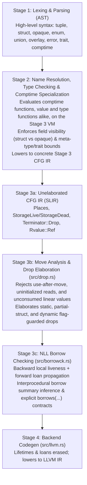

# SlopLang & Stage 3 IR (`SLIR`) Design Document

For a short introduction to the language, read [TOUR.md](TOUR.md) first; every program in it is run by the test suite (`test_tour`).

## 1. Core Philosophy `[Status: Implemented]`
The goal of SlopLang is to combine:
1. **Rust-level memory safety** (ownership, move semantics, RAII destructors, must-consume `linear` types, and Non-Lexical Lifetimes borrow checking), with two differences that matter. The guarantee is conditional on unsafe code keeping its obligations, listed in [5.6](#56-the-safety-guarantee-and-what-unsafe-code-owes-it-status-implemented). And a generic is checked against its bounds when it is defined, as in Rust, and again for each type it is used with: a type parameter promises what its bounds say and nothing more, so a body that uses more is an error even if nothing calls it. Duck typing is opt-in: a parameter declared `[T: unchecked]` may be used as anything, and is checked only where it is used, like a Zig or C++ template.
2. **Zig-level `comptime` metaprogramming** (first-class `type` values, functions that compute types, and compile-time evaluation in place of AST/procedural macros). Generics are ordinary functions whose `comptime` parameters are written in brackets (`fn Vec[T] -> type`, `Vec[i32]`), not angle-bracket generics `<T>`.
3. **Clear, orthogonal type taxonomy** (distinct keywords for distinct memory/lifecycle semantics rather than overloading a single keyword).

---

## 2. Compiler Pipeline Architecture `[Status: Implemented]`



### Implementation Status Overview
To distinguish what is already implemented and tested in the compiler today from planned surface-language extensions, every section in this document carries a status marker:
- **`[Status: Implemented]`**: The compiler parses it, enforces its rules, generates code for it on both backends (the VM and LLVM), and tests cover it. It says nothing about maturity beyond that: implemented features can still have the limits their sections list.
- **`[Status: Partial]`**: Some of it is implemented in that sense and some is not. The section says which, and the implemented parts carry their own `[Status: Implemented]` where they are separate subsections.
- **`[Status: Planned]`**: Specified here but not enforced by the compiler; used on whole sections or inline on individual rules inside an otherwise implemented section.

A section's status describes the section as a whole, so a heading over subsections of mixed status is `Partial`, and an integration with another feature (cancellation inside a fiber executor, say) is described where it is, not implied by the status of either feature.

### Why `comptime` Specialization Happens *Before* Borrow Checking (Benefits & Tradeoffs)
In Rust, borrow checking happens before monomorphization on abstract generic types `<T>`, requiring complex type-system machinery (`T: 'a`, `PhantomData<T>`, `#[may_dangle]`, variance annotations, higher-ranked trait bounds).

By evaluating `comptime` parameters and type-constructing functions **first** (via [`Vm::eval`](src/vm.rs)) and running [`elaborate_drops`](src/drop.rs) and [`check_borrows`](src/borrowck.rs) on the resulting concrete Stage 3 functions:
- **Benefits**:
  - **No `PhantomData<T>` is needed**: Concrete field types and destructors (`drop tyX = fnY`) are directly visible.
  - **No `T: 'a` or variance annotations are needed**: Concrete structs and closures containing references are tracked directly by the borrow checker.
  - **`comptime` parameters are already folded** into concrete [`TypeId`](src/ir.rs)s and [`ConstValue`](src/ir.rs)s before borrow checking begins.
- **Tradeoffs (Post-Specialization Checking)**:
  - **Instantiation-Time Borrow & Move Diagnostics**: Because [`elaborate_drops`](src/drop.rs) and [`check_borrows`](src/borrowck.rs) operate on concrete Stage 3 IR after `comptime` specialization, a generic library function (`fn foo[T](x: T)`) is only move-checked and borrow-checked for the concrete types `T` with which it is actually instantiated (similar to Zig `comptime` functions and C++ templates). Diagnostics inside a generic body name the instantiation they come from: errors found while lowering it end with `in instantiation of root::foo[T = &mut i32]` (or `in instantiation of Vec[Tx]::push` for a method of a type-function instance), and borrow and move errors name the instantiated function (`in root::foo[T = &mut i32] (fn3)`). Instantiations are lowered after the call that requests them, so the trace names the instantiation itself rather than the full chain of calls leading to it. Before any of that, every generic is checked against its bounds ([`check_generic_bodies`](src/lower/archetype.rs)), used or not: it is instantiated, in a scratch copy of the compiler, with an *archetype* for each type parameter, a type made to have exactly what the bounds promise. A plain `T` is an affine `opaque` with no methods, fields, or operators that is neither `send` nor `sync`; `copy`, `send`, `sync`, `default`, `clone`, `format`, and `linear` give it those properties, `?linear` makes it linear, and `?sized` makes it unsized, as an `extern opaque` is; a trait bound gives it that trait's methods (as stubs, since the archetype is never run); and a numeric bound (`integer`, `float`, ...) is a real number type, since those bounds are about operators. A body that uses more than that is an error that names the generic and says to state a bound, or to write `[T: unchecked]`. The members of types are checked the same way, as nothing else checks them until they are called: a generic type's methods (and each method a `where` clause gates, with archetypes that meet the clause), the generic methods of any type (with archetypes for their own parameters), and every `impl` block, generic or not. A generic method whose `where` clause is on its type's parameters is checked on an instance whose archetypes meet the clause. Its limits: a bound on a kind of type (`struct`, `enum`, `opaque`, a bare `callable`, ...) has no archetype, so such a generic is checked where used (a `callable(A, B) -> R` bound does have one: the function pointer type `fn(A, B) -> R`, so its generic is held to calling it with those arguments). Linear types do not escape the check: a parameter takes them only when its bound says `?linear` (see the constraints table), and its archetype is then linear, so a generic that may drop a `T` is refused where it is written. Unsized types are handled the same way, with `?sized`. One scratch compiler serves each module, so the check costs a little per generic rather than a copy of the compiler. Std's generics meet the same rule, checked by a test rather than on every compile.
  - **Bounds Are What a Body May Use**: a type parameter offers what its bounds say: members of a bound trait, the operators of a numeric bound, the properties of `copy`, `send`, and the rest. That is what the generic is checked against before any use, and what an IDE can offer while editing it. An `unchecked` parameter offers nothing in advance and anything at a use, as a template parameter does.

### Panic, Trap, and Unwind Semantics (`panic = abort`) `[Status: Implemented]`
The language has **no stack unwinding** (`panic = abort` in all build modes):
- **Unrecoverable Violations Trap Immediately**: Checked arithmetic overflow (`+`, `-`, `*`), division or remainder by zero, bit shifts $\ge$ bit width, out-of-bounds array/slice indexing, reaching `unreachable`, `@trap()`, or out-of-memory in infallible `@alloc`/`@realloc` immediately terminates the process via LLVM's `@llvm.trap()` intrinsic (`UD2` on x86_64 / `BRK` on AArch64).
- **`@assert(cond)` and `@assert(cond, "message")`**: trap unless `cond`, which must be a `bool`, and say so first: natively they write `assertion failed: message (line 4, column 5)` to stderr (without a message, the condition as written: `assertion failed: x == 4 (...)`) (with the module, outside the root); under the VM that is the error; in compile-time code it is a compile error. The message is a string literal. Nothing compiles them out: there is no build mode that drops checks, and an assertion costs a branch.
- **No Cleanup on a Trap**: a trap ends the process where it stands. No destructor runs, no `drop` hook, no scope end, and nothing buffered is flushed; files, pipes, sockets, and other processes are left as they were. `drop` is the cleanup of normal control flow, including early returns and `try`, but not of a failure. Cleanup that must happen whatever the program does belongs outside it: in the operating system (descriptors close, memory returns), or in a parent process.
- **Recoverable Failures Use Explicit Return Types**: Operations that can legitimately fail at runtime use [`?T` or `E!T`](#36-language-level-optionals-t-and-results-et-status-partial) (`a +? b`, `v.get(i)`, `s.try_push(val)`), never exceptions or unwinding panics.
- **Soundness Guarantee for Linear Types & Scoped Threads**: Because stack unwinding does not exist, a panic can never unwind past a parent stack frame while a child thread spawned via [`spawn_scoped`](#54-safe-threading-automatic-structural-sendsync-linear-mutext--execution-agnostic-select-status-partial) is still reading parent stack memory, nor can unwinding bypass a [`linear struct`](#must-consume-linear-types-linear-struct--shared-drop-cleanup-status-implemented) consumption obligation.

---

## 3. High-Level Type Taxonomy

### 3.0 Primitive Scalar Types, Arbitrary-Width Integers (`i1`..`i512` / `u1`..`u512`), `simd[T; N]`, `rune`, and Scalar Pattern Types (`Int in ...`) `[Status: Implemented]`
The primitive scalar and vector types are:
- **Unit, Bottom (`never`), & Boolean**:
  - `void` (0 bytes, cardinality 1: function returns normally with no data)
  - **`never`** ([`Type::Never`](src/ir.rs); 0 bytes, cardinality 0: uninhabited bottom type for expressions and functions that never return, such as `return ...`, `@trap()`, `unreachable`, or `fn abort() -> never`; implicitly coerces to any expected type `T` on diverging branches like `let x = opt orelse return -1;`)
  - `bool` (1 byte: `true` / `false`)
- **Arbitrary-Width Signed & Unsigned Integers**: **`i1`..`i512`** and **`u1`..`u512`** (any bit width from 1 to 512 bits, represented uniformly by [`Type::Int`](src/ir.rs) `Type::Int { signed, bits }` in Stage 3 and lowered directly to LLVM `iN`), plus pointer-sized `isize` and `usize`
- **Distinct C-Compatible Integer Types (`c_*`)**: **`c_char`**, **`c_schar`**, **`c_uchar`**, **`c_short`**, **`c_ushort`**, **`c_int`**, **`c_uint`**, **`c_long`**, **`c_ulong`**, **`c_longlong`**, and **`c_ulonglong`** (distinct nominal integer types for C FFI imports and C header export generation)
- **Floating-Point**: `f32`, `f64` (with **`f128`** and **`c_longdouble`** reserved `[Status: Planned / Reserved]`)
- **Unsized / Unknown-Layout Type (`opaque`) & Type-Erased Pointers**: **`*const opaque`**, **`*mut opaque`**, **`&opaque`**, and **`&mut opaque`** (replacing C's `void*` so `void` remains a pure zero-sized unit type)
- **First-Class SIMD Vectors**: **`simd[T; N]`** (hardware vector of `N` scalar lanes of integer or float type `T`, represented by [`Type::Simd`](src/ir.rs) in Stage 3 and lowered directly to LLVM `<N x T>`)
- **Unicode Scalar Value**: **`rune`** (4 bytes; represents a single validated Unicode scalar value in `0x0000..=0xD7FF` or `0xE000..=0x10FFFF`)
- **Scalar Pattern / Range Types**: **`Int in Lo..=Hi | ...`** (an integer type constrained to a compile-time union of inclusive ranges, represented by [`Type::Pattern`](src/ir.rs))
- **Compile-Time Meta-Type**: `type` ([`Type::MetaType`](src/ir.rs); 0 runtime bytes, exists only at `comptime`)

#### Arbitrary-Width Integers (`i1`..`i512`, `u1`..`u512`) & `packed` Bit-Level Layouts
1. **Unified Representation (`Type::Int { signed: bool, bits: u16 }`) `[Status: Implemented]`**:
   - Instead of hardcoding only power-of-two integer widths (`8, 16, 32, 64, 128`), any signed (`i1`..`i512`) or unsigned (`u1`..`u512`) integer width up to 512 bits is a first-class primitive type.
   - Standard standalone memory layout rounds `(bits + 7) / 8` up to the next power-of-two byte size (with alignment capped at 16 bytes), while arithmetic (`+`, `+%`, `+|`), comparisons, and casts operate at the exact `N`-bit precision (`[-2^(N-1), 2^(N-1) - 1]` or `[0, 2^N - 1]`).
   - Wide integers (`u256`, `u512`) support 256-bit/512-bit cryptography, hashes (SHA-256, SHA-512), and wide bitsets (`u256` character-class tables or 512-bit AVX-512 bitmasks).
2. **Eliminating C Bitfield Undefined Behavior (`packed struct` / `packed opaque` & `enum(uN)`) `[Status: Implemented]`**:
   - When placed inside a `packed struct` or `packed opaque` (which lowers to an `iN` backing integer with automatic shift/mask field extraction), arbitrary-width integers (`u1`, `u3`, `u4`, `u12`, `u24`, `u48`) and sub-byte enums (`enum(u3)`) pack bit-tightly with deterministic layout—completely replacing C's implementation-defined `: 3` bitfield syntax:
     ```rust
     pub packed struct Ipv4Header {
         ihl:       u4 = 5, // Bits 0..=3  (LSB of byte 0 on little-endian)
         version:   u4 = 4, // Bits 4..=7  (MSB of byte 0 on little-endian)
         ecn:       u2,     // Bits 8..=9
         dscp:      u6,     // Bits 10..=15
         total_len: u16,    // Bits 16..=31
     } // Guaranteed exact 32-bit (4-byte) backing integer `i32`
     ```
   - **Deterministic Bit & Byte Ordering**:
     - Fields of a `packed struct` or `packed opaque` are packed sequentially starting from **least-significant bit 0 (LSB 0)** of the aggregate `iN` backing integer (`bit_offset(field_k) = sum_{j < k} bits(field_j)`). Reading `hdr.version` lowers to `((hdr_bits >> 4) & 0xF) as u4`.
     - In memory, the backing `iN` integer uses the target architecture's native endianness (little-endian on x86_64/AArch64/RISC-V); byte-swapping intrinsics (`@bswap`) can be applied to the whole packed value or multi-byte fields when converting to/from big-endian network byte order.
   - **Across C: the backing integer, with accessors** `[Status: Implemented]`: an `export packed struct` is, to C, its backing integer in a struct of its own, never a C struct with a member per field, which would have C's padding and alignment, and never C bitfields, whose order is each compiler's choice. The header gives each field a shift and a mask, and `static inline` accessors that apply them, so C needs nothing from SlopLang to read or build one and its compiler folds them away:
     ```c
     /* Flags is packed into `bits`, least significant bit first:
          ready: bit 0, mode: bits 1..2, delta: bits 3..7.
        `bits` is in this machine's byte order; bits above bit 7 are unspecified. */
     struct Flags { uint8_t bits; };
     #define Flags_delta_SHIFT 3
     #define Flags_delta_MASK 0x1full
     static inline int8_t Flags_get_delta(Flags v);          /* sign-extended */
     static inline Flags Flags_with_delta(Flags v, int8_t x); /* masked */
     static inline Flags Flags_make(bool ready, Mode mode, int8_t delta);
     ```
     A struct with one integer member is passed exactly as that integer on the targets the C ABI supports, which is what SlopLang passes. Fields may be integers of any width (read as the narrowest `intN_t`/`uintN_t`), `bool`, an `export` enum (read as the C enum), or an `export` packed struct (read as that struct). A packed type over 64 bits cannot be exported, as C has no integer for it. A value C hands over is checked like any other: an enum field whose bits name no variant traps at the boundary, as a union tag would. The header is valid C++ as well.
   - **No References to Packed Fields**:
     - Because fields of a `packed struct` or `packed opaque` may sit at non-byte-aligned bit offsets or unaligned byte boundaries, taking a reference (`&p.field`, `&mut p.field`, or `&rel self.field`) to any field of a `packed` type is a **compile-time error**. Packed fields are read and written strictly by value.
3. **Computed `comptime` Integer Widths (`@Int`) `[Status: Implemented]`**:
   - `comptime` functions can compute exact-width integer types dynamically (e.g., `@Int(.unsigned, a.bits + b.bits)` for lossless widening multiplication without overflow).

#### First-Class SIMD Vector Types (`simd[T; N]`) `[Status: Implemented]`
While `u256` and `u512` represent single 256-bit or 512-bit scalar integers (with carry propagation across all 256/512 bits), **`simd[T; N]`** represents a parallel SIMD vector of `N` independent lanes of scalar element type `T` (`i8`..`i128`, `u8`..`u128`, `f32`, `f64`):
- **Stage 3 & LLVM Lowering**: `simd[ty0; 16]` ([`Type::Simd`](src/ir.rs)) lowers directly to LLVM's first-class vector type `<16 x i32>` (targeting SSE/AVX2/AVX-512/NEON vector registers).
- **Splat & Lane-Wise Construction**: `aggregate ty_simd(copy _scalar)` splats a single scalar across all `N` lanes, while `aggregate ty_simd(op0, op1, ...)` constructs each lane explicitly.
- **Parallel Lane-Wise Operations**: Arithmetic (`add`, `sub`, `mul`, `add_wrap`, `sub_wrap`, `mul_wrap`, `add_sat`, `sub_sat`, `mul_sat`, `div`, `rem`) and bitwise operations (`bitand`, `bitor`, `bitxor`, `shl`, `shr`, `neg`, `not`) operate in parallel across all `N` lanes, lowering to LLVM vector instructions and vector intrinsics (`@llvm.sadd.sat.v16i8`, `@llvm.sadd.with.overflow.v4i32`).
- **Lane Indexing & `comptime` Construction**: Individual lanes can be indexed via `_vec[_idx]`, and `comptime` type functions can construct SIMD types dynamically via `simd[copy _elem; copy _len]` ([`Rvalue::SimdType`](src/ir.rs)).

#### Why `rune` Instead of `char` `[Status: Implemented]`
- **`char` is historically ambiguous**: In C/C++ `char` is a 1-byte integer (`u8` / `i8`), in Java/C#/UTF-16 it is a 16-bit code unit (`u16`), in Rust it is a 32-bit Unicode scalar value, and in human prose a "character" usually means a user-perceived Unicode Extended Grapheme Cluster (which has variable byte length).
- **`rune` (borrowed from Go/Plan 9) is unambiguous**: A `rune` is always a 32-bit Unicode scalar value, while raw bytes are always `u8`.
- **Distinct Type Identity from `u32`**: Unlike Go (where `rune` is merely a type alias for `int32`), `rune` is a **distinct primitive type** ([`Type::Rune`](src/ir.rs) in Stage 3):
  - **Formatting & Display**: Formatting a `rune` outputs the UTF-8 character (`'🦀'`), whereas formatting a `u32` outputs the decimal number (`129408`).
  - **`comptime` Type Reflection**: Because [`Type::Rune`](src/ir.rs) (`rune`) is distinct from `Type::Int { signed: false, bits: 32 }` (`u32`) in Stage 3, `comptime` functions and overloads can distinguish text code points from 32-bit numbers.
  - **No Nonsense Arithmetic**: Arithmetic and bitwise operators on `rune`s (`'a' * 'b'`, `'a' + 1`) are compile errors (comparisons are allowed); explicit casts (`r as u32`) are always zero-cost, and `u8 as rune` is always safe and lossless because ASCII/Latin-1 (`0x00..=0xFF`) is a valid subset of Unicode scalar values.
  - **Literals**: `'a'`, `'\n'`, `'\u{1F980}'` have type `rune`; `b'a'`, `b'\n'`, `b'\x7F'` have type `u8`.

#### Distinct C-Compatible Integer Types (`c_*`) & Type-Erased `opaque` Pointers (`*const opaque` / `*mut opaque` / `&opaque` / `&mut opaque`) `[Status: Implemented]`
1. **Distinct C ABI Integer Types (`c_char`, `c_schar`, `c_uchar`, `c_short`, `c_ushort`, `c_int`, `c_uint`, `c_long`, `c_ulong`, `c_longlong`, `c_ulonglong`)**:
   - Rather than making `c_int` a transparent alias for `i32` or `c_long` a transparent alias for `i64`, each C integer type has a **distinct `TypeId`** in [`src/lower/`](src/lower/mod.rs) backed by the target ABI's [`Type::Int`](src/ir.rs) (`LP64` on 64-bit Unix: `c_char`/`c_schar` = `i8`, `c_uchar` = `u8`, `c_short` = `i16`, `c_ushort` = `u16`, `c_int` = `i32`, `c_uint` = `u32`, `c_long`/`c_longlong` = `i64`, `c_ulong`/`c_ulonglong` = `u64`):
     - **Accurate C Header (`.h`) Export Generation**: Preserving `CIntKind` in the type system allows future C header generation from exported functions/types to emit `int`, `long`, `unsigned long`, and `char` rather than collapsing them to `int32_t`, `int64_t`, or `int8_t`.
     - **Portability & C++ Overload Safety**: Mixing `c_int` with `i32`, `c_long` with `i64`, or `c_long` with `c_longlong` without an explicit `as` cast (`x as c_int`, `y as i32`) is a compile-time error, catching `LP64` (Unix 64-bit `long`) vs. `LLP64` (Windows 32-bit `long`) portability bugs immediately on any host.
     - **Full Ergonomics**: Integer literals coerce directly when a `c_*` type is expected (`let rc: c_int = 0;`), same-type arithmetic (`a + b` where `a: c_int, b: c_int`) works naturally, and all `c_*` types satisfy the `scalar`, `number`, `integer`, and `signed` / `unsigned` meta-type constraints.
   - **Reserved Extended Floating-Point Types (`f128` & `c_longdouble`) `[Status: Planned / Reserved]`**:
     - `f128` (IEEE 754 binary128 quadruple precision) and `c_longdouble` (platform-dependent C `long double`: 80-bit `x86_fp80` on x86_64 SysV, `f128` on AArch64 Linux, `f64` on Windows/macOS ARM64) are reserved keywords in [`src/frontend/mod.rs`](src/frontend/mod.rs).
2. **`void` (Zero-Sized Unit Type) vs. `opaque` (Encapsulated Product Type, Universal Type-Erased Pointee, `extern opaque` FFI Handles, Opaque Newtypes, & Existential Return Types)**:
   - **`void` is strictly a zero-sized unit type (ZST)** (`size_of(void) == 0, align_of(void) == 1`), never C's incomplete type of unknown layout.
     - **`void` the value** `[Status: Implemented]`: `void` is also its one value. Where a value is expected, it is that value, converted as any `void` is: `let o: ?void = void;`, `return void;` in a function returning `E!void`, `m.insert(k, void)` on a `HashMap[K, void]`. Where a `type` is expected it is the type, and so it is in a type function and in an unannotated `let` (`let t = void;`); elsewhere with nothing expected, it is the value (`mk(void)` for an inferred `T` makes `T = void`), as a type is of no use at run time. A variant without a payload takes one `void` argument as well as none, so a generic union's `.A(x)`, where `A(T)` has `T = void`, compiles as it does for any other `T`.
     - **Types at run time**: a function that holds `type` values is run only at compile time. The compiler refuses a program whose run-time code reaches one (what `main`, an exported function, a test, or a destructor calls, through calls, function values, and globals' initializers): `'root::second[T = type]' is called at run time, by 'root::f', but it handles 'type' values, ...`. So `slop run` and `slop build` agree; the LLVM backend, which leaves such functions out, keeps its own check behind it.
     - **Pointers & References to ZSTs (`void`, `struct {}`, `opaque {}`, `[T; 0]`)**: Like Rust and Zig, SlopLang permits pointers and references to any zero-sized type (`&void`, `&mut void`, `*const void`, `*mut void`, `*own void`, `&[void]`), enabling uniform generic containers (`Box[void]`, `Vec[void]`, `HashMap[K, void]`). Canonical ZST allocations and dangling pointers map to their power-of-two alignment **`@align_of(T) as *mut T`** (`1, 2, 4, 8, 16, ...`) in the OS's unmapped null page (`0x1..0x1000`), preserving the `0` null-pointer niche (`?*mut void`, `?&void`) with zero heap traffic and zero-byte memory reads/writes. At the C FFI boundary (`export` / `extern fn`), `*const void` and `*mut void` are rejected with a diagnostic directing the author to `*const opaque` / `*mut opaque` for C's untyped `void*`.
   - **Sized Encapsulated Product Type (`opaque Name { ... }` / `opaque(copy | affine | linear, unsafe send, unsafe sync, !send, !sync)`) `[Status: Implemented]`**:
     - `opaque Name { ... }` (or `opaque { ... }` inside a `comptime` type function) defines a sized, encapsulated nominal product type whose fields are **strictly private** to the `opaque { ... }` block (`pub` on a field inside `opaque { ... }` is a compile-time error), and which owns custom lifecycle hooks (`default`, `clone`, `drop`, `format`) and self-referential `&rel` fields. Even a zero-field `opaque Token {}` is a sized (0-byte ZST) encapsulated value type.
   - **Universal Type-Erased Pointee (`*const opaque`, `*mut opaque`, `&opaque`, `&mut opaque`) `[Status: Implemented]`**:
     - Bare `opaque` in a pointer/reference type is an **unsized, uninstantiable pointee type** representing memory of unknown layout, alignment, and size:
     - **Forbidden by value, dereference, or pointer offset**: Using bare `opaque` by value (`let x: opaque`, parameter `x: opaque`, struct field `f: opaque`, array `[opaque; N]`), dereferencing `*p` on an `opaque` pointer/reference, or performing element-scaled pointer arithmetic `p + i` on `*const opaque` / `*mut opaque` is a **compile-time error**.
     - **Raw type-erased pointers (`*const opaque` and `*mut opaque`)**: Any `*const T`, `*mut T`, `&T`, or `&mut T` implicitly coerces (or casts via `as`) to `*const opaque`, and any `*mut T` or `&mut T` implicitly coerces (or casts via `as`) to `*mut opaque` (matching C's `void*` / `const void*` at FFI boundaries such as `free(ptr: *mut opaque)` or `pthread_create`). Converting back (`p as *mut T` or `p as *const T`) requires an explicit `as` cast.
     - **Safe NLL borrow-checked type-erased references (`&opaque` and `&mut opaque`)**: Any `&T` or `&mut T` coerces to `&opaque`, and any `&mut T` coerces to `&mut opaque` (with automatic reborrowing of `&mut opaque` -> `&mut opaque` / `&opaque`), while **retaining the underlying NLL borrow loan** in [`src/borrowck.rs`](src/borrowck.rs).
   - **Unsized Foreign C Handles (`pub extern opaque Sqlite3;` / `pub extern opaque Sqlite3 { ... }`) `[Status: Implemented]`**:
     - Declaring `pub extern opaque Name;` or `pub extern opaque Name { ... }` (with methods only, no fields) creates a **distinct nominal unsized foreign opaque type** modeling C forward-declared incomplete structs (`typedef struct sqlite3 sqlite3;`, `typedef struct _IO_FILE FILE;`).
     - Like bare `opaque`, an `extern opaque` type is unsized and cannot declare fields, be instantiated by value, dereferenced, or offset with pointer arithmetic.
     - **Distinct Handle Type Safety**: Unlike universal `*mut opaque`, pointers to distinct `extern opaque` types (`*mut Sqlite3` vs. `*mut CFile`) do **not** implicitly coerce to each other (preventing passing a `FILE*` to `sqlite3_close`), nor do arbitrary concrete pointers (`*mut i32`) implicitly coerce to `*mut Sqlite3`. Both `*mut Sqlite3` and `*mut CFile` still implicitly coerce to the universal `*mut opaque` / `*const opaque` (`void*`).
     - **Inherent & Extension Methods**: An `extern opaque` type can define inherent methods inside `{ ... }` (or module-level extension methods) taking `self: *mut Self`, `self: *const Self`, `self: &Self`, or `self: &mut Self`, as well as associated constructor functions (`Sqlite3::open(...)`).
   - **Distinct Types (`pub type UserId = distinct u64;` / `pub type UserId = distinct u64 { ... }`) `[Status: Implemented]`**:
     - Declaring `type Name = distinct Underlying;` (optionally with inherent methods in `{ ... }`) creates a **sized, zero-cost nominal type** with the exact ABI, size, alignment, and ownership semantics of the underlying type. It separates values that share a representation (`UserId` vs `OrderId` vs a raw `u64`); it does not hide the representation, which `opaque Name { ... }` does.
     - **The same rules in every module**: a distinct type never converts implicitly to or from its underlying type (not even in its defining module) and never mixes with another distinct type; `as` converts both ways anywhere (`raw as UserId`, `id as u64`). Literals initialize it (`let id: UserId = 7;`) and the underlying type's operators apply between values of the same distinct type (`id + 1` is a `UserId`).
     - It wraps any sized type except a tuple or an anonymous struct, directly or through an `alias`: their fields would be reachable only through `as`, so write `struct Name { ... }`, which is just as nominal and keeps the fields usable. The former spellings `opaque Name = T` and `type Name = opaque T` are errors that name the new one.
   - **Existential Return Types (`-> opaque MyTrait` / `-> opaque A + B`) `[Status: Implemented]`**:
     - Writing `-> opaque MyTrait` (or `-> opaque A + B` / `-> opaque callable`) in a function return type returns a concrete value **by value on the stack** with zero vtable or heap overhead, while hiding the concrete return type behind the trait/constraint bound.
     - The compiler infers the single concrete return type from the function body's `return` statements and verifies at compile time that it satisfies the declared bound(s). Callers can invoke trait methods, pass the value to generic `[T: MyTrait]` parameters, or borrow it as `&MyTrait`, but cannot bind it to the hidden concrete type name, access private/concrete fields, or call non-trait inherent methods.
   - **C FFI Exports (`export` Types, `export fn`, Automatic Null Checks, `?T` / `E!T` Lowering, & C Header Generation) `[Status: Implemented]`**:
     - **Valid `export` Types**:
       - **By value across C FFI**: Standard fixed-width primitives (`i8`..`i64`, `u8`..`u64`, `isize`, `usize`, `f32`, `f64`, `bool` mapped to C99/C23 `<stdbool.h>` `bool`, `void`), distinct C integer types (`c_char`..`c_ulonglong` mapped to native C `char`, `int`, `unsigned long`, etc.), `export enum`, unit-only `export error` (integer error codes lowered to a C `typedef enum`; see [`export error`: Unit Error Codes vs. Payload-Carrying Errors](#c-values-of-export-error-status-implemented)), `export type Name = distinct T` distinct types over export-valid types, `export struct` (transparent C `struct` whose fields may also include fixed-size arrays `[T; N]` of export-valid types), `export union` (C's tagged representation, see below), `export overlay` (untagged C `union` of export-valid fields, emitted as `typedef union Name Name;`; reading a field is `unsafe` as for any overlay), and raw pointers (`*const T`, `*mut T`, `?*const T`, `?*mut T`).
       - **Payload-carrying `export error` (`export fn ... -> E!T`)**: An `export error` with payload variants (`export error MyError { Bad: i32 }`) is valid as the error side `E` of an `export fn` returning `E!T`, where C receives the status code enum (`MyError_Tag`) as the return value and the untagged payload union (`union MyError* err_out`) via an out-pointer. Because C's `union MyError` is untagged, passing or embedding a payload-carrying `export error` by value outside `E!T` return position is rejected at compile time.
       - **`export opaque` (Opaque Handle Only)**: All exported multi-field `opaque` types (`export opaque Name { ... }`, whether `copy`, affine `drop`, or `linear`) are enforced as **opaque handle types** across FFI (`typedef struct Name Name;` in the generated `.h` header). Passing, returning, or embedding an `opaque` struct by value in an `export fn` or `export struct` is a compile-time error; C callers interact with `export opaque` types strictly through raw pointers (`*mut Name`, `*const Name`, `?*mut Name`, `?*const Name`).
       - **Forbidden across `export` FFI**: Safe references (`&T`, `&mut T`, `&[T]`, `&mut [T]`, `&str`, `&Trait`, `&rel`), bare `[T; N]` arrays by value in `export fn` signatures (must be wrapped in an `export struct` or passed via pointer), `export error` that embeds other error sets or carries non-`copy` payloads, and `export trait` are rejected at compile time.
     - **C Calling Convention for Aggregates** `[Status: Implemented (x86-64 System V, AArch64)]` ([`src/c_abi.rs`](src/c_abi.rs)): `export fn` definitions (the C-ABI wrapper) and calls to `extern fn` pass structs, overlays, and arrays by value the way C does, rather than as LLVM first-class aggregates. Aggregates up to 16 bytes travel in the registers C uses, reinterpreted per eightbyte (`{ i32, f64 }` as `i64, double`; `{ f32, f32 }` as `<2 x float>`); larger ones, and any that no longer fit in the remaining registers, go through memory (`byval` arguments, `sret` returns). Integers narrower than 32 bits and `bool` carry `signext` / `zeroext`. On AArch64 (AAPCS64) a homogeneous floating-point aggregate (1-4 `f32`s or `f64`s) travels in consecutive FP registers (`[3 x float]`), any other aggregate up to 16 bytes in one or two integer registers (`i64`, `[2 x i64]`), and a larger one as a pointer to a caller-made copy (arguments) or through `sret` (returns); narrow integers are extended only on Apple's variant. `LlvmLowering::lower_for_target` emits for a target other than the host; the AArch64 signatures are tested against clang's. Other targets reject by-value aggregates at the C boundary (pass a pointer). Function pointers that cross the C boundary are typed `extern fn(...) -> R`: a distinct type from the SlopLang `fn(...) -> R` (neither converts to the other), produced by `@c_abi(f)` and by naming an `extern fn`, accepted in `export fn` signatures and `export struct` fields (declared in the header as `R (*name)(...)`), and called with the C convention, so callbacks from C and pointers returned by C pass aggregates correctly.
     - **`export union`: C's Tagged Representation** `[Status: Implemented]`: An exported union is laid out, and declared in the header, as `struct Name { Name_Tag tag; union { ... } payload; }`, the same representation as Rust's `#[repr(C)]` enums. SlopLang's own union layout already places the tag first and the payload at its natural alignment, so nothing changes in memory; inside SlopLang, `match`, `if let`, and `T::Tag` work as for any union.
       - **Tag**: a generated `typedef enum Name_Tag { Name_Variant = 0, ... }` numbered in declaration order (or using explicit `= N` values and optional `export union(Int)` backing integer type).
       - **Payload members** are named after their variants: unit variants have none (an all-unit union has no `payload` member), a type payload is a member of that type, and an inline `Variant: struct { ... }` or tuple payload is an inline `struct` (tuple fields are `_0`, `_1`, ...). Payloads must be FFI-safe, and the union must be `copy`, since C copies it freely.
       - **Validation**: values C hands to SlopLang by value are checked before SlopLang code sees them: the C-ABI wrapper of an `export fn` checks its parameters, and a call to an `extern fn` (or through an `extern fn(...)` pointer) checks its result. A union or unit-only `export error` tag must name a variant, and the active variant's payload is checked in turn; a `bool` stored in memory must be 0 or 1, an enum one of its values, a `rune` a Unicode scalar value, and a non-optional raw pointer non-`NULL`; struct fields and array elements are checked recursively. A violation traps. Overlays are not checked (any bits are valid), and values reached through pointers are trusted: C code must store valid data behind them.
     - <a id="c-values-of-export-error-status-implemented"></a>**`export error`: Unit Error Codes vs. Payload-Carrying Errors** `[Status: Implemented]` ([`Compiler::instantiate_error`](src/lower/types.rs)):
       - Any `error` / `export error` (that does not embed another error set) may specify an optional backing integer type (`error(u8)` / `error(c_int)`, like `enum(u8)`), a custom C success sentinel (`ok Success = 200`; `ok Name` alone means `= 0`), and explicit per-variant tag values (`Variant = 404` or `Variant: i32 = 404`): e.g. `export error DbError { NotFound = 404, Busy = -1, Aborted = 7 }`, `export error(c_int) ExplicitCInt { ok Ok = 1, Zero = 0, Neg = -5 }`, or `export error MyError { Bad: i32 = 1 }`.
       - By default, **`Ok = 0` is automatically reserved for the C success sentinel**, and automatic variant enumeration starts at **`1`** (`1, 2, 3, ...`) in declaration order. If a custom `ok <ident> = <value>` success sentinel is declared, `0` is freed for use as an ordinary error variant (`Zero = 0`). The success sentinel is emitted first in the C enum (`<Name>_<OkIdent> = <OkVal>,`) and is used only at the C FFI boundary; inside SlopLang it is not a failure variant, so `match` over an `error` remains exhaustive over failure variants only, and `E::Tag` / `e.tag` expose the failure variants' tag enum.
       - Once one variant has an explicit `= N` value, every variant must; values must be distinct, must not collide with the reserved success sentinel's name or value, and must fit the backing type (or for a default C `enum`, all within `int` or all non-negative within `unsigned int`, so HRESULT-style `0x80004005` works).
       - **Unit-only `export error`**: When all variants have `void` payloads, the C value **is** the stored tag ([`Program::union_tag_values`](src/ir.rs)), and the C header emits `typedef enum Name { Name_Ok = 0, Name_Var = 1, ... } Name;`. A unit-only `export error` has the C enum's layout everywhere: `E!T` return values, by-value parameters, `*mut E` / `*const E` pointees, and `export struct` fields. The C-ABI wrapper of an `export fn` traps on a by-value `export error` parameter whose value names no failure variant (including the C `ok` success sentinel).
       - **Payload-carrying `export error`**: When at least one variant carries a payload (`export error MyError { Bad: i32 }`), the C header splits the tag and payload into:
         - `typedef enum MyError_Tag { MyError_Ok = 0, MyError_Bad = 1, ... } MyError_Tag;` (status code returned by `export fn`), and
         - `typedef union MyError MyError; union MyError { int32_t Bad; ... };` (untagged payload union written through `MyError* err_out` on failure; unit variants are omitted from `union MyError`).
     - **Automatic Panicking Null Checks on Non-Optional `*mut T` / `*const T` Parameters**:
       - In `export fn`, bare `*mut T` and `*const T` parameters are contractually non-null (`T*` / `const T*`), and the C-ABI wrapper (see the two-symbol model below) checks them on entry (`(ptr as usize) == 0` -> `@llvm.trap()`) before calling the SlopLang body.
       - Explicitly nullable raw pointer parameters (`?*mut T` and `?*const T`) accept C `NULL` without trapping and unwrap inside the function via `orelse` or `if let`.
     - **`?T` and `E!T` Return Lowering in `export fn`**:
       - `export fn foo(...) -> ?*mut U` / `-> ?*const U`: Returns a nullable C pointer `U*` / `const U*` directly (`NULL` on `null`).
       - `export fn foo(...) -> ?T` (for non-pointer value `T`): Lowers to `bool foo[...](/* out */ T* out_val)` — writes `*out_val` (if `out_val != NULL`) and returns `true` on `Some(v)`, or returns `false` on `null`.
       - `export fn foo(...) -> E!T` (where `E` is a unit-only `export error`):
         - For `T != void`: Lowers to `E foo[...](/* out */ T* out_val)` — writes `*out_val` (if `out_val != NULL`) and returns `E`'s success sentinel (`<E>_Ok = 0` by default) on `Ok(v)`, or returns the failure variant's `E` enumerator on `Err(e)`.
         - For `T == void`: Lowers to `E foo(...)` — returns `E`'s success sentinel on `Ok`, or the failure variant's `E` enumerator on `Err(e)`.
       - `export fn foo(...) -> E!T` (where `E` is a payload-carrying `export error`):
         - For `T != void`: Lowers to `E_Tag foo[...](/* out */ T* out_val, /* out */ E* err_out)` — on `Ok(v)`, writes `*out_val` (if `out_val != NULL`) and returns `E`'s success sentinel; on `Err(e)`, writes the active variant's payload to `*err_out` (if `err_out != NULL` and the active variant has a payload) and returns the failure variant's `E_Tag` status code.
         - For `T == void`: Lowers to `E_Tag foo[...](/* out */ E* err_out)` — returns `E`'s success sentinel on `Ok`, or writes `*err_out` (if non-`NULL` and non-unit) and returns the failure variant's `E_Tag` status code on `Err(e)`.
     - **Two-Symbol Model: SlopLang Callers Use Only the SlopLang Signature** `[Status: Implemented]`:
       - Every `export fn foo` is compiled to **two functions**: an internal SlopLang-ABI body (returning `?T` / `E!T` natively, with no entry null checks or out-pointer writes) and a C-ABI wrapper exported under the symbol `foo` that performs the null checks and the `?T` / `E!T` out-pointer lowering before delegating to the internal body.
       - Inside SlopLang, an `export fn` is callable **only** through its SlopLang signature (`try`, `catch`, `orelse`); calling it with the lowered C out-pointer arguments is a compile-time error. Every SlopLang call site binds directly to the internal body.
       - Using `foo` as a function value in SlopLang yields its SlopLang function-pointer type (`fn(...) -> E!T`). Handing the C-ABI wrapper to C code as a callback (`qsort`, `pthread_create`) requires the explicit intrinsic **`@c_abi(foo)`**, which yields a C function pointer with the wrapper's lowered C signature (`@c_abi(maybe)` for `export fn maybe(ok: bool) -> ?i32` has type `extern fn(bool, *mut i32) -> bool`). `@c_abi` of a non-`export` function is a compile-time error.
     - **Automatic `.h` C Header Generation** ([`Compiler::generate_c_header`](src/lower/export.rs), [`Compiler::compile_source_with_c_header`](src/lower/mod.rs)): Emits a complete C99/C11/C23/C++ compatible `.h` header with `#include <stdint.h>`, `#include <stddef.h>`, `#include <stdbool.h>`, forward-declared opaque handle structs, enum/error definitions, `struct` definitions, and C function prototypes.

#### Scalar Pattern / Range Types (`Int in Lo..=Hi | ...`) `[Status: Implemented]`
Rather than embedding an unpredictable SMT solver for arbitrary predicate refinement types (`x % 2 == 0`), the type system directly supports **Scalar Pattern Types**—constraining any integer type `Int` to a union of inclusive compile-time ranges:

```rust
// 1. `rune` has the exact same range constraint as:
//    u32 in 0x0000..=0xD7FF | 0xE000..=0x10FFFF

// 2. Non-zero integers via a 3-line comptime function (replaces NonZeroU8..NonZeroU64)
fn NonZero[Int: integer] -> type {
    return Int in 1..=Int::MAX;
}

// 3. Domain-specific bounded scalars & proven-in-bounds array indices
alias Ascii   = u8  in 0x00..=0x7F;
alias Percent = u8  in 0..=100;
alias PosixFd = i32 in 0..=2147483647; // Valid POSIX file descriptors are >= 0

fn Index[len: NonZero[usize]] -> type {
    return usize in 0..=(len - 1);
}
```

1. **Deterministic Niche Optimization Rule (`?T`)** ([`Program::union_niche`](src/ir.rs)):
   - Any bit pattern outside a scalar or pointer type's valid value set is a **niche**. When `T` has one, `?T` is laid out exactly like `T` (no tag): the chosen `null` bit pattern means `null` and every other value means a present payload. The compiler selects the `null` bit pattern using a deterministic priority order so FFI layouts are completely predictable:
     1. **`0` (All-Zeroes)** if `0` is outside `T`'s valid set:
        - `?&T`, `?&mut T`, `?*const T`, `?*mut T`, and `?fn(...)` use `0` (`null` pointer) and are 8 bytes.
        - `?NonZero[u32]` is 4 bytes and uses `0` for `null`.
     2. **All-Ones (`0xFF..FF`, i.e., `-1` for signed or `MAX` for unsigned)** if `0` is valid in `T` but all-ones is outside `T`'s valid set:
        - **`?PosixFd` (`i32 in 0..=i32::MAX`) is 4 bytes and uses `-1` (`0xFFFFFFFF`) for `null`**, matching POSIX C FFI return conventions (`open()`, `socket()`, `read()`) with zero wrapper conversion.
        - **`?rune` is 4 bytes and uses `0xFFFFFFFF` (`u32::MAX`) for `null`**.
        - **`?Ascii` (`u8 in 0x00..=0x7F`) and `?Percent` (`u8 in 0..=100`) are 1 byte and use `0xFF` for `null`**.
     3. **Lowest Excluded Value (`Hi_0 + 1`)** immediately above the first contiguous valid interval if both `0` and all-ones are valid:
        - **`?Digit` (`u8 in 0..=9 | 200..=255`) is 1 byte and uses `10` for `null`**.
     4. **Inside a struct**: a struct has the niche of the first `*own` pointer it holds by value, in declaration order and at any depth, so `?Box[T]` is 8 bytes and the `next` of `struct Node { v: i32, next: ?Box[Node] }` adds no tag. `null` is `0` in that field and the rest of the value means nothing. An owning pointer is never null: allocation traps on failure, a box of a zero-sized type holds its alignment, and types that can be empty, like `Vec`, say so with `?*own T`. Raw pointers do not count, because `0 as *const T` is an ordinary field value in unsafe code, and neither does `uninit` storage. `*own` cannot cross the C ABI, so no C layout depends on this.
     - Types with no niche (`?i32`, `?bool`, `?Vec[T]`, other optionals of aggregates) keep a separate tag. Niche selection applies to `?T` only; general `union` types always carry a tag, and `??Box[T]` has a tag for its outer optional.
2. **Conversion, Widening, Narrowing & Arithmetic Rules**:
   - **Bounds Span the Base Type**: Each bound is a constant of the base type and must fit it (`u8 in 0..=256` is a compile error); a range may cover the base type's whole range (`u8 in 0..=255`, `i8 in -128..=127`).
   - **Compile-Time Verified Literals**: Assigning a constant or literal to a pattern type is verified at `comptime` (`let p: Percent = 50;` succeeds; `let p: Percent = 150;` is a compile error). A runtime value of the base type never narrows implicitly (`let p: Percent = x;` is a compile error); it needs one of the explicit conversions below.
   - **Lossless Subset-to-Superset Widening**: A pattern type `A` can be cast (`x as B`) or widened without a runtime check into its base integer type or any pattern type `B` whose valid intervals are a superset of `A`'s intervals (e.g., `Ascii as u8`, `Ascii as rune`, `NonZero[u32] as u32`).
   - **Arithmetic Operates on the Base Integer Type**: To avoid Ada-style intermediate overflow traps or interval-type explosion across loops, arithmetic (`a + b`), unary operators, and comparisons operate on the base integer type (`u8`, `u32`, etc.): `p + 1` is a `u8`, and the literal `1` need not lie in `p`'s ranges. Storing the result back into a pattern type takes an explicit `as P` or `as ?P`.
   - **Checked vs. Unchecked Runtime Narrowing**: Converting an unconstrained runtime integer `x` into a pattern type `P` requires either:
     - **Checked narrowing (`x as ?P`)** `[Status: Implemented]`: Performs the range check and returns `?P` (`null` if out of range), composing naturally with `orelse` (`let p = (raw as ?Percent) orelse return -1;`).
     - **Direct checked cast (`x as P`)** `[Status: Implemented]`: Verifies at `comptime` for constants, or traps at runtime if `x` is outside `P`'s valid intervals.
3. **Bounds-Check Elimination & LLVM `!range` Metadata `[Status: Implemented]`**:
   - Indexing an array `[T; N]` with a value of type `usize in Lo..=Hi` where `Hi < N` elides the runtime bounds check completely at compile time.
   - When lowering to Stage 4 LLVM IR ([`src/llvm.rs`](src/llvm.rs)), loads of pattern-typed values attach LLVM `!range` metadata, enabling LLVM to eliminate redundant comparisons and dead branches downstream. Intervals are normalized to LLVM's signed, sorted, non-adjacent form, and a pattern covering its whole base type gets no metadata.

#### Mutable Bindings `[Status: Implemented]`
A binding's own memory is read-only unless it is declared `mut` (`let mut x`, `let mut { a, b } = t;`, a `mut x` parameter). Assigning to it or any field or element of it, borrowing it `&mut` / `&raw mut`, calling a `&mut self` method on it, iterating it with `for ref mut`, and assigning it from a closure all require `mut`; the error names the binding (`Cannot assign to 'p': it is not declared 'mut'`). Writes through a reference or pointer are governed by that pointer instead (`p: &mut T` permits `p.x = 1` without `mut p`). Loop variables and `match` / `if let` / `while let` bindings are immutable.

#### Operators Need Types That Have Them `[Status: Implemented]`
Arithmetic (`+ - * / %` and their wrapping, saturating and checked forms) applies to numbers, SIMD vectors, and pointers; bitwise operators to integers, `bool`, and SIMD vectors; shifts to integers and SIMD vectors; ordering (`< <= > >=`) to numbers, `rune`, pointers, and enums; and equality (`== !=`) to those, to `bool`, function pointers, types, `&str`, and unions whose variants carry nothing. A `struct`, an `opaque`, or a type parameter has none of them: compare their fields, or give them methods through a trait.

#### Implicit Conversions `[Status: Implemented]`
Implicit conversions are a closed list ([`FuncLowerer::classify_coercion`](src/lower/stmt.rs)); any other mismatch is a compile error (`cannot implicitly convert 'i64' to 'i32'`). Numeric types never convert implicitly: widening, narrowing, `bool` to integer, and integer to float all use `as`. The list:
- **References and pointers**: reborrowing a named `&mut T` / `&mut [T]` / `&mut Trait` as `&mut` or `&`; `&mut T` -> `&T`; `&T` / `&mut T` -> `*const T` / `*mut T`; `*mut T` -> `*const T`; any pointer -> `&opaque` / `*const opaque` (keeping mutability rules); `&T` / `&mut T` -> `&Trait` / `&mut Trait` and `&mut Trait` -> `&Trait`.
- **Slices**: a string literal -> `&str`, `&[T; N]` / `&mut [T; N]` -> `&[T]` / `&mut [T]`, and `&mut [T]` -> `&[T]`.
- **Optionals and results**: `T` -> `?T` (a raw pointer `*T` -> `?*T` maps null to `null`), a pointer coercing to `*T` -> `?*T`, `T` -> `E!T`, `E` -> `E!T`, `E'!T` -> `E!T`, and `E'` -> `E` when `E'`'s variants are a subset of `E`'s.
- **Pattern types**: a verified constant -> a pattern type, and a pattern type -> its base type. (A distinct type and its underlying type convert only with `as`.)
- **`never`** (a diverging expression) fits any type.

**Literal bindings infer their type** ([`src/lower/infer.rs`](src/lower/infer.rs)): an unannotated `let` / `let mut` initialized by an integer or float literal takes its type from its first typed use (a parameter, the other operand of an operator, an index, a return value, or an assignment to a typed place), so `let mut i = 0; while i < n { a[i] ... }` makes `i` a `usize` and `let x = 5; f(x)` works for `f(x: i32)`. Literals already given to the binding are checked against the type it settles on (`let x = 300; f_u8(x)` is an error), and a binding used at two different types is an error. With no typed use it is `i64` (`f64` for floats). A use whose type cannot wait (taking the address, a closure capture, a method receiver, a tuple element) settles it on `i64` / `f64` for the moment; if a later typed use then needs another type (`let mut c = 0; let g = fn() { c += 1; }; take_i32(c)`), the function is lowered again with the binding given that type from the start.

Binary operators take both operands at one type: the right operand converts to the left operand's type through the list above (so `s == "text"` compares a `&str` with a literal), and anything else is an error. Shifts are no exception: `a << b` needs `b` of `a`'s type (`a << (b as u64)`).

#### Integer Overflow, Division, Shift & Cast Semantics `[Status: Implemented]`
Following Zig's philosophy, standard integer arithmetic (`+`, `-`, `*`) **never silently wraps**. Instead, distinct operator families express exact overflow semantics:

| Operator Family | High-Level Syntax | Stage 3 (`SLIR`) [`BinOp`](src/ir.rs) | Overflow / Edge-Case Behavior (`comptime` & Runtime) | Stage 4 LLVM Lowering ([`src/llvm.rs`](src/llvm.rs)) |
| :--- | :--- | :--- | :--- | :--- |
| **Default (Checked)** | `a + b`, `a - b`, `a * b` | `add`, `sub`, `mul` | **Compile error** at `comptime`; **traps** (`@llvm.trap()`) at runtime | `@llvm.[s\|u][add\|sub\|mul].with.overflow` + branch to `@llvm.trap()` |
| **Wrapping (Modular)** | `a +% b`, `a -% b`, `a *% b` | `add_wrap`, `sub_wrap`, `mul_wrap` | Wraps modulo $2^N$ at both `comptime` and runtime | Plain two's-complement `add`, `sub`, `mul` |
| **Saturating (Clamping)** | `a +\| b`, `a -\| b`, `a *\| b` | `add_sat`, `sub_sat`, `mul_sat` | Clamps to `[T::MIN, T::MAX]` | `@llvm.[s\|u][add\|sub].sat` / overflow-clamped `select` |
| **Fallible (`-> ?T`)** `[Status: Implemented]` | `a +? b`, `a -? b`, `a *? b` | `add_checked`, `sub_checked`, `mul_checked` | Returns **`?T`** (`null` on overflow); chains with `orelse` / `try` | `@llvm.[s\|u][add\|sub\|mul].with.overflow` -> `?T` |
| **Unchecked (`nsw`/`nuw`)** | `unsafe @add_unchecked(a, b)` (or proven by Pattern Type) | `add_unchecked`, `sub_unchecked`, `mul_unchecked` | **Compile error** at `comptime`; assumed no-wrap at runtime | `add nsw` / `add nuw`, `sub nsw` / `sub nuw`, `mul nsw` / `mul nuw` |

- **Division (`/`), Remainder (`%`), Negation (`-x`), Shifts (`<<`, `>>`), and Casts (`as`)**:
  - **Division & Remainder (`a / b`, `a % b`)**: Truncates toward zero. Dividing by zero (`b == 0`) or signed overflow (`T::MIN / -1` and `T::MIN % -1`) is a **compile error** at `comptime` and **traps** (`@llvm.trap()`) at runtime before executing LLVM `sdiv`/`udiv`/`srem`/`urem` (never undefined behavior).
  - **Unary Negation (`-x`)**: Checked `0 - x` on signed integers (trapping on `T::MIN`); wrapping negation is written `0 -% x`.
  - **Bit Shifts (`a << b`, `a >> b`)**: `<<` (`shl`) is logical left shift; `>>` (`shr`) is arithmetic right shift on `signed` integers and logical right shift on `unsigned` integers. A shift count `b >= bit_width(a)` (or `b < 0`) is a **compile error** at `comptime` and **traps** (`@llvm.trap()`) at runtime.
  - **Explicit Casts (`x as Dest`)**:
    - **Integer-to-Integer**: Widening (`u8 as u32`, `i8 as i32`) zero-extends unsigned integers (`zext`) and sign-extends signed integers (`sext`). Narrowing (`u32 as u8`, `i32 as i8`) performs **modular bitwise truncation** (`trunc i32 to i8`); range-checked narrowing uses pattern types (`x as ?(u8 in 0..=255)`).
    - **Float-to-Integer (`f as i32`, `f as u32`)**: Uses **saturating conversion** (`@llvm.fptosi.sat` / `@llvm.fptoui.sat`): values above `Dest::MAX` clamp to `Dest::MAX`, values below `Dest::MIN` clamp to `Dest::MIN`, and `NaN` maps to `0` (eliminating LLVM `fptosi` poison/UB on out-of-range floats).
    - **Integer-to-Float & Float-to-Float**: Round-to-nearest-even (`sitofp`, `uitofp`, `fpext`, `fptrunc`).
    - **To an Enum (`n as E`, `F::X as E`)**: An enum holds only its variants' values. A constant that is none of them is a compile error (`7 is not a value of enum 'E', whose values are -1, 0, 5`), and a run-time value is checked by its numeric value, trapping unless it is one, as a cast to a pattern type does. An enum converts to an integer (`e as i32`) unchecked. A `union` converts neither way, payload-less or not; its tag does (`u.tag as i32`).

---

### 3.1 First-Class Slices (`&[T]`, `&mut [T]`) & UTF-8 String Views (`&str`) `[Status: Implemented]`
1. **Stage 3 Fat-Pointer Representation (`{ ptr, len }`)**:
   - A slice `&[T]` or `&mut [T]` lowers in Stage 2 to a 2-field Stage 3 [`Type::Struct`](src/ir.rs) `{ ptr: &[T; 0], len: usize }` (or `{ ptr: &mut [T; 0], len: usize }`, 16 bytes on 64-bit).
   - Indexing `s[i]` verifies `i < s.len` (trapping via `@llvm.trap()` on out-of-bounds) and projects `(*s.0)[i]` (`[Projection::Field(0), Projection::Deref, Projection::Index[i]]`), which lowers directly to `getelementptr inbounds [0 x T], ptr %data, i64 0, i64 %i` in LLVM IR while enforcing reference mutability (`&[T]` vs `&mut [T]`) and NLL loan tracking in [`src/borrowck.rs`](src/borrowck.rs).
   - Indices and slice bounds have type `usize` (or a `usize` pattern type); other integers convert explicitly (`a[i as usize]`).
   - Fixed-length arrays and SIMD vectors are checked the same way against their static length. The check is omitted when the index is statically in range (a constant, or a `usize in Lo..=Hi` pattern type with `Hi < N`); a constant index past a static length is a compile-time error. The one unchecked case is the C flexible-array idiom: indexing a zero-length `[T; 0]` reached through a raw pointer or inside `unsafe`.
2. **UTF-8 String Slices (`&str`)**:
   - **`&str`** is a first-class, immutable UTF-8 string slice represented at Stage 3 as `{ ptr: &[u8; 0], len: usize }` (16 bytes on 64-bit) with distinct surface type identity (`TypeExpr::StrRef`):
     - String literals (`"hello"`) have type `&str` and point to static read-only UTF-8 bytes in a Stage 3 [`Global`](src/ir.rs).
     - `&str` exposes `.len -> usize` (byte length) and byte indexing `s[i] -> u8`, is always `Copy`, `send`, and `sync`, and formats as UTF-8 text in `f"..."` strings (whereas `&[u8]` formats as a numeric byte array `"[104, 101, ...]"`).
     - There is no mutable `&mut str` type because arbitrary single-byte writes could violate the UTF-8 invariant.
3. **Coercions & Range Slicing (`lo..hi`)**:
   - References to fixed-length arrays (`&[T; N]` / `&mut [T; N]`) implicitly coerce to slices (`&[T]` / `&mut [T]`), and mutable slices `&mut [T]` implicitly coerce to shared slices `&[T]`.
   - Range slicing (`&arr[lo..hi]`, `&mut arr[lo..hi]`, `s[lo..hi]`, and open-ended `s[lo..]`, `s[..hi]`, `s[..]`) checks `lo <= hi && hi <= base.len`, computes the offset pointer `&base[lo]` and length `hi - lo`, and propagates the underlying NLL borrow loan in Stage 3.
4. **Uniform `sequence` Operations (`.len` and `s[i]`)**:
   - Both `[T; N]` (`array`) and `&[T]` / `&mut [T]` (`slice`) satisfy `[S: sequence]` and expose `.len -> usize` and element indexing `s[i]`.

---

### 3.2 First-Class Lambdas & Automatic-Capture Closures (`fn(...) { ... }` / `move fn(...) { ... }`) `[Status: Implemented]`
1. **Non-Capturing Lambdas Decay to `fn` Pointers (`fn`)**:
   - An anonymous function `fn(x: i32) -> i32 { return x * 2; }` that references no enclosing local variables has zero environment state and lowers directly to a Stage 3 function pointer ([`Type::FnPtr`](src/ir.rs)), satisfying both `fn` and `callable`.
2. **Automatic Capture & Call-Mode Inference (`closure` — No `Fn`/`FnMut`/`FnOnce` Trait Boilerplate)**:
   - When `fn(x: i32) -> i32 { ... }` references outer local variables, Stage 2 ([`src/lower/`](src/lower/mod.rs)) automatically synthesizes a stack-allocated anonymous closure environment (`TypeConstraint::Closure` under `callable`):
     - Outer variables that are only read inside the closure body are captured by shared reference (`&T`).
     - Outer variables that are mutated (`total += x`) inside the closure body are captured by mutable reference (`&mut T`).
     - When prefixed with `move` (`move fn(x: i32) -> i32 { ... }`), outer variables are captured by value (copied if `Copy`, or moved into the closure environment and automatically dropped by Stage 3 [`elaborate_drops`](src/drop.rs) when the closure goes out of scope).
   - **Automatic Call Convention (`&env` vs `&mut env` vs `move env`)**:
     - Instead of requiring callers to write separate `F: Fn(...)`, `F: FnMut(...)`, or `F: FnOnce(...)` trait bounds, a generic function simply accepts `[F: callable]` (or `[F: closure]`).
     - **Signature Bounds** `[Status: Implemented]`: `[F: callable(&T, &T) -> bool]` admits the functions and closures that take those parameters and return that type, and nothing else (`Type 'fn(i64) -> i32' cannot be called as 'fn(i32) -> i32'`). Its parameter types may name earlier type parameters. The generic check models `F` as the function pointer `fn(&T, &T) -> bool`, so a body that calls it otherwise is refused where it is written rather than where it is used. (`fn(...)` is not the spelling, since a `fn` type as a bound already means a comptime function value.) A call through a function pointer or closure must give as many arguments as it takes.
     - The compiler automatically selects the closure call convention from its captures:
       - **Shared call (`&env`)**: Used when the closure only reads its captures.
       - **Mutable call (`&mut env`)**: Used when the closure mutates a captured variable or reborrows a captured `&mut T`.
       - **Consuming single-use call (`move env`)**: Used when a `move fn` closure captures a [`linear`](#must-consume-linear-types-linear-struct--shared-drop-cleanup-status-implemented) value (or moves a non-`Copy` capture out of its environment on call). Calling such a closure consumes it in Stage 3b [`elaborate_drops`](src/drop.rs), statically preventing a second call.
3. **Zero-Config NLL Borrow Checking Across Closure Captures**:
   - Because Stage 2 lowers closure environments into concrete Stage 3 structs holding `&T` or `&mut T` fields **before** Stage 3 runs, [`check_borrows`](src/borrowck.rs) automatically tracks every captured loan:
     - Reading or mutating a variable while it is mutably captured by an active closure is rejected.
     - Immediately after the last call to the closure, NLL ends the closure's loan so the outer variable is freely accessible again.

---

### 3.3 Meta-Type Constraint Hierarchy & Overload Resolution `[Status: Implemented]`
Rather than requiring verbose trait bounds (`T: PrimInt + Signed` or `F: FnMut(i32) -> i32`) or leaving `[T: type]` completely unconstrained across 1,024 integer widths and structural types, the language provides a built-in hierarchy of **refined meta-types** for constraining `comptime` type parameters.

Meta-type constraints are organized into two orthogonal axes:
1. **The Disjoint Structural Kind Tree** (every concrete type belongs to at most one branch below `type`):

```
                                                     type
        ┌───────────────────┬─────────────────────────┼─────────────────────────┬──────────────────┬─────────┬─────────┐
     scalar              callable                  sequence                 aggregate        discriminated opaque    simd
   ┌────┼────┬────┐      ╱      ╲                  ╱      ╲                 ╱       ╲        ┌─────┼─────┐
number bool rune *T    fn     closure           array    slice           struct   tuple     enum union error
 ╱   ╲
integer float
 ╱   ╲
signed unsigned
(i1..i512, (u1..u512,
  isize)     usize)
```

2. **Cross-Cutting Property & Lifecycle Constraints** (orthogonal predicates that cut across structural kinds):
   - **Concurrency Properties**: **`send`** (safe to transfer across threads) and **`sync`** (safe to share via `&T` across threads).
   - **Substructural Ownership Modes**: **`copy`** (unrestricted $0..\infty$ uses), **`affine`** (move-only $0..1$ uses, dropped at scope exit), and **`linear`** (must-consume $1..1$ uses; applies to `opaque(linear)` and any `tuple`, `struct`, `?T`/`union`, `[T; N]`, or `move fn` closure containing a linear value).
   - **Lifecycle Properties**: **`default`**, **`clone`**, and **`format`**.

| Meta-Type Constraint | Axis | Matching Types | Direct Super-Constraint in Subsumption Poset |
| :--- | :--- | :--- | :--- |
| **`type`** | Root | Any type | — (top of poset) |
| **`scalar`** | Structural Kind | Any `number`, `bool`, `rune`, or raw pointer (`*const T`, `*mut T`) — single-register, trivially copyable primitives; strictly disjoint from `callable`, `sequence`, `aggregate`, `discriminated`, `opaque`, and `simd` | `type` |
| **`callable`** | Structural Kind | Any `fn` pointer (`fn(...) -> R`) or capturing `closure`; `callable(A, B) -> R` only those taking `A, B` and returning `R` (`-> void` when left out) | `type` |
| **`sequence`** | Structural Kind | Any fixed-length `array` (`[T; N]`) or dynamically-sized `slice` (`&[T]`, `&mut [T]`) — contiguous homogeneous memory sequences supporting `.len` and `s[i]` | `type` |
| **`aggregate`** | Structural Kind | Any `struct` or `tuple` (transparent open data; excludes encapsulated `opaque`) | `type` |
| **`discriminated`** | Structural Kind | Any `enum`, `union`, or `error` (types with an active discriminant tag) | `type` |
| **`opaque`** | Structural Kind | Encapsulated nominal types (`opaque`, `opaque(copy)`, `opaque(affine)`, `opaque(linear)`) | `type` |
| **`simd`** | Structural Kind | Hardware SIMD vector types (`simd[T; N]`) | `type` |
| **`number`** | Structural Kind | Any `integer` or `float` | `scalar` |
| **`fn`** | Structural Kind | Non-capturing function pointer types (`fn(T1, ...) -> R` and non-capturing lambdas) | `callable` |
| **`closure`** | Structural Kind | Capturing closure types (`fn(...) -> R { ... }` / `move fn(...) -> R { ... }`) | `callable` |
| **`array`** | Structural Kind | Fixed-length array types (`[T; N]`) | `sequence` |
| **`slice`** | Structural Kind | Fat-pointer slice types (`&[T]`, `&mut [T]`) | `sequence` |
| **`struct`** | Structural Kind | Named or anonymous transparent product types (`struct { ... }`) | `aggregate` |
| **`tuple`** | Structural Kind | Positional product types (`tuple { ... }`) | `aggregate` |
| **`enum`** | Structural Kind | Scalar tag-only enumerations (`enum { ... }`) | `discriminated` |
| **`union`** | Structural Kind | Payload-carrying tagged unions (`union { ... }`, optionals `?T`, and results `E!T`) | `discriminated` |
| **`error`** | Structural Kind | Composable error sum types (`error { ... }`, `export error`, and ad-hoc `E1 \|\| E2` error unions) | `discriminated` |
| **`integer`** | Structural Kind | Any `signed` or `unsigned` (`i1`..`i512`, `u1`..`u512`, `isize`, `usize`, integer `pattern`s) | `number` |
| **`float`** | Structural Kind | `f32`, `f64` | `number` |
| **`signed`** | Structural Kind | `i1`..`i512`, `isize` (and signed `pattern`s) | `integer` |
| **`unsigned`** | Structural Kind | `u1`..`u512`, `usize` (and unsigned `pattern`s) | `integer` |
| **`send`** | Cross-Cutting | Any type safe to transfer across threads (primitives, `&T` where `T: sync`, `&mut T` where `T: send`, `opaque(unsafe send)`, and containers/closures whose fields/captures are `send`) | `type` |
| **`sync`** | Cross-Cutting | Any type safe to share by immutable reference (`&T`) across threads (`&T: send` $\iff$ `T: sync`) | `type` |
| **`copy`** | Cross-Cutting | Unrestricted copyable types (primitives, `&T`/`&[T]`/`&str`, `opaque(copy)`, and transparent containers whose elements are all `copy`) | `type` |
| **`affine`** | Cross-Cutting | Move-only non-linear types (`opaque` / `opaque(affine)`, `&mut T`, and containers holding an `affine` value without `linear` fields) | `type` |
| **`linear`** | Cross-Cutting | Must-consume linear types (`opaque(linear)` and any `tuple`, `struct`, `?T`/`union`, `[T; N]`, or `move fn` closure containing a linear value) | `type` |
| **`?linear`** | Admission `[Status: Implemented]` | Any type, linear or not. A type parameter admits linear types only when its bound says `?linear` (`[T: ?linear]`, `[T: Named + ?linear]`; `linear` and `unchecked` admit them too): `[T]` and `[T: Named]` refuse one where the generic is used (`Type 'Tx' is linear, and a type parameter takes linear types only when its bound says '?linear'`), since they may drop it. Under `?linear` the generic check models `T` as linear, so the body must consume each `T` it owns, or gate the code that drops one with `where T: !linear`. It widens a bound rather than narrowing it: `[T]` is more specific than `[T: ?linear]` in overload resolution. A function's type parameter that its signature holds no value of takes linear types unasked, as if it said `?linear` (and is checked so): `[T](x: &T)`, `[T: sync]()`. That is when `T` appears only behind `&`, `&mut`, `*const`, `*mut`, or `*ref`, is given to no generic type (`&Tree[T]` does not count, as `Tree` may not take linear types), and is bounded by nothing or by `send`, `sync`, or `format`; a named bound may be the type of a comptime value rather than a trait, so `[T: Named](x: &T)` still says `?linear`. Type functions are not functions in this sense. `where T: linear` still means that `T` is linear. Std's owning types and the functions they use take `?linear` (`Vec`, `Box`, `Mutex`, `Channel`, `HashMap`'s values, `Slots`, `JoinHandle`, `Task`, `spawn`, `replace`, `swap`). | `type` |
| **`?sized`** | Admission `[Status: Implemented]` | Any type, sized or not. A type parameter admits an unsized type (bare `opaque`, an `extern opaque` handle) only when its bound says `?sized` (`[T: ?sized]`, `[T: ?sized + ?linear]`; `unchecked` admits them too); otherwise it is refused where the generic is used (`Type 'Db' is unsized, and a type parameter takes unsized types only when its bound says '?sized'`), since the generic may hold a `T` by value or take its size. Under `?sized` the generic check models `T` as unsized, so a body that passes, returns, or stores a `T` by value, or asks `@size_of(T)`, is refused where it is written; behind a pointer (`*const T`, `&T`) it is usable. It widens a bound as `?linear` does: `[T]` beats `[T: ?sized]`. No std generic takes `?sized` yet; each one holds or sizes its `T`. | `type` |
| **`unchecked`** | Cross-Cutting | Any type, which the generic may use as anything (duck typing): the body is checked only where it is used, with the type it is given. Without it, a type parameter promises its bounds and nothing more. A [structural trait](#structural-traits-status-implemented) is the checked middle ground: any type with the right methods, and the body may use only those. |
| **`recursive`** | Cross-Cutting | Types a value of which can own another of the same type, by value or through `*own` pointers (`Box`, `Vec`, `HashMap`), but not through references or raw pointers. `Box` uses it to choose how it drops. |
| **`default` / `clone` / `format`** | Cross-Cutting | Any type supporting `@default(T)` / `@clone(v)` / `@format(f, v)` | `type` |
| **`zeroinit`** | Cross-Cutting | A type that all zero bytes are a value of: numbers, `bool`, `rune`, an enum with a variant of value 0, a pattern type whose range holds 0, an optional (zero is `null`) or a union whose first variant is tagged 0 with such a payload, and structs, tuples, and arrays of such; an `opaque` only when it says so, with `opaque(unsafe zeroinit)` (its invariants are its own, and every field must be `zeroinit`). References, raw and owning pointers, and functions are not. See [`zeroinit`](#zero-initialized-values-zeroinit-status-implemented). | `type` |
| **Concrete Type** | Leaf | Specific type (`i32`, `f64`, `Point`, `Pair[i32]`) | All constraints satisfied by that type |

#### Subsumption Partial Order for Overload Resolution
Because cross-cutting constraints (`send`, `sync`, `linear`, `format`) can overlap with structural kind constraints (`number`, `sequence`, `opaque`), overload resolution uses **constraint subsumption ($C_1 \subset C_2$)** rather than a flat numeric rank:
- A constraint $C_1$ is **strictly more specific** than $C_2$ ($C_1 \prec C_2$) if and only if every type satisfying $C_1$ strictly satisfies $C_2$ (i.e., $C_1$ is a descendant of $C_2$ in the structural kind tree, such as `signed` $\prec$ `integer` $\prec$ `number` $\prec$ `scalar` $\prec$ `type`, or a concrete type `i32` $\prec$ `signed`).
- If two candidate overloads match a call with incomparable constraints—for example, `fn foo[T: send](x: T)` and `fn foo[T: number](x: T)` called with `42: i32` (since neither `send` $\subset$ `number` nor `number` $\subset$ `send` holds)—the compiler rejects the call as an **ambiguous overload error** rather than guessing by depth.
- **Negative bounds and `where` clauses** `[Status: Implemented]`: `[T: !sync]` admits any type that does not satisfy the constraint; it is shorthand for `[T]` with `where T: !sync`. A function's `where` clauses (negated or not) are checked during overload selection like its parameter bounds, so `fn kind[T: sync](x: &T)` and `fn kind[T: !sync](x: &T)` are disjoint overloads, and a call no overload's clauses admit is rejected with the clause it fails.

```rust
// Constrained generic extension on any numeric type (`integer` or `float`):
pub fn clamp[N: number](self: N, lo: N, hi: N) -> N {
    if self < lo { return lo; }
    if self > hi { return hi; }
    return self;
}

// Disjoint overloads by meta-type constraint (`signed` vs `float`):
pub fn abs[S: signed](self: S) -> S {
    if self < 0 { return -self; }
    return self;
}
pub fn abs[F: float](self: F) -> F {
    if self < 0.0 { return -self; }
    return self;
}

// Structural & composite constraints (`aggregate` = `struct` | `tuple`, excluding `opaque`):
pub fn is_open_data[A: aggregate](x: &A) -> bool { return true; }
pub fn is_open_data[S: opaque](x: &S) -> bool { return false; }
```

---

### 3.4 Product Types: `tuple` vs `struct` vs `opaque` `[Status: Implemented]`
All three product types (`tuple`, `struct`, and `opaque`) are inline value types (no implicit heap allocation or OOP inheritance) and all three lower to [`Type::Struct`](src/ir.rs) (`{ ty0, ty1, ... }`) in Stage 3, but they form a clear progression of high-level contracts:

| Feature | `tuple` (Anonymous Positional Data) | `struct` (Named Transparent C-Aligned Data) | `opaque` (Encapsulated Invariant / Resource) |
| :--- | :--- | :--- | :--- |
| **Type & Literal Syntax** | `tuple { i32, f64 }` / `{ 10, 3.14 }` | `struct Name { x: i32, y: f64 }` / `struct { x: i32, y: f64 }` | `opaque Name { ... }` / `opaque { ... }` (`opaque(copy \| affine \| linear, unsafe sync)`) |
| **Intent** | Multi-value returns, ad-hoc pairs/triples, positional variant payloads | Plain transparent bundle of named fields (`Point`, `Config`, C FFI `export struct`) | Encapsulated state with private invariants or lifecycle (`Ipv4Addr`, `Vec`, `File`, `MutexGuard`) |
| **Type Identity** | **Structural** (any two `tuple { i32, f64 }` are the exact same type) | **Named means nominal, anonymous means structural.** A named struct is a distinct type per declaration: `struct Name { ... }` and a `struct { ... }` literal returned by a `comptime` type function (named after the function and memoized by `(module, fn_name, comptime_args)`). An anonymous `struct { ... }` is structural by ordered `(field_name, TypeId)` pairs however it is written (`@Struct` / `@PackedStruct` with the same fields, and `@entries` records, give the same type, named `struct { x: i32, ... }` in diagnostics); anonymous `overlay { ... }` types are structural too | **Nominal** (distinct type per declaration; memoized by `(module, fn_name, comptime_args)` for `comptime` type functions) |
| **Field Access & Visibility** | Public positional (`t.0`, `t.1`); empty `tuple {}` is forbidden (use `void`) | All fields are **public** (`r.x`, `r.y`); a named struct may give fields default values (`x: T = expr`), an anonymous one may not | All fields are **strictly private** (visible strictly inside the `opaque { ... }` block; `pub` on fields is rejected) |
| **`comptime` Fields (`const C: T = val;`)** | **Forbidden** | **Forbidden** (every `struct` field is strictly an instance data field) | **Allowed** `[Status: Implemented]` (associated constants and `type`s, private unless `pub`, 0 runtime bytes; `const` is the same field; see [associated items](#associated-items-status-implemented)) |
| **`static` Fields (`static S: T = val`)** | **Forbidden** | **Forbidden** (no hidden global state on transparent data) | **Allowed** `[Status: Implemented]` (encapsulated type-scoped global state; lowers to Stage 3 [`Global`](src/ir.rs)) |
| **Inherent Methods** | **Forbidden** | Named structs only (stateless convenience helpers); an anonymous struct is pure data, so methods or field defaults on it are a compile error that asks for a name | Allowed (invariant-preserving API) |
| **Custom Lifecycle (`default`, `clone`, `drop`, `format`)** | **Forbidden** (always auto-synthesized structurally from elements) | **Forbidden** (always auto-synthesized structurally from fields) | **Allowed** (`impl default { fn default() -> Self { ... } }`, `impl clone { fn clone(self: &Self) -> Self { ... } }`, `impl drop { fn drop(self: &mut Self) { ... } }`, `impl format { fn format(self: &Self, f: &mut Formatter) { ... } }`) |
| **Substructural Ownership (`copy` vs `affine` vs `linear`)** | **`copy`** $\iff$ all elements are `copy` (otherwise `affine`, or `linear` if any element is `linear`) | **`copy`** $\iff$ all fields are `copy` (otherwise `affine`, or `linear` if any field is `linear`) | **Adaptive on bare `opaque`, strict on `opaque(...)`**:<br/>• `opaque`: `affine` ($0..1$ uses) by default, upgrading to `linear` if any field/`*own T`/`owns T` is `linear` (or `copy` on a plain `packed opaque`)<br/>• `opaque(copy)`: strictly unrestricted ($0..\infty$ uses)<br/>• `opaque(affine)`: strictly move-only ($0..1$ uses; rejects `linear` fields)<br/>• `opaque(linear)`: strictly must-consume ($1..1$ uses) |
| **Partial Moves (`move t.0` / `move r.x`)** | **Always allowed** (remaining elements stay valid and are dropped individually) | **Always allowed** (remaining fields stay valid and are dropped individually) | **Only inside the `opaque`'s own methods** (fields are private), and **forbidden when the type has a `drop` hook**, because the hook would later run on the partially moved value |
| **Arrays (`[T; N]`)** | An array is one unit to the move checker. A droppable element cannot be moved out by index, since which one an index names is not known when checking, so it is swapped out (`core::mem::replace`, `core::mem::swap`) or the array is taken apart whole. Assigning to an element drops the one there, so writing into an array that was moved out is an error. An array of droppable elements is dropped by a loop over them, in order. `uninit` slots are the unsafe exception, as they are not dropped. | | |
| **Stage 3 Drop Behavior** | Decomposed into leaf elements in [`src/drop.rs`](src/drop.rs) | Decomposed into leaf fields in [`src/drop.rs`](src/drop.rs) | Treated as an atomic drop unit if registered in [`Program::destructors`](src/ir.rs) or `opaque(linear)` |

- **Record literals take the expected type** `[Status: Implemented]`: `{ x: 1, y: 2 }` is a literal of the struct (or `opaque`, inside its block, or overlay) type the context expects: a return type, a `let` annotation, an argument, a field, a constant, `?T`, the ok side of `E!T`, or a variant payload (`.Move({ dx: 1, dy: 2 })`). With no expected type it is the structural anonymous struct of its fields, so `let p = { x: 1, y: 2 };` needs no type written, and `struct { x: i32 } { x: 1 }` is never necessary. `Name { ... }` remains for naming the type explicitly. Either form rejects a field the type lacks or one given twice. At compile time a record literal is a record value (`@Struct(&[{ name: "v", ty: i32 }])`).
- **One declaration form per kind; `alias` names** `[Status: Implemented]`: each kind of type is declared with its own keyword, in one spelling: `struct Name { ... }`, `packed struct Name { ... }`, `opaque Name { ... }`, `extern opaque Name;`, `enum Name { ... }`, `union Name { ... }`, `error Name { ... }`, `overlay Name { ... }`, `trait Name { ... }`, and `type Name = distinct T;` for a distinct type (the only use of `type`). Writing `type Name = struct { ... }` (or any other kind after `type =`), `trait Name = trait { ... }`, or `pub export` is an error naming the right form. Every other type (tuples, primitives, pattern types such as `u8 in 0..=100`, pointers, arrays, slices, other named types, error unions `E1 || E2`, type-function calls, and `@Tuple` / `@Struct` results) is structural or already has an identity, so naming it takes `alias Name = ...;`, which declares no new type: `alias Pair = tuple { i32, i32 };` is `tuple { i32, i32 }`. `alias Name = struct { ... }` names the structural anonymous struct; `alias` with an `enum`, `union`, `error`, or `opaque` literal is an error, since those always declare a new type. An alias cannot be `export`ed (export the declaration it names). A trait alias names an existing trait expression (`trait AB = A + B;`, `trait FromI32 = From[i32];`).
- **Why `tuple { T1, T2 }` and `{ v1, v2 }` instead of `(T1, T2)`**:
  - Avoids overloading parentheses `(...)` for both expression grouping and tuples (eliminating the `(x,)` 1-tuple trailing-comma wart—`tuple { i32 }` and `{ 42 }` are completely unambiguous).
  - Matches `struct { ... }`, `opaque { ... }`, and Stage 3 (`SLIR`) `{ ty0, ty1 }` syntax directly.
  - Supports clean destructuring (`let { q, r } = div_rem(17, 5);`) and multi-element `union` / `error` variant payloads (`V4: tuple { u8, u8, u8, u8 }`).
  - **Deferred initialization** `[Status: Implemented]`: `let mut r: T;` declares a variable with no value yet (the `mut` and the type are required). It starts in the state of a value whose every field was moved out: assigning it, or each field of it, initializes it, and move checking and drop elaboration track each field. Reading, borrowing, or capturing anything not definitely initialized is a compile-time error, a scope exit drops exactly what was initialized, and a linear field assigned and not consumed is an error. This builds an aggregate from a `comptime for`, unlike `uninit`, without `unsafe`. A type with a `drop` hook is a single unit to these checks, so it cannot be assembled field by field.
  - **Destructuring `let`** `[Status: Implemented]`: `let { q, r } = e;` binds a tuple's elements and `let Point { x, y: py, .. } = e;` a struct's fields (renaming with `field: name`, skipping with `_`). Every element or field must be named unless the pattern ends in `..`; fields left to `..` are dropped with the value at scope exit (so an unconsumed linear field is still a compile error). Fields are copied or moved out, as for partial moves; an `opaque`'s private fields cannot be destructured.
  - **`_` discards** `[Status: Implemented]`: `let _ = expr;` (or `let _: T = expr;`) and `_ = expr;` drop the value at once, where `let _name = expr;` keeps it to the end of its scope like any variable, so a guard is bound with a name. Given a variable's place (`let _ = x;`, `x.f`, `*p`) they do nothing: the place is not read, moved, or dropped. A `_` in a destructuring pattern drops that part at once. A linear value cannot be discarded: `'_' would discard a linear value of type 'Tx', which must be consumed`.
  - **Unused results** `[Status: Implemented]`: a statement may not leave a value unused (`plain();`, `v.pop();`, `*r;`): `This discards a value of type 'i32'; use it, or discard it with '_ = ...'`. It is an error rather than a warning, as every other rule here is, and the fix is always at hand. `void` and `!` results are fine, and so is the result of a call to a function declared `-> T discardable`, whose result is a convenience (`println`, `print`, `HashMap::insert`'s old value, a builder's `&mut Self`). An error union is never discardable, so an error is not lost by accident: `fallible();` is refused even if `fallible` says `discardable`, and is handled with `try` or `catch`, or discarded with `_ = fallible();`. A linear result cannot be discarded at all, and the move checker says so. `Channel::send` is not discardable: the value it gives back is one that was not sent. A call through a trait object or a function pointer is not known to be discardable.

#### Recursive Types `[Status: Implemented]`

A `struct`, `union`, `overlay` or `opaque` can refer to itself, or to another that refers to it, as long as something with a fixed size stands in between: a raw pointer, `Box`, `Vec`, `HashMap`, a reference. `struct Tree { value: i32, kids: Vec[Tree] }`, `union Json { Number(f64), Items(Vec[Json]), Fields(HashMap[String, Json]) }` and a type function's `struct { next: ?Box[Node[T]] }` all work.

- **Finite size is required**: a type that holds itself by value, directly or through a field, optional, array, union, or generic wrapper, is an error naming the type. So are `alias A = *const A;` and a `distinct` defined in terms of itself, which have no declaration to stand behind the name.
- **How it is built**: a declaration gets its `TypeId` before its fields are resolved, so a field finds the type being built instead of building it again. The types of a cycle stay unfinished until all of them are defined. A type function called with an unfinished argument (`Vec[Tree]` inside `Tree`) is put off until then, which is possible when its body is one `return struct { ... }`, because such a call has a type of its own whatever it finds. Its `where` clauses, hooks and method selection therefore see a complete argument.
- **Answers inside a cycle**: while put-off instances are themselves being built, one of them is `!copy` and counts as `clone`. A cycle cannot be the reason a type does not clone, and `Tree` clones if everything else in it does.
- **Questions with no answer yet**: `@size_of` of a type whose size depends on an unfinished type, and a `packed` field of one, are errors. A type function whose body inspects an unfinished argument in other ways sees it undefined.
- **Function bodies wait**: lowering any body could name an unfinished type, so bodies stay queued while a type is being built. Compile-time evaluation lowers the ones it reaches through calls, function values and drops.
- **Formatting**: a structural `format` is expanded inline, so a `struct` that reaches itself through references cannot be formatted, and an `opaque` with a `format` hook is how to give it a form.
- **Dropping never overflows through `Box`**: a value's destructor runs those of its fields, which for a list would recurse once a node. So a `Box` of a type that can own another of itself (the `recursive` constraint) counts how deeply such drops nest, per fiber, and past 128 it queues the box for the outermost drop to run in a loop. A list of any length, a chain through a union, or a cycle of types drops in constant stack on a fiber or a thread. Up to that depth the order is the usual one; past it a node's destructor runs after those of the nodes above have finished, which only a `next` declared before other droppable fields can observe. Queuing allocates, one entry for each 128 levels, and a failed allocation traps. A `Box` of anything else compiles as it always did, with no count. Nesting through `Vec` or `HashMap` alone still recurses, as does `clone`, `format`, and any function a program writes.
- **Nesting limit**: a type being built may nest 256 others, which ends `G[T]` naming `G[*const T]`.

---

### 3.5 Sum, Error & Overlay Types: `enum`, `union`, `error`, and `overlay` `[Status: Implemented]`
Rather than overloading `enum` or `union`, four distinct one-word keywords represent four distinct memory and safety models:

| Keyword | Concept | Stage 3 Representation | Safety, Status & Semantics |
| :--- | :--- | :--- | :--- |
| **`enum` / `enum(Int)`** | Scalar integer enumeration (`enum(u8) { Red = 0, ... }`) | Integer type (`u8`, `u16`, `i32`, etc.) | `[Status: Implemented]` Safe scalar integer constants; optional explicit `= N` wire values and backing integer type via `enum(u8)`. |
| **`union` / `union(Int)`** | Safe tagged union / sum type (Rust `enum` with payloads) | [`Type::Union`](src/ir.rs) | `[Status: Implemented]` Safe; always has a discriminant tag in all build modes, optional backing integer type `union(u16)` and explicit `= N` variant values, tracks active variant `v0`, `v1`, ... via [`Rvalue::Discriminant`](src/ir.rs), borrow-checks variant references, supports exhaustive `match`, and auto-drops the active variant payload. A union whose variants all lack payloads compares with `==` and `!=`, by variant; one with payloads does not. |
| **`error` / `error(Int)`** | First-class composable error sum type (`error { ... }`, `export error`, and `E1 \|\| E2`) | [`Type::Union`](src/ir.rs) (integer tag + optional payload) | `[Status: Implemented]` Only `error` types (and `E1 \|\| E2` compositions) may appear on the left of `E!T`; supports unit and payload variants, optional `error(Int)` backing type, `ok Ident = Val` C success sentinel, and explicit `= N` tag values, `export error` (unit enum or `MyError_Tag` + `union MyError` in C), hierarchical embedding of child `error`s, automatic `try`/`catch` widening, leaf & subtype `match`, and auto-synthesized `format`. |
| **`overlay`** | Unsafe C-style untagged memory overlay | [`Type::Overlay`](src/ir.rs) | `[Status: Implemented]` Unsafe field reads (`.field`, `.0`, `.1`); **never** injects a hidden debug tag (layout is identical in Debug and Release), and never auto-drops. |

#### `.Variant`: Variants of the Expected Type `[Status: Implemented]`
Where the type is known from context, a variant is written `.Name` (or `.Name(payload)`), without the type name:
- **Patterns**: `match c { .Red => ..., .Circle(r) => ..., .Denied(n) => ... }` names a variant of the scrutinee's type (for an `error`, the one leaf of that name; an ambiguous one asks for `ErrorType::Name`). A bare name in a pattern **always binds** the value, so writing a variant without the dot (`Red =>`, `Circle(r) =>`) is a compile error that asks for `.Red` rather than a catch-all that silently swallows every case; a misspelled `.Redd` is a "no variant" error. Qualified patterns (`Color::Red`, `IoError::Timeout(t)`) and embedded error types (`IoError(e)`) keep their meaning.
- **Values**: `let c: Color = .Blue;`, `f(.Red)`, `let s: Shape = .Circle(5);`, `return .Denied(7);` construct a variant of the expected type, looking through `?T` and through both sides of `E!T`. Without an expected type (`let x = .Red;`) it is an error asking for `Color::Red`.

#### Explicit `enum(Int)` / `union(Int)` / `error(Int)` Backing Types, Derived `T::Tag` & Safe `match` Reading
1. **Specifying `enum` Backing Width (`enum(u8)`) `[Status: Implemented]`**:
   - By default, the compiler picks the smallest integer (`u8`, `u16`, `u32`, `u64`, or the signed equivalent when a value is negative) that fits all variants of an `enum`. An `export enum` without an explicit backing type keeps at least 32 bits, matching the size of a C `enum` in the generated header.
   - Writing `enum(u16)` or `enum(i32)` explicitly fixes the backing integer representation for wire protocols, FFI, or hardware registers:
     ```rust
     pub enum(u16) Opcode {
         Ping       = 0x0001,
         Auth       = 0x0010,
         Disconnect = 0xFFFF,
     }
     ```
2. **Automatic `T::Tag` Synthesis & `.tag` Access on `union` and `error` `[Status: Implemented]`**:
   - Every `union` or `error` type `T` automatically exposes an associated scalar `enum` **`T::Tag`** with the same variant names and discriminant values (`Shape::Tag::Circle`, `MyError::Tag::Bad`), and every instance `v: T` exposes **`v.tag -> T::Tag`**, computed from Stage 3 [`Rvalue::Discriminant`](src/ir.rs). `.tag` reads the value in place (it never moves it); it applies to variables, fields, and dereferences, so bind the result of a call to a local first.
3. **Explicit Backing Types & Variant Values on `union` (`union(u16)`) `[Status: Implemented]`**:
   - Writing `union(u16)` and/or `= N` on variants fixes the union's backing tag integer type and discriminant values directly on the union (without requiring a separate linked `enum` whose variant order might drift), and `Message::Tag` derives those exact values (`0x0001`, `0x0010`, `0xFFFF`), recorded in [`Program::union_tag_values`](src/ir.rs); the Stage 3 discriminant remains the variant index, so `match` and the borrow checker are unaffected:
     ```rust,ignore
     pub union(u16) Message {
         Ping: u64 = 0x0001,
         Auth: AuthCredentials = 0x0010,
         Disconnect = 0xFFFF,
     }
     ```
4. **Safe Pattern Matching (`match`, `if let`, and `while let`) `[Status: Implemented]`**:
   - `match`, `if let`, and `while let` support general, composable patterns across sum types, primitives, strings, and aggregates:
     - **Sum types (`enum`, `union`, `error`, `?T`, `E!T`)**:
       - Named and shorthand `.Variant` patterns (`Message::Ping(seq)`, `.Ping(seq)`, `.Ok(v)`, `.Err(e)`), plus `null` and non-null subpatterns on `?T`.
     - **Primitives, ranges, and `&str`**:
       - `bool` (`true`, `false`), `rune` (`'a'`, `'0'..='9'`), integers and `u8` byte literals (`0`, `-5`, `b'A'`, `1..10`, `10..=20`), floats (`0.0`, `-1.5`, including signed negative zero `-0.0`), and `&str` string literals (`""`, `"GET"`, `"POST"`).
       - Integer range exhaustiveness is checked precisely against both full primitive integer bounds (`u8` `0..=255`, `i8` `-128..=127`, etc.) and `Type::Pattern` range-restricted integer subtypes (`i32 in 0..=10`).
     - **Structs, `packed struct`, and `opaque` (within its defining module)**:
       - Brace field patterns `Point { x: 0, y }`, anonymous `{ x: 0, y }`, field shorthand `{ x, y }`, and partial matching `{ x, .. }`.
       - Encapsulation is enforced: matching on private fields or `opaque` fields from outside the defining module is rejected at compile time.
     - **Tuples, fixed-size arrays `[T; N]`, and slices `&[T]` / `&mut [T]`**:
       - Tuple patterns `(a, b)` or `{ a, b }` (with optional `..` rest pattern `{ head, .. }`).
       - Array and slice patterns `[a, b, c]` and prefix/suffix rest patterns `[head, .., tail]`, `[]`, `[first, ..]`. Fixed-size arrays verify pattern length at compile time; slice patterns check length at runtime and support exhaustive coverage when `[]`, `[_, ..]` (or fixed lengths `0..K` plus `[_, ..]` of length `K`) are covered.
     - **Or-patterns (`p1 | p2`) and deep nesting**:
       - Or-patterns may appear at top level or nested inside variant/struct/tuple/array/slice patterns (`"PUT" | "PATCH"`, `.Move({ x: 0, y } | { x: y, y: 0 })`). All alternatives must bind the same set of variable names with identical types and binding modes (`plain`, `move`, `ref`, `ref mut`).
     - **Ownership-safe binding timing**:
       - Pattern tests (`SwitchInt`, range comparisons, string equality, slice length checks, nested subpattern checks) execute **before** any pattern bindings in an arm are materialized. A failed pattern arm never moves or drops `affine` or `linear` fields from the scrutinee.
     - **A variant named through a type** (`Shape::Circle(r)`, `Maybe[i32]::Some(v)`) must name a variant of the matched value's own type; naming another type's variant of the same name is an error.
     - **Single-pattern conditional unwrapping (`if let` / `while let`)**:
       - For `?T`: `if let val = opt { ... }` and `while let val = iter.next() { ... }`. `if let ref val = opt` and `if let ref mut val = opt` unwrap by reference and leave `opt` in place, and `while let ref next = cur.next { cur = next.get(); }` walks a list.
       - For any general refutable pattern: `if let Message::Ping(seq) = msg { ... } else { ... }`, `if let { x: 0, y } = pt { ... }`, or `while let [head, ..] = slice { ... }` desugars to a `match` with that pattern arm and a wildcard else arm.
     - **Exhaustive `match` statement/expression (`[Status: Implemented]`)**:
       ```rust,ignore
       match msg {
           Message::Ping(seq)       => handle_ping(seq),
           Message::Auth(move cred) => authenticate(move cred),
           Message::Disconnect      => close(),
       }
       ```
       Simple flat sum-type matches compile directly to a single Stage 3 [`Rvalue::Discriminant`](src/ir.rs) + [`Terminator::SwitchInt`](src/ir.rs) dispatch table, while nested, structural, range, slice, and `&str` patterns lower to a decision sequence of basic blocks that test all conditions before binding variables in the matched arm. Plain bindings (`Message::Ping(seq)`) copy or move the payload, and move bindings (`Message::Auth(move cred)`) move `_msg.v1` and mark `_msg` consumed in [`src/drop.rs`](src/drop.rs). Borrow bindings (`Message::Auth(ref cred)`, `ref mut cred`) bind a reference into the matched place instead; a `match` with any `ref` binding matches on a borrow of the scrutinee (`&msg` / `&mut msg`), so the matched value is not moved and stays usable afterwards.

---

### 3.6 The Value Lifecycle Quartet: `default`, `clone`, `drop`, `format` `[Status: Implemented]`
Creation (`default`), duplication (`clone`), destruction (`drop`), and formatting (`format`) are **language-level lifecycle constructs** (always written in **lowercase**), rather than user-implemented traits:

| Lifecycle Hook | On Transparent Data (`tuple`, `struct`, `[T; N]`, `&[T]`, `?T`, `enum`, `union`) | On an `opaque` (Encapsulated Resource / Invariant) |
| :--- | :--- | :--- |
| **`default`** | **Auto-synthesized** if all elements/fields have `default` (or field default values). **Forbidden** to implement manually. | **No default by default.** Allowed to implement `impl default { fn default() -> Self { ... } }`. |
| **`clone`** | **Auto-synthesized** if all elements/fields have `clone`. **Forbidden** to implement manually. | **Not clonable by default.** Allowed to implement `impl clone { fn clone(self: &Self) -> Self { ... } }`. |
| **`drop`** | **Auto-synthesized** if any element/field has `drop`. **Forbidden** to implement manually. | **No custom drop by default.** Allowed to implement `impl drop { fn drop(self: &mut Self) { ... } }`. The hook runs first, then the fields are dropped in the order they are declared, as in Rust, so a hook never drops a field itself (that would drop it twice); what it holds through an `*own` pointer or in `uninit` storage is its own to drop. Linear fields are left out, since they are moved out before the value is retired. |
| **`format`** | **Auto-synthesized** structurally if all elements/fields satisfy `format`. **Forbidden** to implement manually. | **Not formattable by default** (never leaks private fields). Allowed to implement `impl format { fn format(self: &Self, f: &mut Formatter) { ... } }` (or with optional `spec: &str`). |

- **Lowercase Bounds (`[T: format]`, `[T: clone]`, `[T: default]`) & Matching Intrinsics (`@format(f, v)`, `@clone(v)`, `@default(T)`, `@drop(v)`)**:
  - Because `default`, `clone`, `drop`, and `format` are built-in language lifecycle properties (like `type`), they use lowercase keywords when constraining `comptime` type parameters (`[T: format]`). This visually distinguishes language-level lifecycle properties from user-defined `PascalCase` types.
  - Each lifecycle hook is invoked uniformly through its matching intrinsic:
    - **`@default(T) -> T`**: Constructs the default value of type `T`.
    - **`@clone(expr) -> T`**: Accepts either a value `v: T` or a shared reference `&v: &T` (or dereferenced pointer `*ptr` inside `unsafe`) and returns a freshly cloned `T` by invoking `T`'s `impl clone { fn clone(self: &Self) -> Self { ... } }` hook or structural field-by-field clone.
    - **`@drop(target)`**: Runs `T`'s destructor in-place (`Terminator::Drop { place, target }`). Accepts a mutable local/field `v: T`, a mutable reference `&mut T`, or (inside an `unsafe` block) a raw pointer `*mut T` (such as `@drop(p + i)` in `Vec::drop`). **Calling `@drop` on any `linear` type is a compile-time error** (preventing generic containers like `Vec[T]` from silently dropping linear elements).
    - **`@format(f, v)` / `@format(f, v, "spec")`**: Streams `v` into `f: &mut Formatter` via `T`'s `format` hook or structural formatting.
- **Substructural Ownership Modes on `opaque`: bare `opaque` vs `opaque(copy)` vs `opaque(affine)` vs `opaque(linear)`** ([`Compiler::is_copy_type`](src/lower/types.rs)):
  Just as `enum(u8)`, `union(u16)`, and `error(c_int)` parameterize sum declarations, `opaque(...)` accepts an optional substructural ownership discipline (`copy`, `affine`, or `linear`) and an optional concurrency qualifier (`unsafe sync`). Omitting the ownership modifier (`opaque`) selects the adaptive default (`affine` unless upgraded to `linear` by a linear field/element), while writing `opaque(copy)`, `opaque(affine)`, or `opaque(linear)` asserts that exact ownership discipline:

  | Declaration | Usage Count | Field Requirement | Allowed Lifecycle Hooks | Copy / Clone / Drop Semantics |
  | :--- | :--- | :--- | :--- | :--- |
  | **`opaque`** | $0..1$ (Affine by default; $1..1$ Linear if holding a `linear` field/`*own T`/`owns T`; $0..\infty$ Copy on a plain `packed opaque`) | Any fields | `default`, `clone` (when not linear), `drop`, `format` | Move-only and implicitly droppable by default; automatically upgrades to `linear` when instantiated with or holding a `linear` value (`Box[Tx]`, `Vec[Tx]`) |
  | **`opaque(copy)`** | $0..\infty$ (Unrestricted) | All fields must be `copy` (compile error if any field is `affine`, `linear`, `*own T`, or `&mut T`) | `default`, `format` (**forbids** `drop` and custom `clone`) | Implicitly bitwise-copied on assignment/argument pass; automatically satisfies `copy` and `clone` (`@clone(x)` performs a bitwise copy) |
  | **`opaque(affine)`** | $0..1$ (Strictly Affine) | No field, `*own T`, `uninit T`, or `owns T` may be `linear` (compile error if any is `linear`) | `default`, `clone`, `drop`, `format` | Guaranteed move-only and always implicitly droppable at scope exit (never `copy`, even on `packed opaque(affine)`, and never `linear`) |
  | **`opaque(linear)`** | $1..1$ (Strictly Linear) | Any fields | `default`, `drop` (shared cleanup for `move self` methods), `format` (**forbids** `clone`) | Must be consumed exactly once on every control-flow path; `@drop(x)` in caller scopes is a compile error |

- **Exact Rules for Implicit `copy` Across All Types**:
  1. **Primitive scalars, shared views, and raw pointers are `copy`**: `void`, `never`, `bool`, `rune`, all integers (`i1`..`i512`, `u1`..`u512`, `isize`, `usize`), `f32`, `f64`, `enum`, scalar pattern types, `simd[T; N]`, `fn` pointers, raw pointers (`*const T`, `*mut T`), and **shared** references/slices (`&T`, `&[T]`, `&str`) are implicitly `copy`.
  2. **Unique mutable references (`&mut T` and `&mut [T]`) are NEVER `copy`**: Passing or assigning a `&mut T` (or a `struct`/`tuple` containing `&mut T`) moves the mutable reference (or automatically reborrows it when coerced to a shorter-lived `&mut T`/`&T` parameter), statically preventing two live `&mut T` aliases from being created via a `struct { r: &mut i32 }` copy.
  3. **Nominal `opaque` types are `copy` if and only if declared `opaque(copy)` (or plain `packed opaque` without `drop`/`clone`)**: Bare `opaque` and `opaque(affine)` are move-only, while small encapsulated value types with private invariants or custom `format` (such as `pub opaque(copy) Ipv4Addr { octets: [u8; 4], format(...) { ... } }`) opt into implicit bitwise copyability via `opaque(copy)`.
  4. **Transparent containers (`tuple`, `struct`, `[T; N]`, `?T`, `union`) are `copy` if and only if all of their fields/elements/variants are `copy`** (and the type is not `linear`).

#### Temporaries `[Status: Implemented]`
A value with no name that something takes a reference to, such as the `Vec` in `mk().len()` or `len_of(&mk())`, lives until the end of its statement and is then dropped, on every path out of it. So a reference to it cannot outlive the statement, `let s = String::from("a").as_str();` is a borrow error, and a linear temporary must be consumed, like any other value. `let x = &value;` keeps the value for as long as `x`. A `while` condition's temporaries last one evaluation of it, and a `while let` condition's last one time round, so the body can borrow from them.

#### Must-Consume Linear Types (`opaque(linear)`) & Shared `drop` Cleanup `[Status: Implemented]`
Standard RAII `opaque` types (`opaque` / `opaque(affine)`) are **affine** (used *at most* once, then implicitly dropped at scope exit). When a resource requires explicit disposition (`commit(move self)` vs `rollback(move self)`, `join(move self)` vs `detach(move self)`), declaring **`opaque(linear)`** (`pub opaque(linear) Transaction { ... }`)—or holding a linear value inside a bare `opaque` (`Box[Transaction]`, `Vec[Transaction]`)—gives it a **linear** lifecycle (must be consumed *exactly* once on every control-flow path):

1. **Encapsulated Linearity + Contagious Structural Propagation**:
   - Only `opaque` declarations may be declared `opaque(linear)` (since only `opaque` has strictly private fields and encapsulated methods that can retire the value).
   - Linearity propagates **contagiously** to any open container (`tuple`, `struct`, `?T` / `union`, `[T; N]`, or `move fn` closure) that holds a linear value:
     - Moving the linear field out of a `tuple` or `struct` (`let tx = pair.1; tx.commit();`) marks that leaf as consumed so the outer container can exit scope cleanly.
     - Unwrapping `?Transaction` with `if let tx = maybe_tx { tx.commit(); }` or `let tx = maybe_tx orelse return ...;` consumes `maybe_tx` and requires `tx` to be consumed on the `Some` branch.
     - A `move fn` closure that captures a linear value is automatically a single-use (`FnOnce`) linear closure that must be called once and whose body must consume the captured linear value.
2. **Stage 3b Path-Sensitive Enforcement & Shared `impl drop { fn drop(self: &mut Self) { ... } }` Cleanup**:
   - **In caller scopes**: Reaching scope exit (`Terminator::Drop`) while a linear value (or linear container leaf) is still `maybe_init` on any control-flow branch is a compile-time error in [`elaborate_drops`](src/drop.rs). Furthermore, calling `@drop(x)` on a linear type (including through a raw pointer `@drop(p + i)` inside a generic container) is rejected at compile time.
   - **Inside the `opaque(linear)`'s own consuming `move self` methods**: Any associated method taking `self` by value (`pub fn commit(move self) -> i32`, `pub fn rollback(move self) -> i32`) is privileged to retire `self`. If the `opaque(linear)` defines a `impl drop { fn drop(self: &mut Self) { ... } }` hook, [`elaborate_drops`](src/drop.rs) automatically invokes `impl drop { fn drop(self: &mut Self) { ... } }` at the exit of every consuming `move self` method (unless `self` was delegated by move to another consuming method), providing DRY shared teardown without permitting silent implicit drops in caller scopes.
     - **Retiring `self` Does Not Retire Its Linear Fields**: A linear value held inline in `self` (a field `t: Tx`, or `p.t` inside a field `p: P` of a plain `struct`) must be moved out on every path before `self` is retired (`return self.t;`, `let p = self.p; ... p.t.commit()`, or delegating `self` to another consuming method). [`elaborate_drops`](src/drop.rs) tracks these fields from the method's entry and rejects `fn discard(move self) {}` with `Linear field 'self.0' of type 'Tx' must be moved out before 'self' is retired`. Since a field cannot be moved out of a type with a `drop` hook, an `opaque(linear)` with both a `drop` hook and an inline linear field has no way to consume itself. Values a container keeps behind an `*own` pointer are invisible here: such a container's methods are trusted to hand every element back, as the `unsafe` code that made the owning pointer asserts.
   - Implementing `clone` on an `opaque(linear)` is forbidden at compile time.
3. **Pointer Kinds: Ownership and Borrowing Follow Contents** `[Status: Implemented]`:
   - **One rule**: a type is linear, carries borrows, and is `send` / `sync` according to what it **contains**. For inline fields this is structural (a `struct` holding a `Tx` is linear). Generic containers hold their elements out of line, so pointers come in kinds that say what they contain ([`ast::PtrKind`](src/ast.rs)):

     | Field type | Holds | Linear, borrow-carrying, `send` / `sync` as | Storing a linear value through it |
     |---|---|---|---|
     | `T`, `uninit T`, `[uninit T; N]` | values of `T` | `T` | `uninit`: allowed in a method of a linear type |
     | `*own T` (owning pointer, possibly to a buffer) | values of `T` | `T` | allowed |
     | `*ref T` / `*ref mut T` (view) | a borrow of `T` | `&T` / `&mut T` | refill only |
     | `*const T` / `*mut T` (raw) | nothing | nothing (never `send` / `sync`) | refill only |

     All three pointer kinds share the raw-pointer rules: dereferencing needs `unsafe`, `p + i` keeps the kind, and `?*own T` is nullable. They compile to the same code.
     ```rust
     opaque Box[T] {
         ptr: *own T, // Box[Tx] is linear, Box[&i32] carries the borrow, Box[i32] is `send`
         // ...
     }
     ```
   - **Raw pointers keep no loan alive**: `r as *const T` ends the borrow checker's interest in `r`, so the place it came from can be used again, and turning the pointer back into a reference (`unsafe { &*p }`) is the promise that this is sound. What is written through a raw pointer still counts as a flow for a function's [borrow contract](#51-the-sweet-spot-lifetime--self-elision-rules-status-implemented). A `*ref` view carries its borrow.
   - **Conversions carry the obligation**: making a pointer that claims ownership or a borrow asserts something only `unsafe` code can know, so `p as *own T` and `p as *ref T` from a raw pointer or an integer require an `unsafe` block, and nothing converts into those kinds implicitly. The one safe conversion is a reference becoming a view of the same type (`&x as *ref T`, `&mut x as *ref mut T`, or implicitly), which carries the reference's borrow. Converting any kind out to a raw pointer is safe. A round trip through `usize` therefore cannot drop a view's borrow without `unsafe`.
   - **Only `opaque` owns**: a `struct` (whose fields anyone can take apart) may not hold an `*own` pointer, and neither may an `opaque(copy)` (a copy would duplicate what it owns). A bare `opaque` holding a linear value (inline, behind `*own`, in `uninit` storage, or via `owns T`) automatically upgrades to linear—regardless of which hooks the type defines—so caller scope-exit drops of `Box[Transaction]` or `Vec[Transaction]` are rejected by [`elaborate_drops`](src/drop.rs). Conversely, an explicit `opaque(affine)` asserts that the type is always droppable without consumption and rejects any linear field, `*own T`, `uninit T`, or `owns T` at compile time.
   - **Borrows through signatures**: a type holding a view, or an owning pointer to borrowing values, counts as a reference for [borrow contracts](#51-the-sweet-spot-lifetime--self-elision-rules-status-implemented): `Vec::iter(self: &Self) -> Iter[T]` borrows `self` by elision, and `Box[&i32]::new(r)` borrows `r`. An owning pointer confers its pointee's borrows only on the `opaque` that holds it; a bare `*own T` read out of a container is just an address. Stage 3 learns which opaques carry borrows from [`Program::loan_types`](src/ir.rs).
   - **Declared contents** (`opaque(owns T)`, `opaque(borrows T)`): for values a type holds through no typed field, such as `JoinHandle[R]`, whose result travels through the `*mut u8` that `pthread_join` fills. `owns T` acts as a hidden `*own T` field and `borrows T` as a hidden `*ref T` field, for linearity, borrows, and `send` / `sync`. Declaring `opaque(copy, owns T)` is a compile-time error.
   - **Lints** (collected by [`Compiler::compile_package_with_warnings`](src/lower/mod.rs)): an `opaque` from a `comptime` type function that has a `drop` hook (the signature of an owning container) and holds a type parameter `T` only behind a raw pointer is warned to use `*own T`; an `owns T` that a visible `*own T` or `uninit T` field already implies is warned as redundant.
   - **Storing a Linear Value Out of Sight Requires an Owner**: inside a method of a type, writing a linear value through a pointer (`*p = move v`), storing it with `uninit(v)`, or `@forget`-ing it (after copying it into the container) is a compile-time error unless that type's instantiation is itself linear ([`FuncLowerer::check_linear_sink`](src/lower/stmt.rs)). A non-linear `Holder[Tx]` would otherwise be dropped at scope exit with the `Tx` inside it, and a leaked `ScopedHandle` would let its thread outlive the stack it borrows. The check runs per instantiation, so `Holder[i32]` is unaffected. Closures inside a method are checked as part of it.
     - **Only Owned Storage, Otherwise Refills**: a linear value may be stored behind a pointer only through an `*own` pointer, or into `uninit` storage inside a method of a linear type. Any other such store (through a raw pointer or a view, anywhere) must refill a slot the function moved a linear value out of on every path to the store, as `core::mem::replace` (`let old = move *p; *p = move src;`) and `core::mem::swap` do ([`check_linear_raw_stores`](src/drop.rs), a must-dataflow over vacated slots, with [`Function::linear_owner`](src/ir.rs) marking methods of linear types). Otherwise a non-owning container could delegate the store to a helper such as `fn write_raw[T](p: *mut T, v: T)`, and nothing obliges its author to declare it [`unsafe fn`](#unsafe-fn-and-safe-extern-fn-status-implemented). Explicit `unsafe { @forget(v) }` remains the deliberate escape hatch.
4. **Conditional `drop` Hooks (`where T: !linear` & `where T: linear`) on Owning Containers (`Vec[T]`, `StackVec[T, cap]`)**:
   - Because `@drop` on a linear type is a compile-time error, a `drop` hook that destroys owned elements (`@drop(p + i)`) cannot compile for a linear instantiation. An owning container that wants to support **both** affine/copy and linear element types provides **two disjoint `drop` hooks** ([`Compiler::instantiate_composite`](src/lower/types.rs)):
     - **`impl drop where T: !linear { fn drop(self: &mut Self) { ... } }`**: Selected when `T` is not linear. Drops remaining elements `0..self.len` via `@drop(p + i)` and frees the backing buffer (`@dealloc(p)`).
     - **`impl drop where T: linear { fn drop(self: &mut Self) { ... } }`**: Selected when `T` is linear (the instantiation is already linear, holding `T` behind `*own T`). It runs only as shared teardown at the exit of consuming `move self` methods (such as `v.drain(fn(tx) { tx.commit(); })` or `b.into_inner()`), and frees storage without touching elements, which those methods have already moved out.
   - If an owning container provides only an unconditional `drop` hook that drops `T`, instantiating it with a linear `T` fails to compile inside that hook. The fix is to add the `where T: linear` alternative plus at least one consuming exit (`into_inner(move self) -> T`, `drain(move self, f)`).
   - Inherent methods that drop elements in-place without consuming them (such as `pub fn clear(self: &mut Self) where T: !linear` or `pub fn truncate(self: &mut Self, new_len: usize) where T: !linear`) are similarly gated by `where T: !linear`.
5. **No Silent Discarding of Linear Values** `[Status: Implemented]`:
   - **No Overwriting a Linear Place**: Assigning to an initialized (or `maybe_init`) place of linear type (`t = Tx::new(2);` while `t` is still live, or `*r = Tx::new(9);` through `r: &mut Tx`) is a compile-time error, because the old value would be discarded unconsumed. A `&mut L` always points to an initialized value, so `*r = ...` on a linear `L` is always rejected. Replacement uses `core::mem::replace(r, new) -> L` (whose returned old value must then be consumed) or `core::mem::swap(a, b)`.
   - **`catch` Cannot Discard a Linear Error**: `error` variants cannot carry linear payloads (rejected at the declaration), so `x catch fallback` can never discard a linear value.
   - **Writes Through Raw Pointers**: Writes into uninitialized storage (`*(p + len) = move value` in `Vec::push`) run no destructor, and are allowed for a linear value only in a method of a linear owner or as a refill (see [Storing a Linear Value Out of Sight](#must-consume-linear-types-opaquelinear--shared-drop-cleanup-status-implemented)).
   - **`match` and Pattern `if let` Settle Their Scrutinee**: A scrutinee moved into a `match` is a hidden variable of the enclosing scope ([`FuncLowerer::lower_match`](src/lower/expr.rs)), so an arm that does not move the payload out (`_ => 0`, `.B(n) => n`, the fall-through of `if let .B(n) = u`) leaves it to the scope-exit drop: an affine payload is dropped and a linear one is rejected (`Linear value 'match scrutinee' of type 'Tx' must be explicitly consumed`). An arm whose variants carry only `copy` payloads retires the scrutinee, since nothing in it needs dropping.
   - **Linear Values Do Not Cross the C Boundary**: A linear type (including any `struct`, `tuple`, `?T`, or array holding one) cannot appear by value in the parameters or return type of an `extern fn`, an `export fn`, or an `extern fn(...)` pointer type ([`Compiler::reject_linear_across_ffi`](src/lower/export.rs)). C cannot be made to consume a value it receives, and a value C returns could be forged (`extern fn forge() -> ScopedHandle[...]` would yield a handle for a thread that never existed). Raw pointers to linear values (`*const Tx`) may cross.
   - **`@forget` Is the Only Escape Hatch**: `unsafe { @forget(v) }` on a linear value compiles; the `unsafe` block asserts that discarding `v` cannot violate any invariant (it is unsound to `@forget` a `ScopedHandle`, whose soundness relies on `.join()` running).

---

### 3.7 Language-Level Optionals (`?T`) and Results (`E!T`) `[Status: Implemented]`
Instead of library-level generic sum types (`Option(T)` and `Result[T, E]`), optionality and fallibility are first-class type modifiers inspired by Zig (`?T` and `E!T`), eliminating verbose `Option(T)::Some(...)` / `Option(T)::None` and `Result::Ok(...)` / `Result::Err(...)` ceremony in a macro-less language.

#### Non-Null by Default for *Both* References and Raw Pointers `[Status: Implemented]`
Both safe references (`&T`, `&mut T`) and raw pointers (`*const T`, `*mut T`) are **non-null by default**. Nullability is orthogonal and expressed uniformly with `?`:

| Type | Nullability | Safety / Borrow Checking | Layout (64-bit) |
| :--- | :--- | :--- | :--- |
| `&T` / `&mut T` | **Non-null** (`0` is invalid) | Safe; tracked by [`src/borrowck.rs`](src/borrowck.rs) | 8 bytes |
| `?&T` / `?&mut T` | **Nullable** (`null` is `0`) | Safe; must unwrap before dereferencing; borrow-tracked | 8 bytes (null niche) |
| `*const T` / `*mut T` | **Non-null** (`0` is invalid; replaces `NonNull<T>`) | Unsafe to dereference (`*ptr`) | 8 bytes |
| `?*const T` / `?*mut T` | **Nullable** (`null` is `0`; C FFI pointer) | Must unwrap (`?*mut T -> *mut T`) before unsafe deref | 8 bytes (null niche) |

#### Implicit Wrapping Coercions & Dedicated Control-Flow Operators `[Status: Implemented]`
- **Implicit Value Wrapping**:
  - **`T -> ?T`**: Any value `v: T` implicitly coerces to `?T` (wrapping `v` in the active `Some` variant `v1`), and `null` coerces to any `?T` (setting discriminant `0`).
  - **`T -> E!T` and `E -> E!T`**: Inside a function returning `E!T` (or any context expecting `E!T`), a success value `v: T` implicitly wraps in the `Ok` payload (`v0`), and an error `err: E` (or any child error subtype embedded in `E`) implicitly widens to `E` and wraps in the `Err` payload (`v1`).
- **Control-Flow Unwrapping Operators**:
  - **`null` literal**: The empty value for any `?T`.
  - **`x orelse fallback`**: Unwraps `?T` to `T`, or evaluates `fallback` (a default value of type `T`, or a diverging `never` expression: `return ...`, `break`, `continue`, `unreachable`, `@trap()`).
  - **`if let val = opt_expr { ... }` / `while let val = iter.next() { ... }`**: Safe conditional unwrapping for `?T`.
  - **`for` loops** `[Status: Implemented]`:
    - `for i in a..b` / `for i in a..=b` count over integers. The counter takes a bound's type, or, when both bounds are literals, is inferred from its uses like a literal `let` (`for i in 0..4 { a[i] }` counts in `usize`). An inclusive range stops at `b` without stepping past it, so `0..=255` over `u8` cannot overflow.
    - `for x in seq` iterates an array, a slice, or a reference to an array by copying elements (non-`copy` elements need `for ref x`); `for ref x` / `for ref mut x` borrow them, and `for (x, i) in seq` also binds the `usize` index.
    - Any other value is an iterator: `for x in it` is `let mut tmp = it; while let x = tmp.next() { ... }`, so a type iterates by defining `next(self: &mut Self) -> ?T`.
    - In the head of `if`, `while`, `for`, and `match`, `name {}` is `name` followed by an empty block, not an empty struct literal (parenthesize one there: `match (Unit {}) { ... }`).
  - **`break` / `continue`**: Leave or restart the innermost `while` / `while let` / `for` loop (`continue` in a `for` steps to the next element). Both are `never`-typed expressions, so they also work as `orelse` / `catch` fallbacks (`let v = next() orelse break;`); the loop body's locals are dropped on the way out (a still-live linear value is a compile error). A loop can be labelled (`outer: for ...`, `outer: while ...`) and left or restarted from nested loops with `break outer` / `continue outer`; a label must not shadow an enclosing loop's.
  - **`try expr`**: Unwraps `E!T` to `T` (or `?T` to `T`), returning the error (or `null`) early from the enclosing function and automatically widening embedded/child error types into the enclosing function's return error type.
  - **`x catch fallback` / `x catch |err| fallback`**: The `E!T` counterpart to `orelse`. Unwraps `E!T` to `T` on success, or evaluates `fallback` (either a fallback value/block of type `T` or a diverging `never` expression such as `return ...` or `unreachable`, optionally binding the error payload `|err|`). Because `error` variants cannot carry linear payloads, `catch` never discards a linear value ([No Silent Discarding of Linear Values](#must-consume-linear-types-opaquelinear--shared-drop-cleanup-status-implemented)).

#### First-Class Unified `error` Types, Hierarchical Embedding & Ad-Hoc Error Unions (`E1 || E2`) `[Status: Implemented]`
To eliminate Rust's `impl Display` / `impl Error` / `impl From<ChildError>` boilerplate (and `thiserror` proc-macros), the language provides a single unified **`error`** sum type construct (`pub error Name { ... }`). The left-hand side `E` of `E!T` must be an **`error`** type or an ad-hoc union `E1 || E2` of `error` types:

```rust
// 1. Symbolic error variants (with optional `= N` tag values and `error(Int)` backing):
pub error IoError {
    PermissionDenied,
    ConnectionReset,
    Timeout,
}

pub error DbError {
    Deadlock,
    Timeout,
}

// 2. Payload-carrying error variants:
pub error ParseError {
    InvalidUtf8,
    UnexpectedToken: usize,
}

// 3. Hierarchical embedding in `error`:
pub error ConfigError {
    IoError,    // Directly embeds IoError without wrapper or `From` boilerplate!
    ParseError, // Directly embeds ParseError!
    MissingHeader,
    SyntaxError: struct {
        line: usize,
        col: usize,
    },
}
```

1. **Unified `error` Representation, Optional `= N` Discriminants & `export error`**:
   - **No `error` / `errorcode` split**: Every `error` declaration is a tagged sum type ([`Type::Union`](src/ir.rs)) whose variants may be unit variants (`PermissionDenied`), payload-carrying variants (`UnexpectedToken: usize`), or embedded child `error` types (`IoError`). When all variants of an `error` have `void` payloads, Stage 4 LLVM codegen ([`src/llvm.rs`](src/llvm.rs)) automatically emits a 0-byte payload (`{ i32, {} }`), so a purely symbolic `error` has the exact same footprint as an integer tag (and as a C `enum`).
   - **Optional `error(Int)` Backing, `ok` Sentinel & `= N` Values**: An `error` that does not embed child error sets may specify an optional backing integer type (`error(c_int)` / `error(u8)`), a custom C success sentinel (`ok Success = 200`; defaults to `ok Ok = 0`), and explicit `= N` integer tag values on unit or payload variants (`NotFound = 404`, `Bad: i32 = 1`), and may be declared `export error`; see [`export error`: Unit Error Codes vs. Payload-Carrying Errors](#c-values-of-export-error-status-implemented). Unioning two `error`s (`E1 || E2`) or embedding an `error` inside `error { ... }` produces a composed `error` sum type and does not flatten their numeric tag values.
2. **Zero-Boilerplate Hierarchy & Automatic `try` Widening**:
   - Embedding `IoError` directly inside `ConfigError` declares `IoError` as a subtype of `ConfigError`.
   - When `try read_file(path)` (`IoError!String`) is used inside a function returning `ConfigError!Config`, `try` automatically widens `IoError` into `ConfigError` without any manual `From` conversion.
3. **Ad-Hoc Error Unions (`E1 || E2`), Qualified Leaf Identity & Subtype Group Matching**:
   - Functions can compose error types inline in their signature without declaring a new named wrapper type:
     ```rust,ignore
     fn query_and_save(path: &str) -> (IoError || DbError)!Data {
         let rows = try query_db();       // DbError widens into (IoError || DbError)
         let data = try write_file(path); // IoError widens into (IoError || DbError)
         return data;
     }
     ```
   - **Algebraic Properties (`||` is Commutative, Associative, and Idempotent)**:
     - Error composition `E1 || E2` flattens all leaf variants into a **canonical set** sorted and deduplicated by fully qualified nominal leaf identity `(module_path, error_type_name, variant_name)`.
     - Consequently, **`A || B` and `B || A` are the exact same type** (`TypeId`), `(A || B) || C == A || (B || C)`, and `A || A == A`.
     - **Diamond Embedding**: If `ErrorA` and `ErrorB` both embed `IoError`, then `ErrorA || ErrorB` deduplicates `IoError`'s variants so `IoError::PermissionDenied` appears once in the composed error set.
     - **Disjoint Same-Named Variants (`IoError::Timeout` vs `DbError::Timeout`)**: Because leaf identity includes the defining error type `(module_path, error_type_name, variant_name)`, `IoError::Timeout` and `DbError::Timeout` remain distinct variants in `IoError || DbError` and never collide.
   - **Leaf & Subtype Group Pattern Matching in `match`**:
     - When matching on a composed error `err: IoError || DbError` (or `ConfigError`), `match` arms can match **individual qualified leaves** (`IoError::Timeout`), **entire embedded error subtypes** (`IoError(io_err)`), or a mix of both:
       ```rust,ignore
       match err {
           IoError::Timeout => retry_io(),       // Matches specifically IoError::Timeout
           DbError::Timeout => retry_query(),    // Matches specifically DbError::Timeout
           IoError(io_err)  => log_io(io_err),   // Narrows all remaining IoError variants to `io_err: IoError`
           DbError(db_err)  => log_db(db_err),   // Narrows all remaining DbError variants to `db_err: DbError`
       }
       ```
     - Exhaustiveness checking tracks coverage at the leaf level: once `IoError::Timeout` is handled by an earlier arm and `IoError(io_err)` handles the remaining `IoError` leaves, all of `IoError` is covered.
4. **Automatic Structural `format` Synthesis**:
   - Just like transparent `enum` and `union` types, every `error` automatically synthesizes the lowercase **`format`** lifecycle hook (`"IoError::PermissionDenied"`, `"ParseError::UnexpectedToken(42)"`, `"ConfigError::SyntaxError(SyntaxError { line: 10, col: 4 })"`), so errors can be interpolated directly into `f"Failed: {err}"` with zero boilerplate.

#### Interaction with the Value Lifecycle Quartet (`default`, `clone`, `drop`, `format`)
| Lifecycle Hook | `?T` (Optional) | `E!T` (Result) |
| :--- | :--- | :--- |
| **`default`** | **Always has `default` (`null`)**, even if `T` does *not* satisfy `default`. | Does **not** satisfy `default`. |
| **`clone`** | Satisfies `clone` if `T: clone` (clones payload if non-null). | Satisfies `clone` if `T: clone` and `E: clone`. |
| **`drop`** | Automatically drops `T` if active (`!= null`) and `T` has a destructor. | Automatically drops active `T` or `E` if it has a destructor. |
| **`format`** | Satisfies `format` if `T: format` (outputs `"null"` or formatted payload). | Satisfies `format` if `T: format` and `E: format`. |
| **Copy vs Move** | Implicitly `Copy` if `T` is `Copy`; move-only if `T` is move-only. | Implicitly `Copy` if both `T` and `E` are `Copy`. |

#### Stage 3 (`SLIR`) Lowering & Borrow Checking
`?T` and `E!T` require no new Stage 3 IR instructions — they lower directly to [`Type::Union`](src/ir.rs) (`union u8 { void, T }` for `?T` and `union u8 { T, E }` for `E!T`):
- [`src/drop.rs`](src/drop.rs) automatically checks the active discriminant ([`Rvalue::Discriminant`](src/ir.rs)) and drops the active variant payload (`_opt.v1`).
- [`src/borrowck.rs`](src/borrowck.rs) propagates loans across variant projections (`.v0`, `.v1`), so functions returning `?&T` or `E!&mut T` work seamlessly with both explicit `borrows(_1)` contracts and automatic interprocedural borrow inference ([`infer_borrow_summaries`](src/borrowck.rs)).

---

### 3.8 Uninitialized Storage: `uninit T` and `uninit` `[Status: Implemented]`
Just as `?T` + `null` provide language-level optional values, **`uninit T`** (type modifier) + **`uninit`** (value literal) provide zero-overhead uninitialized inline storage (replacing Rust's `MaybeUninit<T>` wrapper):

| Concept | Optional (`?T`) | Uninitialized Storage (`uninit T`) |
| :--- | :--- | :--- |
| **Type Syntax** | `?T` | `uninit T` |
| **Empty Value Literal** | `null` | `uninit` |
| **Size & Alignment** | `size_of(T) + tag` (or niche) | **Identical to `T`** (`size_of(T)`, `align_of(T)`) |
| **Automatic `drop`** | Drops `T` if active (`!= null`) | **Never auto-drops** (caller manages lifecycle via `@drop`) |
| **Stage 3 (`SLIR`) Lowering** | `union u8 { void, T }` ([`Type::Union`](src/ir.rs)) | `overlay { void, T }` ([`Type::Overlay`](src/ir.rs)) |

- **Array Initialization**: An array `[uninit T; cap]` can be initialized in one shot with `uninit` (which sets field `.0 = const void` in Stage 3 and emits zero memory writes in LLVM).
- **Overwriting Without Drop**: Assigning `slot = uninit(move val)` writes directly into the slot without running a destructor on the prior uninitialized bytes.
- **Unsafe Access & In-Place Drop**: Reading, borrowing, moving out of, or dropping the inner `T` (`slot.assume_init`, which projects `.1` on `overlay { void, T }` in Stage 3) requires `unsafe`.

#### Zero-Initialized Values (`zeroinit`) `[Status: Implemented]`
`zeroinit` is the value of all zero bytes, as `uninit` is the value of none: `let buf: [u8; 4096] = zeroinit;` is one `zeroinitializer` store (a `memset`), however large the type, where filling it would be a store an element. It needs a known type that is `zeroinit` (a reference has no zero value, and neither does an enum without a 0 variant), and is safe, as zero is a value of such a type. Generic code bounds what it zeroes, `fn fill[T: zeroinit]() -> [T; 4] { return zeroinit; }`, and the generic check holds it to that; `Vec[T]::zeroed(n)` makes `n` zeros of a `zeroinit` element. A `zeroinit` type is not thereby zero by default: `@default` keeps a struct's field defaults and an `opaque`'s `default` hook, though when what it gives is all zeros (an array of numbers, say) it is the same one store.
- **Zeroed allocation**: `Allocator` and `GlobalAllocator` have a default method `alloc_zeroed` (what `alloc` gives, then zeros), which `Global` replaces with `@raw_alloc_zeroed(bytes)`: C's `calloc` for the default program allocator, whose fresh pages need no writing, and the program allocator's `alloc_zeroed` otherwise. `Vec[T, A]::zeroed(n)` takes its memory from there when `A` is an allocator, writing nothing, and writes its zeros (one `memset`) into other storage. The VM's `calloc` gives memory that reads as zero and that the cast typing it fills with zeros of its type.

---

### 3.9 Zero-Allocation String Formatting (`f"..."`), Lazy Stack Formatter Structs, and Inline Specifiers `[Status: Implemented]`
String interpolation (`f"Hello {name}, x={x:04x}"`) unifies Rust's `Display`/`Debug` traits and `format_args!` macro with Zig's `comptime` formatting into a single zero-allocation, macro-less mechanism:

1. **Transparent Types vs. Encapsulated `opaque` Types (No `#[derive(Debug)]` Boilerplate)**:
   - **Transparent data types** (`signed`, `unsigned`, `float`, `bool`, `rune`, `&str`, `struct`, `tuple`, `[T; N]`, `&[T]`, `?T`, `enum`, `union`) have no private invariants and are **always auto-formatted structurally** by the compiler (provided all inner fields/elements satisfy `format`):
     - `Point { x: 10, y: 20 }` (`struct Point`) $\rightarrow$ `"Point { x: 10, y: 20 }"`
     - `{ 1, "ok" }` (`tuple`) $\rightarrow$ `"{ 1, ok }"`
     - `[10, 20, 30]` / `&[10, 20, 30]` $\rightarrow$ `"[10, 20, 30]"`
     - `?T` $\rightarrow$ `"null"` or the formatted payload
     - `Color::Red` (`enum Color`) $\rightarrow$ `"Color::Red"`
     - Defining a custom `format` hook on a transparent `struct` is **forbidden** at compile time.
   - **Encapsulated `opaque` types** have strictly private fields and **never** auto-format their internal representation (preventing accidental leakage of raw pointers or sensitive invariants). An `opaque` type is formattable (`[T: format]`) if and only if it defines a lowercase **`format` lifecycle hook**:
     ```rust
     pub opaque Ipv4Addr {
         octets: [u8; 4],

         impl format {
             fn format(self: &Self, f: &mut Formatter) {
                 f.write(f"{self.octets[0]}.{self.octets[1]}.{self.octets[2]}.{self.octets[3]}");
             }
         }
     }
     ```
     An `opaque` type that also wishes to inspect inline format specifiers (`{addr:?}`) may declare the 3-parameter form `fn format(self: &Self, f: &mut Formatter, spec: &str)` inside `impl format`.
2. **Lazy, Stack-Allocated Formatter Structs & Stage 3c NLL Borrow Checking**:
   - An expression `f"User {name} at {pt}"` does **not** eagerly allocate a heap `String`. Instead, Stage 2 ([`src/lower/`](src/lower/mod.rs)) lowers it into an anonymous stack-allocated `opaque` holding shared references (`{ &name, &pt }`) with a compiler-synthesized `format[self: &Self](f: &mut Formatter)` hook.
   - Because every `f"..."` expression is itself an `opaque` with a `format` hook:
     - **Nested `f"..."` expressions compose with zero intermediate allocation**: `let inner = f"({x}, {y})"; let outer = f"pos={inner}";` streams directly into the target `Formatter` in a single pass.
     - **NLL Borrow Checking ([`src/borrowck.rs`](src/borrowck.rs))**: Captured `&T` references inside a lazy `f"..."` value are tracked by Stage 3c NLL borrow analysis—preventing mutation of borrowed variables while the `f"..."` value is live and rejecting returning a lazy `f"..."` that borrows a stack local.
3. **Inline Format Specifiers (`{expr:spec}`)**:
   - `{x}` (default): decimal for numbers, UTF-8 text for `&str` and `rune`, `"true"`/`"false"` for `bool`, structural representation for transparent composites, and `format` hook for `opaque`.
   - `{x:x}` / `{x:X}`: lowercase / uppercase hexadecimal integers.
   - `{x:b}` / `{x:o}`: binary / octal integers.
   - `{x:04x}` / `{x:08b}` / `{x:6}`: minimum width with `'0'` or `' '` padding.
   - `{s:?}` / `{r:?}`: debug-quoted string (`"\"hello\""`) and rune (`"'a'"`).
   - `{val:.2}`: fixed decimal places for floating-point values (`f32`, `f64`).
4. **Freestanding `core::fmt` vs. Hosted `std::fmt` & `std::io` (Buffer Truncation Behavior)**:
   - **`core::fmt`** (re-exported in `core::prelude` in [`src/stdlib.rs`](src/stdlib.rs)): `Formatter`, `fmt_slice(buf: &mut [u8], val: T) -> &str`, and `fmt_buf(buf: &mut [u8; N], val: T) -> &str` format any `T: format` into a caller-supplied buffer with zero heap allocation or OS dependencies.
   - **Buffer Exhaustion in `Formatter` (`truncated` flag)**: When writing into a fixed-capacity buffer (`fmt_slice` / `fmt_buf`), if the remaining capacity (`cap - pos`) is smaller than the incoming bytes, `Formatter::write_str` / `Formatter::write_byte` clamps the copy to the remaining space, advances `pos` to `cap` (never writing out of bounds or splitting a multi-byte `rune`), sets `f.truncated = true` (queryable via `f.is_truncated() -> bool`), and returns the valid written prefix `&str` (`buf[0..pos]`).
   - **`std::fmt` & `std::io`** (re-exported in `std::prelude`): `String` (RAII heap-allocated UTF-8 string with `drop` and `format` hooks that dynamically doubles its heap buffer when `f.is_truncated()`), `format(val: T) -> String`, `print(val: T)`, and `println(val: T)`.

---

## 4. `comptime` Metaprogramming & Traits (Macro-less Design)

### 4.1 Type-Generating Functions, Memoization & the `comptime` VM Evaluation Model `[Status: Implemented]`
A function's `comptime` parameters are declared in brackets before its runtime parameters: `fn f[T, N: usize](x: T)`. A bare name is a type parameter (`T` means `T: type`); `N: usize` is a compile-time value; `K: Hash + Eq` or `S: sequence` constrains a type. When there are no runtime parameters the parentheses may be omitted (`fn Vec[T] -> type`). Writing `comptime` in the runtime list is a compile error.

Generic types are ordinary functions that take `comptime` parameters and return `type` ([`Type::MetaType`](src/ir.rs)):
```rust
fn Array[T, len: usize] -> type {
    return struct {
        data: [T; len],
    };
}
```
- **Type values are ordinary values**: a type literal may appear wherever a value of type `type` is expected: an initializer (`let p: type = *mut u8;`, `let k: type = enum { A, B };`), the right of an assignment (`t = tuple { t, u8 };`), an argument, or a `return`.
- **Comptime arguments go in brackets too**: `Vec[i32]`, `Array[u8, 4]`, `Vec[i32]::new()`, `Pair[i32] { first: 1, second: 2 }`, `id[i32](42)`, methods (`x.conv[i64]()`, `Num::make[1]()`), and `impl[T: Hash] Hash for Pair[T]`. A type function without parameters is written `T()`. Because the two lists are separate, a call always has the same runtime arity: `f(x)` omits the comptime arguments and infers them from the value arguments (`fn id[T](v: T) -> T` is called `id(x)`; in a compile-time call too, `const W: i32 = second(i64, 8);`; and through an optional, `&n` given to `?&T` infers `T` from `&n`), and `f[A](x)` gives them all explicitly; `f(A, x)` is an arity error. When inference cannot determine them, the error asks for `f[...](...)`.
- **Defaults and `_`**: a comptime parameter may declare a default (`fn HashMap[K, V, S: Hasher = Fnv] -> type`, `fn scaled[T: integer, k: i32 = 2](self: &Self, x: T)`); parameters after a defaulted one need defaults too, and generic `impl[...]` parameters take none. Each comptime argument is resolved in a fixed order: **explicit, then inferred, then default, then error**. An argument list may stop early (`HashMap[str, i32]`), and `_` marks one to infer (`widen[i64, _](x)` infers the source type from `x`). A default may name the parameters before it (`[T, U = ?T]`), and a method's defaults may name its type's parameters. Static methods have no receiver to infer from, so their comptime arguments are given or defaulted. Defaults are filled before memoization, so `Table[i32]` and `Table[i32, 4]` are the same type when `4` is the default.
- **Brackets versus indexing**: `F[T]` and `a[i]` have the same shape. The parser keeps a single bracketed argument as an index unless a struct literal or `::` follows, and lowering treats it as a type-function call when `F` names a function rather than a local or comptime value; a list of types `ts[i]`, a comptime map `M[key]`, a local array of function pointers `fs[i](x)`, and a field holding them (`s.fs[i](x)`, when `fs` is a field and not a method) still index. Several arguments (`Map[K, V]`) are always a type-function call.
- **A type function returns any kind of type**: the result is an ordinary `type` value, so one function may return an array, a struct, an `opaque`, or a union depending on its arguments (`if N == 0 { return [u8; 0]; } return opaque { ... };`). The bracket syntax only changes how arguments are written, not what the body may compute.
- **Comparing with `null`**: `opt == null` and `opt != null` ask whether an optional holds a value, whatever it holds.
- **Optional binding**: `if let v = opt { ... }` / `while let v = opt { ... }` unwrap a `?T` (as in Swift); applied to a value that is not optional it is a compile error, so it never reads as a plain `let`.

In Stage 3 IR, `comptime` functions can dynamically construct and intern all composite types via [`Vm::eval`](src/vm.rs):
- **Opaque / Struct / Tuple types**: `aggregate ty_meta(copy _1, copy _2)` ([`Rvalue::Aggregate`](src/ir.rs))
- **Pointer / Reference types**: `&_1` / `&mut _1` ([`Rvalue::Ref`](src/ir.rs))
- **Array types**: `[copy _1; copy _2]` ([`Rvalue::ArrayType`](src/ir.rs))
- **SIMD Vector types**: `simd[copy _1; copy _2]` ([`Rvalue::SimdType`](src/ir.rs))
- **Union (safe tagged sum) types**: `union(const ty_tag, copy _1, copy _2)` ([`Rvalue::UnionType`](src/ir.rs))
- **Overlay (unsafe untagged memory overlay) types**: `overlay(copy _1, copy _2)` ([`Rvalue::OverlayType`](src/ir.rs))
- **Scalar Pattern / Range types**: `copy _1 in const 0..=copy _2` ([`Rvalue::PatternType`](src/ir.rs))

#### Generic Type Declarations `[Status: Implemented]`

A type function whose body only returns a type literal can be written as a declaration with parameters in brackets:

```rust,ignore
struct Pair[T] { first: T, second: T }
union Maybe[T] { None, Some(T) }
opaque Guard[T, N: i32 = 3] { value: T, pub fn weight(self: &Self) -> i32 { return N; } }
```

A generic type is named the same way anywhere a type's path goes: `Maybe[i32]::None` and `Guard[u8]::LIMIT` in expressions, `Maybe[i32]::Some(v)` and `Pair[i32] { first, .. }` in `match`, `if let`, and `while let` patterns, and `let Pair[i32] { first, second } = p;`. A literal is an expression like any other, so `Pair[i32] { first: 1, second: 2 }.sum()` calls a method on it.

`alias Grid[T] = Vec[Vec[T]];` is the other half: it names a type that already exists, so `Grid[i32]` is `Vec[Vec[i32]]` itself, where `struct Pair[T]` declares a type of its own. It is `fn Grid[T] -> type { return Vec[Vec[T]]; }`, parameters and all. An anonymous struct or overlay cannot be aliased this way, since each instance would become a type of its own; that is `struct Name[T]`.

`struct Pair[T] { ... }` is `fn Pair[T] -> type { return struct { ... }; }` exactly: the parser builds that function, so instances are memoized and nominal in the same way, and parameters take the same constraints and defaults. `struct`, `packed struct`, `union`, `overlay`, and `opaque` (with any modifiers) take parameters. An `export` type cannot, since C names only complete types. The long form remains for a type that computes something first, such as choosing a layout from its arguments, and this one shape is also the one recursive types rely on: such a call can be put off until its argument is defined (see [Recursive Types](#recursive-types-status-implemented)).

#### Type Identity & `comptime` Type-Function Memoization
- **Memoization Key**: Every call to a `comptime` function returning `type` is memoized in [`src/lower/`](src/lower/mod.rs) by the canonical key **`(module_path, fn_name, comptime_arg_values)`** where type arguments are compared by interned [`TypeId`](src/ir.rs) and scalar arguments by [`ConstValue`](src/ir.rs).
- **Identity Guarantee**: Two calls `Array[i32, 2 + 2]` and `Array[i32, 4]` anywhere in the program evaluate to the **exact same `TypeId`**—even when the body returns a nominal `opaque { ... }` (such as `Box[i32]` or `Vec[i32]`). Distinct `comptime` arguments (`Vec[i32]` vs `Vec[u32]`) produce distinct nominal `opaque` types.

#### `comptime` VM Safety, Termination & Target Width Rules
1. **One Evaluator**: A call to a compile-time function (in a `const` initializer, an array length, a `comptime` argument, or a type position) is instantiated for its `comptime` arguments, lowered with its callees, and run on the Stage 3 VM ([`Vm::eval`](src/vm.rs)), so it may use the whole language: loops, assignment, recursion, and `unsafe` code. Type functions (`-> type`) run the same way ([`src/lower/typefn.rs`](src/lower/typefn.rs)); `type` values and records of them (`[FieldSpec; N]`) are ordinary VM locals, and each expression that builds a type (`[T; N]`, `opaque { ... }`, `@Struct(&specs)`, a call of another type function) is a call of a *host function*: the VM suspends ([`VmExit::Host`](src/vm.rs)), Stage 2 builds the type from the expression and the current values of the locals it names, and the VM resumes. Types are thus built only on the path the function takes, so `if N == 0 { return void; } return tuple { u8, List(N - 1) };` terminates. A type literal a type function returns is named after the function and memoized under its arguments. Borrow and move checking run afterwards on the whole program, so a compile-time call can execute code that the checkers later reject; compilation still fails in that case.
2. **Sandbox & Deterministic Step Limit (Halting Guarantee)**: The VM refuses calls to `extern` functions, so compile-time code cannot perform I/O; its pointers are symbolic, so an invalid memory access in `unsafe` code is an evaluation error rather than corruption. Evaluation is bounded by a deterministic fuel budget (`1,000,000` VM steps per evaluation, and 256 nested type-function calls; the compiler runs on a 512 MiB stack so that these limits, not the host stack, stop runaway recursion). Exceeding it stops compilation with a `step limit` diagnostic rather than hanging the compiler or IDE language server.
3. **Target Architecture Width**: Inside `comptime`, `usize` and `isize` always use the **target architecture's pointer width** (64-bit on `x86_64`/`aarch64`, represented by [`Type::Int`](src/ir.rs) `{ signed: false/true, bits: 64 }`), ensuring `size_of`, array lengths, and struct layouts computed at `comptime` match runtime layout identically.
4. **Type functions are pure**: a call is memoized, so what it returns may depend only on its arguments. Reading a mutable static or calling out of the program (I/O, a C function) is an error in one; reading constants and allocating are not. No keyword marks such a function: returning `type` is what makes it one.
5. **Only what is needed is compiled first**: running a function at compile time lowers the functions it reaches (calls, function values including those of closures and vtables, and drops) and nothing else, so the order the rest are compiled in cannot make one need another that is half done. A function that needs its own value to be compiled is an error.
4. **Compile-Time Integer Constants (up to 512 bits)**: Integer literals and constants of every width up to `i512` / `u512` are exact at compile time: values that fit in `i128` use [`ConstValue::I64`](src/ir.rs), and wider ones use [`ConstValue::Wide`](src/ir.rs) backed by a fixed 1088-bit two's-complement integer ([`src/wide.rs`](src/wide.rs)), which the Stage 3 VM shares (`Value::Wide`). Constant folding and the VM both use the declared type's runtime semantics ([`wide::apply_binop`](src/wide.rs)): checked `+ - *` overflowing the type, division or remainder by zero, `MIN / -1`, and shift amounts outside `0..bits` are compile errors; wrapping and saturating operators wrap or clamp at the type's width. A literal that does not fit its type (`let x: u8 = 300;`) is a compile error, and a literal beyond `i128` needs an explicit wide type. [`Type::Pattern`](src/ir.rs) interval bounds are `Wide` values too, so range types cover every width and the whole range of their base (`u8 in 0..=255`, `u128 in 1..=u128::MAX`, `NonZero[u256]`), and `Int::MIN` / `Int::MAX` are exact for every width.

---

### 4.2 Traits in a `comptime` Language `[Status: Implemented]`
While built-in [meta-type constraints](#33-meta-type-constraint-hierarchy--overload-resolution-status-implemented) (`number`, `signed`, `sequence`, `callable`, `send`, `sync`, `format`, `clone`, `default`) cover standard numeric, container, closure, concurrency, and lifecycle bounds without traits, user-defined **`trait`** declarations serve both static `comptime` bounds and dynamic vtable dispatch without requiring angle brackets or a separate `dyn` keyword. Types opt into a trait explicitly with **`impl`**:

```rust,ignore
pub trait Eq {
    fn eq(self: &Self, other: &Self) -> bool;
}

pub trait Hash {
    fn hash(self: &Self) -> u64;
}

pub opaque(copy) Point {
    x: i32,
    y: i32,

    impl Eq {
        fn eq(self: &Self, other: &Self) -> bool { return self.x == other.x && self.y == other.y; }
    }
    impl Hash {
        fn hash(self: &Self) -> u64 { return (self.x as u64) *% 31 +% (self.y as u64); }
    }
}

// 1. Static constraint on a `comptime` type parameter:
opaque HashMap[K: Hash + Eq, V] { ... }
fn same_hash[T: Hash](a: &T, b: &T) -> bool {
    return a.hash() == b.hash();
}

// 2. Dynamic dispatch via `&Trait` / `&mut Trait` fat pointer (no `dyn` keyword needed):
fn compute_hash(a: &Hash) -> u64 {
    return a.hash();
}
```

#### Traits Are a Distinct Kind, Not Types `[Status: Implemented]`
A trait name plays two roles: in `[T: Hash]` it is a **constraint** on a type, and in `a: &Hash` it names an **existential** ("some implementor, behind a vtable"). To keep these from leaking into each other, `trait` is a compile-time kind of its own, separate from `type`:
- **`[T: type]` rejects traits.** Passing `Hash` where a `type` is expected (`id[Hash](&p)`, `fn pick[T] -> type { return T; }` with `pick[Hash]`) is a compile-time error. A generic `fn f[T](x: &T)` therefore always receives a thin pointer, and its representation never depends on whether the argument happens to be a trait.
- **Trait objects are special forms.** `&Tr`, `&mut Tr`, and `-> opaque Tr` are only valid where `Tr` resolves (at `comptime`) to a trait. They are not `&T` applied to a type `T`.
- **Trait aliases and trait-returning functions use the `trait` kind.** A trait is declared `trait Describable { ... }`, an alias of a trait expression is written `trait Name = <trait expression>;` (not `type Name = ...`), and generic traits are `comptime` functions returning `trait` (`fn From[Src] -> trait`).
- **Meta-type constraints (`number`, `sequence`, `copy`, `send`, …) and lifecycle properties (`format`, `clone`, `default`) are not traits**: they remain compiler-known structural properties that need no `impl`.
- **Default methods**: a trait method with a body (`fn twice(self: &Self) -> i32 { return self.area() * 2; }`) is what an implementation that leaves it out does, so a trait can grow a method without breaking its implementors. The default is compiled for each implementing type, with `Self` that type, in the trait's module and without the type's private access, and is used through the type, a bound, and a trait object alike; an implementation that writes the method replaces it. The generic check compiles each default for an archetype of the trait, so a default that uses more than the trait promises is refused where it is written. A structural trait's methods are the type's own, so it has none.
- **A trait with no methods is a promise like any other**: `trait Marker { }` is met only by a type with `impl Marker` (in its body or at module level), as its documentation, not its methods, is what it promises; a `trait(structural)` with no methods is met by every type.

#### Structural Traits `[Status: Implemented]`
`trait(structural) Name { ... }` declares a trait that a type meets by having its methods, with no `impl`. It sits between a nominal trait, which a type must opt into, and `unchecked`, which promises nothing:

```rust
trait(structural) Keyed { fn key(self: &Self) -> u64; }

fn key_of[T: Keyed](x: &T) -> u64 { return x.key(); } // checked against `Keyed`, like any bound

struct Order { id: u64, pub fn key(self: &Self) -> u64 { return self.id; } }

pub fn main() -> i32 {
    let order = Order { id: 7 };
    return key_of(&order) as i32; // `Order` meets `Keyed`: no `impl` needed
}
```

- **What meets it.** For each of the trait's methods, the type has a `pub` method of that name, its own or one that a trait it implements gives it (so `impl Hash for i32` lets `i32` meet a structural trait with `hash`). The method must match the trait's in parameters, return type, `unsafe`, and `borrows(...)` contract. A private method does not count, since a generic elsewhere would then call it. A type that falls short is refused where it is used, with the method and what differs: `Type 'B' does not meet 'trait(structural) Keyed': its method 'key' has a different signature`.
- **What it is not.** `impl Keyed for T` is an error: the methods are written as the type's own. A structural trait cannot be `unsafe`, since `unsafe trait` puts its promises in an `unsafe impl`, and there is none.
- **It is a trait otherwise.** It bounds generics (`[T: Keyed]`), and the [generic check](#2-compiler-pipeline-architecture-status-implemented) holds bodies to its methods, and nothing more. It also makes trait objects (`&Keyed`, with a vtable built from the methods that meet it) and answers `@satisfies(T, Keyed)`, comparing signatures. `@has_method(T, "name")` asks only whether a method of that name exists.

#### Associated Items `[Status: Implemented]`
A compile-time field, `const Name: T = value;`, is a constant or a type that belongs to a type: written in an `opaque` body, it takes no bytes and is known to the type's fields and methods by its name and as `Self::Name`. It is private to the type, as fields are, unless written `pub const`, which `P::Name` reaches from outside. A trait asks each implementation for one with `const Name: bound;`, and an `impl` gives it, in its block (`impl K for A { const Item: copy = i64; ... }`, or in an `opaque` body's `impl K { ... }`, where it is the type's own field), as visible as the trait. Generic code reaches it through the bound, as `T::Item`. Square brackets stay for parameters; a bracketed field is an error that shows the `const` spelling:

```rust
trait Source { const Item: copy; fn next(self: &mut Self) -> Self::Item; }

opaque Counter {
    n: u32,
    impl Source { const Item: copy = u32; fn next(self: &mut Self) -> u32 { self.n = self.n + 1; return self.n; } }
    pub fn new() -> Self { return Self { n: 0 }; }
}

fn second[S: Source](s: &mut S) -> S::Item { let _first = s.next(); return s.next(); }

pub fn main() -> i32 {
    let mut c = Counter::new();
    let x: Counter::Item = second(&mut c);
    return x as i32;
}
```

- **What the bound promises is all a generic may assume.** The generic check gives an archetype each item its traits ask for, made to meet the item's bound (`copy` here), and nothing more; `S::Item` with no bound naming it is an error (`Type 'S' has no associated type 'Item'`).
- **Each implementation gives each item,** meeting its bound, or a use of it as that trait is refused (`Type 'A' gives no 'const Item', which trait 'Source' asks of each implementation`; `'A::Item' does not meet its bound`). An impl's item that its trait does not ask for is an error, and a trait gives no value of its own. A type's own field meets a trait's item only if it is `pub`.
- **A field's declared type may be a bound** (`const Item: copy = u32;`, `const H: Hash + Eq = Key;`): its value is then a type, checked against the bound where it is written, whether or not anything uses it (`'const Item: ... = String' in 'impl Source for A' ... does not meet its bound`). `const Item: type = u32;` asks only that the value be a type.
- **A blanket impl gives items like any other,** computed from its parameters (`impl[A: Allocator + copy] Storage for A { const Handle: copy = *own u8; ... }`).

#### Static vs. Dynamic Trait Parameter Rules (Why No `dyn` Keyword Is Needed)
In Rust, `<T: Trait>`, `&impl Trait`, and `&Trait` blurred static and dynamic dispatch, forcing Rust 2018 to add `&dyn Trait`. In SlopLang, **static monomorphization is always introduced by `comptime`**, and because [traits are not types](#traits-are-a-distinct-kind-not-types-status-implemented), `&MyTrait` is never ambiguous with static dispatch and directly denotes a 16-byte fat-pointer trait object (`{ data_ptr, vtable_ptr }`)—exact same principle as how `[T]` is unsized by value (`a: [T]` is invalid) while `&[T]` is a 16-byte fat-pointer slice (`{ ptr, len }`):

| Signature | Valid? | Meaning & Representation |
| :--- | :---: | :--- |
| `fn foobar[T: MyTrait]()` | **Yes** | `T` is a compile-time **`type`** constrained by `MyTrait`. |
| `fn foobar[T: MyTrait](a: T)` | **Yes** | **Static dispatch (by value)**: monomorphized per concrete type `T`. |
| `fn foobar[T: MyTrait](a: &T)` | **Yes** | **Static dispatch (by ref)**: monomorphized per concrete type `T` (`a` is a thin 8-byte pointer). |
| `fn foobar[T: MyTrait, a: T]()` | **Yes** | **Compile-time value**: `a` is a `comptime` value of concrete type `T: MyTrait`. |
| `fn foobar(a: MyTrait)` | **No** | **Compile error**: `MyTrait` is an unsized meta-type constraint; use `[T: MyTrait](a: T)` for static dispatch or `(a: &MyTrait)` for dynamic dispatch. |
| `fn foobar(a: &MyTrait)` / `(a: &mut MyTrait)` | **Yes** | **Dynamic dispatch**: `a` is a 16-byte fat pointer `{ data_ptr: &void, vtable_ptr: &VTable }`. |
| `fn foobar[a: &MyTrait]()` | **Yes** | **Compile-time trait object**: `a` is a `{ data_ptr, vtable_ptr }` fat pointer evaluated in the Stage 3 VM (e.g., heterogeneous `comptime` tables `&[&MyTrait]`). |

1. **How a Type Conforms to a `trait`: Explicit `impl` Only** `[Status: Implemented]`:
   - **No duck typing**: A type `T` satisfies a trait `Tr` **if and only if** an `impl Tr` for `T` exists. Inherent or extension methods that happen to have matching names and signatures do **not** make `T` conform.
   - **Three `impl` forms**:
     ```rust,ignore
     // (a) Inside the type's own block (the common case):
     pub opaque Point {
         // ...
         impl Hash { fn hash(self: &Self) -> u64 { ... } }
     }

     // (b) Retroactively, at module level, for an existing type:
     impl Hash for i32 {
         fn hash(self: &Self) -> u64 { return *self as u64; }
     }

     // (c) Generically, over every instantiation of a type function that meets a bound:
     impl[T: Hash] Hash for Pair[T] {
         fn hash(self: &Self) -> u64 { return self.first.hash() *% 31 +% self.second.hash(); }
     }

     // (d) Over every type that meets a bound (a blanket impl), in the trait's module:
     unsafe impl[A: Allocator + copy] Storage for A { ... }
     ```
     A blanket impl is matched only for its own trait, so its bounds may name other traits freely; one whose bound leads back to the impl being looked for (`impl[A: L] L for A`) gives no impl rather than a loop.
     Form (a) is allowed in `struct { ... }` and `opaque { ... }` blocks (and in the method blocks of distinct types and `extern opaque` handles), and its method bodies have the block's private access. Forms (b) and (c) are written outside the block and, like extension functions, have no access to private `opaque` fields. Neither `impl` blocks nor their methods take a visibility modifier: trait methods are as visible as the trait and the type.
   - **Signature Matching**: Every method of `Tr` must be implemented with exactly the declared signature. An `impl` method's [borrow contract](#51-the-sweet-spot-lifetime--self-elision-rules-status-implemented) is the trait method's: it either omits `borrows(...)` (inheriting the trait's) or restates it identically. An `impl` may not add methods that `Tr` does not declare.
   - **Coherence (Orphan Rule & No Overlap)**: To guarantee that constructing a trait object `&Tr` / `&mut Tr` produces the exact same vtable regardless of which module performs the coercion, an `impl Tr for T` must be written in **either the module defining `T` or the module defining `Tr`**, and the whole program may contain **at most one** `impl Tr` applying to any concrete type. Overlapping `impl`s (for example an inline `impl Tr` plus a module-level `impl Tr for T`, or two generic `impl(...)` blocks matching the same instantiation) are rejected as conflicting as soon as both apply to a type that is checked against `Tr`; there is no specialization. Adapting a third-party type to a third-party trait requires a distinct type `type Name = distinct Underlying` in the adapting module.
   - **Method Namespacing & Trait Scope**: Trait methods belong to their `impl`, not to the type's inherent namespace, and `x.method()` only considers traits **in scope** in the calling module (declared there, or imported by name, glob, or prelude), so a new `impl` elsewhere in the program cannot change what an existing call means; calling a method of an out-of-scope trait reports which import to add. Generic bodies are unaffected (their `[T: Tr]` bound names `Tr`), and the qualified form `Tr::method(&x)` works wherever `Tr` can be named. In method-call syntax, an inherent method of the same name takes priority, then the methods of in-scope traits the type implements, then `self`-receiver extension functions ([§6.4](#64-inherent-methods-extension-functions-self-receivers--coherence-status-implemented)). If two implemented traits declare the same method name, `x.hash()` is an ambiguity error and the call must be qualified (`Hash::hash(&x)`), which dispatches statically to the receiver type's `impl`.
   - **Static Constraints (`[K: Hash + Eq]`)**: Verified at the call site by looking up `impl`s; because the trait lists explicit method signatures (`k.hash()`, `k.eq(&other)`), the compiler and IDE provide full pre-instantiation type checking and autocomplete for all trait methods inside `HashMap`.
   - **Generic Traits**: Simply `comptime` functions returning a `trait` (implemented per argument: `impl From[i32] for BigInt { ... }`):
     ```rust
     fn From[Src] -> trait {
         return trait {
             fn from(src: Src) -> Self;
         };
     }
     ```
2. **Dynamic Dispatch (`&Trait` / `&mut Trait`) & Object Safety**:
   - **VTable Eligibility (Object Safety)**: A trait `Tr` can be used as a trait object reference (`&Tr` / `&mut Tr`) if and only if every method in `Tr`:
     1. Takes a pointer receiver `self: &Self` or `self: &mut Self` (calling a `&mut Self` method requires `&mut Tr`; `&Tr` only permits `&Self` methods).
     2. Does not mention `Self` in any non-receiver parameter or return type (traits like `Eq` with `other: &Self` or `From` returning `Self` are valid for static `[T: Eq]` bounds, and report a compile error if used as `&Eq`).
     3. Has no method-level `comptime` parameters.
   - **Borrow Contracts in Trait Signatures**: Because a `&Tr` call has no callee body available to the caller, every trait method signature carries a [borrow contract](#51-the-sweet-spot-lifetime--self-elision-rules-status-implemented) (explicit or elided), and the vtable call site enforces exactly that contract.
   - **Built-in Meta-Types**: Structural/marker meta-type constraints (`number`, `signed`, `sequence`, `send`, `sync`, `copy`, `linear`) are compile-time type predicates only and cannot form `&number` trait objects.
   - **Stage 3 (`SLIR`) Lowering**: Lowers directly to a Stage 3 2-field fat pointer struct `{ data_ptr: &void, vtable_ptr: &VTable }` where `VTable` is a compiler-synthesized read-only [`Global`](src/ir.rs) struct of function pointers ([`Type::FnPtr`](src/ir.rs)).
   - [`src/borrowck.rs`](src/borrowck.rs) automatically propagates the borrow loan of `data_ptr` into the fat pointer struct via [`Rvalue::Cast`](src/ir.rs) and [`Rvalue::Aggregate`](src/ir.rs).

---
- **Static trait methods** `[Status: Implemented]`: a trait method without a `self` parameter is called on a type, as `T::sides()` in a function bounded by `T: Shape`, or `Square::make(3)`, and may return `Self`. An inherent method of the same name wins, and two traits declaring the name make the call ambiguous. A trait with such a method is not object-safe, since a trait object has no type to call it on.

### 4.3 `comptime` Associative Maps (`map[K, V]`) `[Status: Implemented]`
A `map[K, V]` is an immutable, compile-time-constructed associative lookup table mapping a set of unique keys of type `K` to values of type `V`. Because `type` is a first-class `comptime` value, `K` and `V` can be runtime types *or* `type` itself:

```rust
// 1. Type-to-Type mapping (replaces associated-type helper traits)
comptime UNSIGNED_OF: map[type, type] = {
    i8  => u8,
    i16 => u16,
    i32 => u32,
    i64 => u64,
};

// 2. Enum / Scalar metadata table (with compile-time bidirectional inversion)
enum Method { Get, Post, Delete }
comptime HTTP_METHODS: map[Method, &str] = {
    Method::Get    => "GET",
    Method::Post   => "POST",
    Method::Delete => "DELETE",
};
comptime PARSE_METHOD: map[&str, Method] = @invert(HTTP_METHODS);
```

- **Compile-Time Uniqueness & Exhaustiveness**:
  - Duplicate keys in a `map` literal (or duplicate values when calling `@invert(MAP)`) are rejected at compile time.
  - `MAP.get(k) -> ?V` performs a safe lookup for any runtime or `comptime` key.
  - `MAP[k] -> V` is allowed when `k` is a `comptime` key (compile error if absent) *or* when `K` is an `enum` and `MAP` exhaustively covers all variants of `K`.
- **Automatic Zero-Cost Stage 3 (`SLIR`) Lowering**:
  - **`comptime` key (`MAP[comptime_k]`)**: Constant-folded at Stage 2 to a [`ConstValue`](src/ir.rs) or [`TypeId`](src/ir.rs) (0 runtime instructions).
  - **Dense integer / `enum` keys**: Lowers to a read-only Stage 3 [`Global`](src/ir.rs) array `[V; N]` with direct `O(1)` indexing.
  - **Sparse integer / `enum` keys**: Lowers to a Stage 3 [`Terminator::SwitchInt`](src/ir.rs) jump table.
  - **String (`&str`) or composite keys**: Lowers to a compiler-synthesized Perfect Hash Table (PHF) in a read-only Stage 3 `Global` (eliminating the need for Rust's `phf_map!` proc-macro or startup heap allocation).

---

### 4.4 `comptime` Structural Reflection, Unrolled Iteration (`comptime for`), and Programmatic Type Synthesis `[Status: Implemented]`
Instead of procedural macros or runtime RTTI, SlopLang provides compile-time reflection and type synthesis (`core::meta`, re-exported in `core::prelude` and `std::prelude`) governed by a strict encapsulation boundary:
- **Transparent types (`struct`, `packed struct`, `tuple`, `enum`, `union`, `error`, `overlay`, `map[K, V]`)**: Full structural reflection (`@fields`, `@variants`, `@entries`, `@has_field`, `@backing_type`) and programmatic reconstruction are always permitted.
- **Encapsulated `opaque` types**: Calling `@fields(T)`, `@has_field(T, ...)`, or `@backing_type(T)` on an `opaque` type from **outside** `T`'s defining `opaque { ... }` block (`self_ty != Some(T)`) is a **compile-time error**, preserving representation encapsulation. Inside `T`'s own `opaque { ... }` block, `@fields(Self)`, `@has_field(Self, ...)`, and `@field(self, f.name)` are permitted so an `opaque` can write DRY internal helpers over its own fields; external callers can reflect only over `T`'s public API via `@declarations(T)` and `@satisfies(T, Bound)`.

#### 1. Type & Value Reflection Intrinsics (`core::meta`)
| Intrinsic | Accepted Target(s) | Return Type / Descriptor (`core::meta`) | Notes |
| :--- | :--- | :--- | :--- |
| **`@type_name(T)`** | Any `T: type` | `&str` | Canonical display name of `T` (`"Point"`, `"i32"`). |
| **`@satisfies(T, Bound)`** | `T: type` (or `module`), `Bound` (constraint, lifecycle hook, or `trait`) | `bool` | Evaluates to `true` if `T` satisfies `Bound` (`copy`, `send`, `sync`, `linear`, `format`, `integer`, or a user `trait`). |
| **`@has_method(T, name)`** | Any type | `bool` | Checks whether `x.name(...)` names a method of `T` (or `&T`/`&mut T`): its own `pub` method (any of its methods inside `T`), or one that a trait it implements gives it. |
| **`@has_field(T, name_or_idx)`** | `struct`, `tuple`, `overlay`, or `Self` inside `opaque` | `bool` | Checks whether field `name: &str` (or `idx: usize` on `tuple`) exists on `T` (or `&T`/`&mut T`). |
| **`@fields(T)`** | `struct` / `packed struct` / `Self` in `opaque`<br/>`tuple`<br/>`overlay` | `&[StructField]` (`{ name: &str, ty: type, offset: usize, has_default: bool }`)<br/>`&[TupleField]` (`{ name: &str, index: usize, ty: type, offset: usize }`, where `name` is the index in decimal)<br/>`&[OverlayField]` (`{ name: &str, ty: type }`) | `offset` is byte offset for standard `struct`/`tuple` and bit offset for `packed struct`. |
| **`@backing_type(T)`** | `enum`, `union`, `error`, `distinct`, `pattern`, `packed struct`, or `Self` in `packed opaque` | `type` | Backing integer type of an `enum`/`error`/`pattern`/`packed` composite, underlying type of a `distinct` type, or `T::Tag` of a `union`. |
| **`@variants(T)`** | `enum`<br/>`union`<br/>`error` | `&[EnumVariant[T]]` (`{ name: &str, val: T, value: @backing_type(T) }`)<br/>`&[UnionVariant[T]]` (`{ name: &str, tag: T::Tag, payload: type }`)<br/>`&[ErrorVariant]` (`{ error_name: &str, name: &str, payload: type }`) | For `enum`, `@variants(T)` is also usable as a zero-allocation runtime slice `&[EnumVariant[T]]`. |
| **`@entries(M)`**, **`M.keys`**, **`M.values`** | `M: map[K, V]` | `&[MapEntry(K, V)]` (`{ key: K, val: V }`), `&[K]`, `&[V]` | Usable in `comptime for`, and materialized as static slices `&[...]` when `K`/`V` are runtime types. |
| **`@declarations(X)`** | `X: module` or `X: type` (`struct`, `opaque`, `trait`, distinct type) | `&[&str]` | Public declaration names exported by module `X` or associated `pub` constants/statics/methods on type `X`. |
| **`@leaves(T)`** | Any `T: type` | `&[&[&str]]` | The path (see `@field`) of every field of `T` that is not itself a `struct` or `tuple`, depth-first. `opaque` types are leaves, so this never reveals private fields. Usable in `comptime for` and `comptime let`. |
| **`@compile_error(parts...)`** | Compile-time strings, integers, types, and other values | Does not return | Fails compilation with the parts joined (strings verbatim, types by name). In a type function it fires when the function reaches it, so only on the path taken. In any other function it fires if lowering reaches it, so it belongs in a branch pruned at compile time (a `comptime` type predicate). |
| **`@fn_info(f)`** | `f: callable` (function item, `fn(...) -> R` type, or closure) | `FnInfo` (`{ params: &[type], ret: type }`) | Inspects parameter and return types at `comptime`. |

#### 2. Unrolled `comptime for` & First-Class Place/Value Intrinsics (`@field`, `@variant`, `@make_union`)
Because fields of a `struct`/`tuple`, variants of a `union`/`error`, and entries of a `map[&str, type]` have **heterogeneous types** across iterations, **`comptime for`** unrolls at Stage 2 across any `comptime` slice or reflection list (`comptime for item in ...` or `comptime for (item, idx) in ...`), type-checking and borrow/move-checking each unrolled iteration with its concrete per-field or per-variant type (and pruning untaken `if` branches whose condition is a `comptime` type predicate):
- **`@field(base, comptime name_or_index_or_path)`**: First-class **place expression** (supports reading `@field(s, f.name)`, mutation `@field(s, f.name) = v`, borrowing `&@field(s, f.name)` / `&mut @field(s, f.name)`, and `move @field(s, f.name)`), lowering directly to `Projection::Field(idx)` in Stage 3 IR.
- **Paths**: a path is ordinary comptime data, a list of field names and tuple indices such as `&["inner", "b", "1"]`, so it can be bound with `comptime let`, sliced, or passed as a parameter (`fn get[T, P: &[&str]](t: &T)`). `@field(t, p)` expands to the nested projections, so loans see the exact place: `&mut @field(o, &["i", "a"])` and `&mut @field(o, &["i", "b"])` may coexist, and an overlapping pair is a borrow error, in generic code when it is instantiated. `FieldAt[T, P]` (`core::meta`) is the type at a path. With `@leaves(T)`, one loop visits every leaf of a nested aggregate, each with its concrete type, and linear leaves are checked individually.
- **Compile-time values at run time**: what `comptime for` binds can be used as a value: `f.name` and `f.offset` in a format string (`println(f"{f.name}: {@type_name(f.ty)}")`), and a list, such as a field path from `@leaves`, passed to a run-time function as a static slice (`dotted(p)` with `fn dotted(path: &[&str])`).
- **`@variant(base, comptime variant_name)`**: First-class **place expression** on a `union` value/reference (`@variant(u, v.name)`), emitting a runtime discriminant check against `v` that traps if inactive and projecting `Projection::Variant(v_idx)`.
- **`@make_union(comptime U, comptime variant_name[, payload]) -> U`**: Constructs variant `variant_name` of `union` or `error` type `U` (`Rvalue::Union`).

#### 3. Programmatic Type & Map Synthesis (`@Struct`, `@PackedStruct`, `@Tuple`, `@Enum`, `@Union`, `@Error`, `@Map`)
`comptime` functions returning `type` (or `map[K, V]`) can programmatically construct new types from slices of descriptor structs (`FieldSpec`, `EnumSpec`, `UnionSpec`, `ErrorSpec` in `core::meta`), memoized structurally so identical descriptor slices yield the exact same `TypeId`:
- **`@Struct(fields: &[FieldSpec]) -> type`** and **`@PackedStruct(fields: &[FieldSpec]) -> type`** (`FieldSpec { name: &str, ty: type }`)
- **`@Tuple(types: &[type]) -> type`**: `core::meta` builds on it with `TupleConcat[A, B]`, `TupleTake[T, N]`, and `TupleSkip[T, N]`, and with the value functions `tuple_concat(a, b)` and `tuple_split[N, T](t)`, which move every element and so work on linear elements. `tuple_split` needs `0 < N < len`, since an empty tuple does not exist; anything else is a compile error naming `N` and the tuple.
- **`@Enum(comptime Backing: integer, variants: &[EnumSpec]) -> type`** (`EnumSpec { name: &str, value: i128 }`)
- **`@Union(tag_enum: ?type, variants: &[UnionSpec]) -> type`** (`UnionSpec { name: &str, payload: type = void }`)
- **`@Error(variants: &[ErrorSpec]) -> type`** (`ErrorSpec { name: &str, payload: type = void }`)
- **`@Map(comptime K: type, comptime V: type, entries: &[(K, V)]) -> map[K, V]`**

```rust
fn Partial[T] -> type {
    comptime let src = @fields(T);
    comptime let mut out: [FieldSpec; src.len] = uninit;
    comptime for (f, i) in src {
        out[i] = FieldSpec { name: f.name, ty: ?f.ty };
    }
    return @Struct(&out);
}
```

---

## 5. Ownership, Lifetimes, and Borrow Checking

### 5.1 The "Sweet Spot" Lifetime & `self` Elision Rules `[Status: Implemented]`
Instead of abstract tick-lifetime parameters (`<'a, 'b>`), borrow relationships on function signatures are expressed directly in terms of **parameter names** via **`borrows(...)`**:
- **Return borrows (`borrows(a, b)`)**: Declares which parameter(s) the return value may borrow from (`BorrowContractItem::Return` in [`src/ast.rs`](src/ast.rs)).
- **Parameter-to-parameter borrow flows (`borrows(dst: src)`)**: Declares that a mutable destination parameter `dst` may store a reference derived from parameter `src` (`BorrowContractItem::ParamFlow` in [`src/ast.rs`](src/ast.rs)).
- **Borrows held by a parameter (`borrows(*p)`)** `[Status: Implemented]`: Declares that the return value carries only the borrows held by what `p` refers to, not a borrow of `p` itself. `Iter::next(self: &mut Self) -> ?&T borrows(*self)` yields items that borrow the sequence the iterator borrows, so two items may be held at once and an item may outlive the iterator; `fn unnest(x: &&i32) -> &i32 borrows(*x)` returns an inner reference that outlives the outer one. At a call site, the result takes the loans held by the local the argument's own loan points at ([`check_borrows`](src/borrowck.rs)). Inside the body, inference distinguishes the two origins ([`LocalId::contents`](src/ir.rs)): reading a borrow-carrying value through a dereference of a borrow-carrying root (`self.p` for a view field, `*x`) or referencing through a second shared reference (`&T`) or view (`*ref T` / `*ref mut T`) dereference (`&*self.p`) yields `*self`, while referencing `self`'s own fields (`&self.n`), memory behind an owning or raw pointer (`&*self.ptr`), or reborrowing through a safe `&mut T` held inside `self` (`&*self.m`, since `self.m` retains exclusive access unless `self` itself stays borrowed) yields `self`, which `borrows(*self)` does not cover. A contract item `p` covers `*p`. Function-pointer types write it positionally (`borrows(*_1)`).

```rust
// Explicit multi-parameter return borrow contract (no `'a` syntax needed):
pub fn pick_longer(a: &str, b: &str) -> &str borrows(a, b) {
    if a.len >= b.len { return a; }
    return b;
}

// Returning a reference strictly from `second` while ignoring `first`:
pub fn second_ref(first: &i32, second: &i32) -> &i32 borrows(second) {
    return second;
}

// Explicit parameter-to-parameter borrow flow contract (`dst` absorbs a borrow from `x`):
pub struct RefSlot { r: &i32 }
pub fn stash(dst: &mut RefSlot, x: &i32) borrows(dst: x) {
    dst.r = x;
}
```

1. **Every `pub` Function Defines Its Borrow Contract (Signature-Only)** `[Status: Implemented]`:
   - **Scope**: The rule applies to **every** `pub` callable (a `pub(mod)` method, called only within its module, has its contract inferred like a private function): free functions, inherent methods (inside `struct { ... }` / `opaque { ... }` blocks, including `opaque` blocks returned from `comptime` type functions), extension functions, `impl` methods, and generic functions. A `pub` function's borrow behaviour is fixed entirely by its signature; callers never depend on inference over its body, so editing the body can never silently change what callers keep borrowed.
   - **A contract is "defined" either explicitly or by elision**. The elision rules below are part of the signature (they are decided from parameter and return types alone, never from the body), so they count as a defined contract:
     - **`self` Elision Rule**: If a method takes `self: &Self` or `self: &mut Self` (`_1` in Stage 3), returned references borrow from `self` (`borrows(self)` $\rightarrow$ `borrows(_1)`) unless an explicit `borrows(...)` clause says otherwise. This covers methods like `get(self: &Self, index: usize) -> ?&T` and `get_mut(self: &mut Self, index: usize) -> ?&mut T`.
     - **Single-Input Elision Rule**: A function with exactly one reference-containing parameter has its return borrow from that parameter (`borrows(param)`).
     - **No-Reference Elision**: A function whose return type contains no reference and that has at most one reference-containing parameter needs no clause.
   - **Explicit Clause Required Otherwise**: Stage 2 ([`Compiler::apply_func_borrow_contracts`](src/lower/types.rs)) reports a compile-time error requiring an explicit clause when:
     - **Return**: the return type contains a reference and the borrow source is not fixed by elision (several reference-containing non-`self` parameters). `borrows()` (empty) declares that the return borrows from no parameter (only from `static` data).
     - **Parameter-to-Parameter**: the function stores a reference derived from parameter `src` into storage reachable from another parameter `dst`, including `self` (`pub fn push(self: &mut Self, value: T) borrows(self: value)`). Elision never infers a parameter-to-parameter flow; a missing `borrows(dst: src)` is rejected by [`check_borrows`](src/borrowck.rs) as a contract violation.
   - **Contracts on Generic Parameters**: A contract may name any parameter whose type *may* contain a reference after specialization. For instantiations where it contains none (`Vec[i32]::push`), the clause has no effect. The body is verified against the declared contract once per instantiation; callers use only the declared contract.
   - **`unsafe` Bodies**: Where a body stores or derives references through raw pointers in ways [`check_borrows`](src/borrowck.rs) cannot follow (`*(p + len) = move value` in `Vec::push`), the declared contract is a **trusted assertion** of the `unsafe` code, exactly as lifetime signatures are on unsafe Rust APIs. The checker still verifies everything it can see.
   - **What Needs a Clause**: Only flows that can carry a checked borrow count. A flow from a parameter whose type holds no pointer (a by-value `i32`), or from or into a raw-pointer parameter (`*mut T`, unchecked by design), needs no `borrows(...)`.
   - **Contracts Are Part of Function Types**: Function-pointer types carry a contract written with positional parameter names (`fn(&i32, &i32) -> &i32 borrows(_2)`, `fn(&mut Slot, &i32) borrows(_1: _2)`); their return contract may be elided when at most one parameter carries a reference. Calls through a pointer enforce its contract exactly like a direct call, and types that differ only in their contract are distinct (a pointer value may be converted only to a type whose contract is at least as wide).
     - **Function Values**: Naming a function as a value (`let f = helper;`) or writing a non-capturing lambda gives it a default pointer type whose return may borrow from every reference-carrying parameter and which permits no parameter-to-parameter flows. Wherever a function value is stored into a function-pointer type (assignments, struct fields, call arguments, vtables), [`check_borrows`](src/borrowck.rs) verifies the function's actual contract (declared, or inferred for private functions) fits inside that type's, e.g. `stash` must be stored as `fn(&mut Slot, &i32) borrows(_1: _2)`.
     - [Trait method signatures](#42-traits-in-a-comptime-language-status-implemented) carry contracts in the same way: vtable slots use the trait method's contract, and `impl` methods inherit or restate it.
   - **Closures Passed to `pub` Functions**: A closure is an ordinary value whose environment contains its captured references, so storing one (`spawn`-style APIs) is covered by the same `borrows(dst: f)` parameter-to-parameter clause.
   - Lowers to explicit Stage 3 contracts on [`Function::ret_borrows`](src/ir.rs) and [`Function::param_borrows`](src/ir.rs) (and, for function-pointer types, [`Program::fn_ptr_contracts`](src/ir.rs)), verified locally inside the function and enforced at call sites by [`check_borrows`](src/borrowck.rs).
2. **Internal (Private) Functions & Interprocedural Borrow Summary Inference**:
   - On private (non-`pub`) functions, `borrows(...)` annotations are optional and **inferred automatically** across the call graph by [`infer_borrow_summaries`](src/borrowck.rs):
     - **Direct & Field/Container Return Origins (`return_origins`)**: Tracks which parameter locals `_1..=arg_count` flow into `_0` at `return;`. Only a return type that can carry a borrow records origins: a reference, a type holding a view or an owning pointer to borrowing values ([Pointer Kinds](#must-consume-linear-types-opaquelinear--shared-drop-cleanup-status-implemented)), or declared contents. A function returning a raw or owning pointer (`Vec::grow`, whose result is derived from `self.ptr`), or a type holding only raw pointers, borrows nothing; a parameter of such a type likewise needs no `borrows(...)` clause.
     - **Dereferenced Pointer & Raw-Pointer Field Origins**: When a function reads a reference through a dereference (`fn unnest(x: &&i32) -> &i32 { return *x; }`) or constructs a reference by dereferencing a raw pointer stored inside a parameter (`fn get_private(self: &Self) -> &i32 { unsafe { return &*self.ptr; } }`), [`infer_borrow_summaries`](src/borrowck.rs) attributes the origin to the root parameter (`x` or `self`) so callers keep the underlying argument borrowed for the lifetime of the returned reference.
     - **Parameter-to-Parameter Mutation Flows (`param_flows`) & Local Escape Prevention**: When a function stores a reference from parameter `src` into a mutable parameter `dst` (`fn stash(dst: &mut RefSlot, x: &i32) { dst.r = x; }`), [`infer_borrow_summaries`](src/borrowck.rs) records the flow `(src -> dst)`. At every call site `stash(&mut slot, &short_lived)`, [`check_borrows`](src/borrowck.rs) propagates `short_lived`'s loan into `slot`, rejecting the program if `short_lived` goes out of scope while `slot` is still live. Storing a borrow of a local stack variable into a reference parameter (`*out = &local`, or through a callee that flows into `out`) is likewise rejected at `return`, preventing dangling stack references from escaping through output parameters.
3. **How Structs Holding References Track Loans**:
   - In [`src/borrowck.rs`](src/borrowck.rs), the `PointsTo` dataflow lattice maps each local variable `LocalId` whose type contains any pointer/reference ([`place_type_contains_ptr`](src/borrowck.rs)) to the set of `LoanId`s stored anywhere inside that local (whether via `Rvalue::Aggregate`, field assignment `_s.0 = _ref`, or call-site propagation).
   - While local-level loan tracking is conservatively unioned across all reference-bearing fields of a single local `s`, Stage 3b move analysis ([`src/drop.rs`](src/drop.rs)) tracks field-level `MovePath`s (`_s.0`, `_s.1`) independently, and NLL backward liveness (`compute_liveness`) immediately expires all loans held by `s` after the last statement that reads `s`.
   - **Reading through a pointer**: a value read through a dereference (`let v = *rr`, moving a `&i32` out of `*p`) carries the loans held by what the pointer points at, not the pointer's own loan on it. Copying a reference out of a container therefore does not keep the container borrowed, but still depends on what the copied reference refers to.
4. **Precise Drop Check (`unsafe impl drop(may_dangle T)`)** `[Status: Implemented]`:
   - Locals are destroyed in reverse declaration order, so a container declared before the data its elements borrow is dropped after that data dies. Dropping a value whose type has a `drop` hook counts as a use of the borrows it holds, unless the drop provably never reads them ([`Compiler::drop_ignores_borrows`](src/lower/types.rs)):
     - a value holding no borrow, a pointer, or a type without a `drop` hook whose parts all qualify (a `tuple { &i32, i32 }`);
     - a type whose hook is declared **`unsafe impl drop(may_dangle T)`**, when every borrow-carrying field (and any declared `owns` / `borrows` content) recursively holds borrows *only* inside `T` values (inline, behind `*own T`, in `uninit T`, or in nested composites whose parts all qualify) and dropping the concrete `T` itself qualifies. The declaration is the hook author's assertion that it only drops, moves, or frees `T` values and never otherwise reads them; writing `may_dangle` without `unsafe`, or `unsafe` without `may_dangle`, is rejected.
   - `Vec`, `Box`, `HashMap`, `Mutex`, and `Channel` declare it, so `let mut v = Vec[&i32]::new(); let x = 7; v.push(&x);` compiles: dropping an `&i32` reads nothing. `Vec[Peek]` still requires its borrows live when `Peek`'s own hook reads its reference, as does a `may_dangle` type that also holds a reference directly (its hook may read that one), and any use of the container after the referent dies is still rejected.
   - Stage 2 lists the qualifying hooked types in [`Program::dangle_types`](src/ir.rs); Stage 3c recognizes elaborated destructor calls on them and does not count the `&mut v` they take as a use of `v` for liveness ([`check_borrows`](src/borrowck.rs)), so the borrows `v` holds may end before it is dropped.

---

- **Receiver borrows start after the arguments** `[Status: Implemented]`: a method call auto-borrows a `&mut self` receiver after evaluating its arguments, so they can read the receiver: `v.push(v.len())`, `self.add(self.get())`, `m.insert(m.len() as i32, x)`, `self.roll(self.span)`. An argument that is a place (`self.span`) is read into a temporary before the borrow, as a call's result already is. The IR shows the true order, so the borrow checker needs no special case: an argument that still holds a borrow of the receiver when the call starts (`self.add_ref(&self.n)`) conflicts as usual, and one that moves the receiver makes the borrow a use after move. Trait-object calls work the same way. An explicit `&mut v` argument is evaluated in order, as written.

### 5.2 Lifetime Erasure Timeline `[Status: Implemented]`
- **Surface `borrows(...)` clauses**: Lowered to Stage 3 parameter indices on [`Function::ret_borrows`](src/ir.rs) and [`Function::param_borrows`](src/ir.rs).
- **Loans & mutability (`&T` vs `&mut T`)**: Verified by [`check_borrows`](src/borrowck.rs) in Stage 3, then erased when lowering to Stage 4 LLVM IR ([`src/llvm.rs`](src/llvm.rs)), where all pointers become `ptr`.

---

### 5.3 Self-Referential Relative References (`&rel T`, `&rel [T]`, `&rel str`) `[Status: Implemented]`
Because every value move in the language is a bitwise `memcpy` without C++-style move constructors or Rust-style `Pin<T>`, an absolute pointer (`&T`) into an `opaque` type's own inline fields would dangle the moment the value is moved. To support safe, movable self-referential `opaque` types (inline parsers, zero-copy network packets, ring buffers, small-buffer-optimized views), `opaque` field declarations may use **relative references**:

| `opaque` Field Type | Meaning | Stage 3 Representation | On-the-Fly Resolution (`self: &Self` vs `self: &mut Self`) |
| :--- | :--- | :--- | :--- |
| **`&rel T`** | Single-element relative reference into `self` | `isize` (`i64`, 8 bytes): `addr(target) - addr(rel_field)` | Resolves to `&T` on `&Self`, or `&T` / `&mut T` on `&mut Self` |
| **`&rel [T]`** | Relative slice into `self` | `{ offset: isize, len: usize }` (16 bytes): `addr(elem_0) - addr(rel_field)` | Resolves to `&[T]` on `&Self`, or `&[T]` / `&mut [T]` on `&mut Self` |
| **`&rel str`** | Relative UTF-8 string slice into `self` | `{ offset: isize, len: usize }` (16 bytes): `addr(byte_0) - addr(rel_field)` | Resolves to `&str` (always immutable) |

1. **Self-Field-Anchored Offset Invariant (Move-Transparent & Composable)**:
   - Each `&rel` field stores the signed byte offset from **its own field address** (`&self.<rel_field>`) to the target byte inside `self`:
     $$\text{offset} = \text{addr}(\text{target}) - \text{addr}(\text{rel\_field})$$
   - When the enclosing `opaque` is moved by bitwise `memcpy` (or embedded inside an outer `opaque`, `struct`, `tuple`, or `[S; N]` array that is relocated in memory), both `addr(target)` and `addr(rel_field)` shift by the exact same $\Delta$, so their difference $\text{offset}$ remains **100% invariant** with zero fixup code.
2. **Scope & Encapsulation (`opaque` Fields Only)**:
   - `&rel T`, `&rel [T]`, and `&rel str` are permitted **strictly in `opaque` field declarations** (rejected in `struct`, `tuple`, function parameters/returns, local variables, and the meta-type constraint hierarchy). Because `opaque` fields are strictly private and `opaque` forbids partial moves (`move s.field`), only the `opaque`'s own methods can initialize or retarget its `&rel` fields, and sibling fields can never be moved out from under a relative reference.
   - Inside `Self { ... }` literals, non-`&rel` fields are initialized in memory first and `self` is bound to the instance so `&rel` field initializers can write `focus: &rel self.nums[0]` or `window: &rel self.buf[2..6]` directly.
3. **Co-Residence Rule (Compile-Time Safety Invariant)** ([`FuncLowerer::verify_rel_coresidence`](src/lower/stmt.rs)):
   - A `&rel` field on `base_place` (`self`) may only be initialized or assigned via `&rel <target_expr>` where `<target_expr>` resolves to a place `rhs_place` that is a **fixed inline sub-place** of `base_place`:
     1. `rhs_place` must share `base_place`'s root local and projection prefix.
     2. `rhs_place` must traverse **zero `Projection::Deref`** indirections after `base_place` (pointing `&rel` at an external stack variable or heap buffer is rejected).
     3. `rhs_place` must traverse **zero `Projection::Variant` (`union` / `?T`)** and **zero `Type::Overlay` (`overlay` / `uninit T`)** projections after `base_place` (preventing a subsequent active-variant switch from invalidating the payload at that offset).
4. **UTF-8 Invariant for `&rel str`**:
   - Initializing or assigning a `&rel str` field from a `str`-typed inline source or validated slice (`&rel self.buf[lo..hi]`) inside an `opaque` method is encapsulated within that `opaque`. While any resolved `&str` borrowed from `self.<rel_str_field>` is live, [`check_borrows`](src/borrowck.rs) holds an active shared loan on `self`, statically preventing any `&mut self` mutation of `self.buf`. If a `&mut self` method mutates a raw `[u8; N]` buffer that backs a `&rel str` field, maintaining valid UTF-8 in `self.buf` (or updating the `&rel str` slice) is part of the `opaque`'s encapsulated invariant.
5. **Inherited Mutability & Zero-Loan-At-Rest NLL Borrow Checking**:
   - There is no `&rel mut` type modifier; mutability is inherited from `self` at the point of access (`self: &Self` yields shared `&T` / `&[T]` / `&str`; `self: &mut Self` additionally permits `*self.focus = v`, `self.window[i] = v`, or taking `&mut T` / `&mut [T]`).
   - Because `&rel` fields lower to pure integer offsets (`isize` / `{ isize, usize }`) containing no `Type::Ptr`, an `opaque` with `&rel` fields holds **zero active loans at rest** and can be freely moved or returned by value.
   - The moment a `&rel` field is read or dereferenced on `base_place`, [`src/lower/`](src/lower/mod.rs) takes an NLL borrow `Rvalue::Ref { mutable: want_mut, place: base_place }` of the enclosing `opaque` and derives the resolved pointer via pointer-offset GEP (`BinOp::AddWrap`), so [`check_borrows`](src/borrowck.rs) keeps the enclosing `opaque` borrowed for the exact lifetime of the resolved `&T` / `&[T]` / `&str`.

---

### 5.4 Safe Threading, Automatic Structural `send`/`sync`, Linear `Mutex[T]` & Execution-Agnostic `@select` `[Status: Implemented]`
Concurrency safety is built directly on the existing `opaque(linear)`, NLL borrow checker, and `comptime` meta-type constraint systems (`send`, `sync`, `ScopedHandle`, `JoinHandle`, `spawn`, `Mutex`, `Channel`, `Waiter`, `WaitNode`, `Timer`, and `@select` are **`[Status: Implemented]`**):

1. **Automatic Structural `send` & `sync` (and Declared Exceptions)**:
   - **`send`** (safe to transfer or capture into another thread) and **`sync`** (safe to share via `&T` across threads) are automatic structural properties and first-class meta-type constraints (`[T: send]`, `[T: sync]`):
     - **Primitives** (`integer`, `float`, `bool`, `rune`, `void`, `never`, `enum`, `simd`, `fn` pointers) are both `send` and `sync`.
     - **Raw pointers** (`*const T`, `*mut T`) are **`!send` and `!sync`** by default. An owning pointer `*own T` is `send` / `sync` as `T` is, and a view `*ref T` / `*ref mut T` as `&T` / `&mut T` is ([Pointer Kinds](#must-consume-linear-types-opaquelinear--shared-drop-cleanup-status-implemented)).
     - **Safe references & slices**: `&T` / `&[T]` / `&str` are `send` and `sync` $\iff$ `T: sync`. Unique mutable borrows `&mut T` / `&mut [T]` are `send` $\iff$ `T: send` (and `sync` $\iff$ `T: sync`).
     - **Open containers & closures** (`tuple`, `struct`, `[T; N]`, `?T`, `union`, `closure`, standard `opaque` / `opaque(copy)` / `opaque(linear)`) are `send` $\iff$ all fields/captures are `send`, and `sync` $\iff$ all fields/captures are `sync`.
     - **`cell` fields (interior mutability)**: an `opaque` assumes its state does not change while shared by `&T`, which is what makes deriving `sync` sound. State that does change behind a shared reference is declared **`cell name: T`** (only in `opaque`, whose fields are private; forbidden in transparent `struct`). A `cell` field makes its type **`!sync`** unless the type declares `unsafe sync`. Taking a safe reference or slice (`&self.n`, `&mut self.n`, `&self.arr[..]`) to a `cell` field is a compile-time error—`cell` fields are read and written by value (`self.n = v`) or addressed with raw pointers (`&raw const self.n`, `&raw mut self.n`), preventing live `&T` references from coexisting with interior writes. Writing through a shared reference must target a `cell` field (`&raw mut self.n` through `self: &Self`, lowered as a shared borrow and cast to `*mut`), whereas casting a shared reference of the whole enclosing composite to a `*mut` pointer (`self as *mut Self` or `&raw mut *self`) is allowed only for an `opaque` that declares `unsafe sync` ([`FuncLowerer::shared_derefs_reach_cells`](src/lower/stmt.rs), [`Compiler::permits_interior_mutation`](src/lower/types.rs)). Without this, `opaque Counter { n: u64 }` mutating `n` through `&self` would be inferred `sync` and race when shared between threads. Laundering the pointer through `*const T` or `usize` remains the `unsafe` author's responsibility.
     - **Atomics** `[Status: Implemented]`: `@atomic_load(p)`, `@atomic_store(p, v)`, `@atomic_swap(p, v)`, `@atomic_cas(p, expected, new)`, and `@atomic_add` / `@atomic_sub` / `@atomic_and` / `@atomic_or` / `@atomic_xor(p, v)` operate on an 8-, 16-, 32-, or 64-bit integer behind a raw pointer, sequentially consistently. They require `unsafe` (they dereference `p`), and all but `store` yield the previous value (`cas` stores only if the value equals `expected`). With `cell` fields and `unsafe sync` they implement lock-free types (`opaque(unsafe sync) Counter { cell n: u64 }` with `@atomic_add(&raw mut self.n, 1)`). Each lowers to a call of a reserved builtin `slir.atomic.<op>.<type>` ([`ir::ATOMIC_PREFIX`](src/ir.rs)), which the LLVM backend emits as the atomic instruction (`atomicrmw`, `cmpxchg`, `load atomic`, `store atomic`) and the compile-time VM evaluates as a plain read-modify-write that synchronizes its location (see [section 9](#9-soundness-testing-status-implemented)). `@atomic_load_relaxed(p)`, `@atomic_add_relaxed(p, v)`, and `@atomic_sub_relaxed(p, v)` are atomic but synchronize nothing else, for a counter: the compile-time VM treats them that way too, so one cannot make a race look ordered.
     - **Declared exceptions** ([`ast::ThreadDecl`](src/ast.rs)): what the compiler cannot verify is asserted, one trait at a time, with **`opaque(unsafe send)`** and **`opaque(unsafe sync)`**. An assertion is unconditional; conditions on type parameters are written as bounds on the type function (`Mutex[T: send]` is `opaque(unsafe send, unsafe sync)`). A `File` owning a C `FILE*` is `opaque(unsafe send)`: movable to another thread, not shareable. Withholding a trait is always sound, so **`opaque(!send)`** and **`opaque(!sync)`** need no `unsafe` (a handle bound to its creating thread). Bare `opaque(send)` / `opaque(sync)` and asserting and withholding the same trait are rejected in [`src/frontend/mod.rs`](src/frontend/mod.rs). A guard type like `opaque(linear) MutexGuard[T]` holds a raw pointer to the lock and declares nothing, so it is **automatically `!send` and `!sync`**, statically preventing a lock guard from being sent or shared across threads.
     - **Per-value assertions**: `std::sync::UnsafeSend[T]` / `UnsafeSync[T]` wrap a single value (`unsafe { UnsafeSend[*mut i32]::new(p) }`) to hand one raw pointer to a worker thread without declaring a type. They are ordinary library types over `opaque(unsafe send)` / `opaque(unsafe sync)` with an `unsafe fn new`.
2. **Flat Scoped & Unscoped Threads (`ScopedHandle` & `JoinHandle`)**:
   - **`spawn_scoped[F: send](f: F) -> ScopedHandle[F]`**: Accepts a borrowing closure `fn() -> R` (where `R` is the return type of `F`, currently `i32` in `std::thread::spawn_scoped`, and `F: send`) and returns an **`opaque(linear) ScopedHandle[F]`** that retains `f`'s NLL borrow loans (it owns the closure through `anchor: *own F`) and exposes **only** `.join(move self)` (no `.detach()`).
     - Because `ScopedHandle[F]` is `opaque(linear)` and [panics abort without unwinding](#panic-trap-and-unwind-semantics-panic--abort-status-implemented), [`elaborate_drops`](src/drop.rs) guarantees `.join()` executes before the parent stack frame exits.
     - Because `ScopedHandle[F]` carries `f`'s NLL loans, [`check_borrows`](src/borrowck.rs) prevents the parent thread from mutating or dropping any stack variable borrowed by the child thread until `.join(move self)` consumes the handle—achieving safe, zero-allocation stack borrowing across threads with a flat API (no nested `thread::scope(|s| ...)` callback required).
   - **`spawn[F: send](f: F) -> JoinHandle[R]`** `[Status: Implemented]`: Requires a non-borrowing `move fn() -> R` (or `fn` pointer) and returns an **`opaque(linear, unsafe sync) JoinHandle[R]`** supporting both `.join(move self) -> R` and `.detach(move self)`.
     - **Linear Results** `[Status: Implemented]`: `JoinHandle[R]` owns its result through declared contents (`opaque(linear, owns R, unsafe sync)`, since `R` arrives through `pthread_join`), so `.detach(move self)` is gated by `where R: !linear`: detaching would discard an unconsumed linear result. A thread returning a linear `R` must be `.join()`ed.
3. **Linear `Mutex[T]` (`MutexGuard[T]` + `with_lock` Helper)**:
   - **`mtx.lock(self: &Self) -> MutexGuard[T]`**: Returns a must-consume **`opaque(linear) MutexGuard[T]`** borrowing `mtx` (`&Mutex[T]`). Every control-flow path must explicitly release the lock via **`g.unlock(move self)`**, preventing accidental long-lived locks across subsequent blocking operations, while NLL borrow checking ensures no `&T` / `&mut T` obtained from `g.get_mut()` can outlive `g.unlock()`.
   - **`mtx.with_lock[F: callable(&mut T) -> i32](f: F)`**: Convenience helper that acquires `self.lock()`, invokes `f(g.get_mut())` (forwarding `f`'s return value), and calls `g.unlock()` automatically.
   - **Mutexes and Channels Holding Linear Values** `[Status: Implemented]`: `Mutex[T]` holds its value inline and `Channel[T]` holds its buffer behind `*own [uninit T; 64]`, so `Mutex[Transaction]` and `Channel[Transaction]` are linear instantiations. Threads share them by `&` reference while a single owner holds the value; once every borrower has finished (enforced by NLL and [`ScopedHandle`](#54-safe-threading-automatic-structural-sendsync-linear-mutext--execution-agnostic-select-status-implemented)), the owner consumes it:
     - `Mutex[T]::into_inner(move self) -> T` returns the protected value.
     - `Channel[T]::close_and_drain[F: callable(T)](move self, f: F)` closes the channel and passes every still-buffered value to `f` by move.
     - Their `where T: !linear` drop hooks keep implicit scope-exit drops for affine and `copy` element types (dropping the protected value and any still-buffered values).
     - `Channel[T]::send(self: &Self, val: T) borrows(self: val)` and `Channel[T]::try_send(self: &Self, val: T) -> ?T borrows(val, self: val)` record element borrows in the channel (`try_send` also hands `val` back when the channel is full instead of discarding it), while `Channel[T]::recv(self: &Self) -> T borrows(*self)` and `Channel[T]::try_recv(self: &Self) -> ?T borrows(*self)` (as well as `@select` send and receive arms) propagate those element borrows to receivers so a borrowed value sent through a channel cannot outlive its referent.
4. **Execution-Agnostic `@select` Multi-Wait Architecture `[Status: Implemented]`**:
   - Multi-way waiting over channels (`Channel[T]`) and timers (`Timer::after_ms(...)`) uses a stack-allocated `Waiter` (`WAITING -> CLAIMED(branch_idx)` atomic CAS) and `WaitNode` slots: in blocking OS threads `Waiter::park()` waits on an OS condition variable / timer, while in a future `async` context the identical CFG structure (`FastPoll -> Register -> Park -> Unregister -> SwitchInt(winner)`) suspends as a coroutine `await` point.
   - **Losing Send Arms Settle Their Value** `[Status: Implemented]`: Each `.send(val)` arm evaluates `val` into a caller-owned slot whose address is handed to the channel through `select_fast_send` / `select_register_send`. Only the winning arm's value is transferred (the channel copies it out and the caller forgets its slot). In whichever arm wins (including `default`), every *losing* send arm's value is still owned by the caller and is settled first: it is passed to that arm's optional `else |unsent| handler` clause, or otherwise dropped. Dropping a linear value is a compile-time error, so a linear send needs the clause:
     ```rust,ignore
     let r: i32 = @select {
         txs.send(tx) else |unsent| { unsent.rollback(); } => 1,
         n = acks.recv() => n,
     };
     ```

---

### 5.5 Maps, Sorting, and Strings in `std` `[Status: Implemented]`
`HashMap[K, V, A]` owns its keys. `Lookup[K]` is how a key is looked up: `&str` for a `String`, so that a lookup need not make one, the key itself if it is `copy`, and `&K` otherwise. A key is an integer, `&str`, `String`, or a type implementing `Hash` and `Eq`, and `keys()` gives `Vec[Lookup[K]]`, borrowing the map.

`Vec::sort_by(before)` is a stable merge sort, taking room for a copy of the elements, and `sort()` is the same for numbers. `Vec::swap` reorders what cannot be copied, which moving out of a slice cannot. `&str` has `trim`, `starts_with`, `ends_with`, `find_str`, `split`, `words`, `parse_int`, and `str_before`, the slicing ones borrowing from it.

### 5.6 The Safety Guarantee, and What Unsafe Code Owes It `[Status: Implemented]`

**The guarantee.** Safe code has no undefined behaviour, provided every `unsafe` block, `unsafe fn`, `unsafe impl`, and trusted declaration in the program and its libraries keeps the obligations below. The borrow, move, and drop checkers enforce everything else. Safe code is code outside `unsafe { ... }` and outside the bodies of `unsafe fn`; it may call into unsafe code, and relies on it.

**What is not part of the guarantee.** The VM's checks (races, aliasing, use after free, leaks), its seeded schedules, the fuzzer, and the model tests look for broken obligations; they do not establish that none exist, and schedules are a sample. A trap is not undefined behaviour, but it ends the program with no cleanup (see [panic semantics](#panic-trap-and-unwind-semantics-panic--abort-status-implemented)). A generic is checked against its bounds when defined, except a parameter declared `unchecked` and the cases [the pipeline](#2-compiler-pipeline-architecture-status-implemented) lists, which are checked per use.

**The obligations.** Each is something the compiler takes on trust, and where in the language it is taken.

| Where | The obligation |
| :--- | :--- |
| Dereferencing a raw pointer (`*p`, `p + i`) | It points to live, aligned storage of its type, initialized if read. Raw pointers are not tracked for aliasing, so a write through one must not change what a live reference sees, and one made from a `*const` must not write at all. |
| Making a reference from a raw pointer (`&*p`, `&mut *p`) | The reference is valid for as long as the borrow checker lets it be used, and a `&mut` is the only way to reach that place meanwhile. A raw pointer keeps no loan alive, so nothing else checks this. |
| `p as *own T` | It owns a live `T`, nothing else does, and it is not null: an optional of a struct holding one (`?Box[T]`) uses null to mean none. |
| `p as *ref T` | It may be used for as long as the borrow it claims. |
| `borrows(...)` on an `unsafe` body | The body keeps to it; the checker trusts it where it cannot follow raw pointers. |
| `opaque(unsafe send)`, `opaque(unsafe sync)` | The type synchronizes its own state across threads. |
| `unsafe impl drop(may_dangle T)` | The hook does not read the borrows a `T` holds. |
| `unsafe impl` of an `unsafe trait` | What the trait documents. For `Allocator` and `GlobalAllocator`: a non-null result is `bytes` long, aligned, and used by nothing else until given back; `realloc` and `dealloc` get only pointers the same allocator returned. For `Storage`: `grow` gives room for `bytes` aligned to `align` with the first `keep` kept, `resolve` gives that memory back while the handle lives, and nothing else uses it until `release`. |
| A `drop` hook | It does not drop the fields of `Self`, which are dropped after it. What it holds through `*own` or in `uninit` storage is its own to drop. |
| `uninit T` storage | Whatever is put in it is initialized before it is read, and dropped or moved out by the code that owns it: it is never dropped for it. |
| `@transmute(T, v)`, `@forget(v)` | The bits are a valid `T` (pattern types and optionals have bit patterns that are not); a forgotten value's resources are let go of on purpose. |
| `extern fn`, and `safe extern fn` | The C side matches the declared types and keeps any borrow contract; `safe extern fn` also asserts that calling it from safe code cannot cause undefined behaviour. |
| `unsafe fn` | Its callers meet the preconditions it documents. |

## 6. Module, Visibility & Package System

### 6.1 Files *Are* Modules (No `mod foo;` Declarations) `[Status: Implemented]`
Unlike Rust (where creating `math.rs` requires a separate `mod math;` declaration in `lib.rs` or `main.rs`), the directory hierarchy inside `src/` defines the module tree automatically:
- `src/main.slop` or `src/lib.slop` -> `root` module of the package
- `src/math.slop` -> `root::math`
- `src/net/http.slop` -> `root::net::http`

No `mod foo;` statements exist in the language. [`Compiler::compile_package_dir`](src/lower/mod.rs) loads every `.slop` file under a package's `src/` directory by this mapping ([`Compiler::load_package_dir`](src/lower/mod.rs)); [`Compiler::compile_package`](src/lower/mod.rs) accepts the same `(module_path, source)` pairs directly. Items inside modules are analyzed on demand, as `import`s and uses reach them.

### 6.2 Import Syntax (`import`) & First-Class `comptime` Modules `[Status: Implemented]`
Imports use path syntax rooted at a package name (`core`, `std`, `root`, or an external dependency) or `super`:

```rust
// 1. Bind a module namespace in scope (`http::Request`, `http::get(...)`)
import std::io;
import root::net::http;

// 2. Import specific items directly into scope (with optional aliasing)
import std::mem::{Box, swap};
import root::graphics::Color as GfxColor;

// 3. Re-export items from a module (`pub import`)
pub import root::net::http::{Client, Server};
```

- **Order-Independent Top-Level Declarations**: Functions, types, constants, and `comptime` items within a module can reference one another in any order without forward declarations.
- **First-Class `module` Values at `comptime`** `[Status: Implemented]`: Importing a module (`import std::io;`) binds `io` as a `comptime` module value that can be passed to `comptime` functions (e.g., to swap backends or reflect over exported declarations via `@declarations(mod_val)`).

### 6.3 Strict Visibility Rules: `private`, `pub(mod)`, and `pub` `[Status: Implemented]`
Because [`struct`](#34-product-types-tuple-vs-struct-vs-opaque-status-implemented) (transparent public data) and [`opaque`](#34-product-types-tuple-vs-struct-vs-opaque-status-implemented) (encapsulated invariant/resource) are distinct type kinds, visibility has three clean levels:

| Visibility | Syntax | Scope & Access Rule |
| :--- | :--- | :--- |
| **Private (Default)** | `fn helper()`, `field: i32` | - **Top-level module items** (`fn`, `opaque`, `struct`, `const`): visible only within the **same file/module**.<br/>- **`opaque` fields & private methods** (of any type: `struct`, `opaque`, distinct type): visible **strictly inside that type's block itself**! Even other functions in the same file cannot bypass an `opaque`'s methods to mutate or read its private fields (`pub` on a field inside `opaque { ... }` is rejected). |
| **Module-Internal** | `pub(mod) fn ...` (methods only) | A method callable anywhere in its **defining module**, including other types' blocks, and nowhere else. Cooperating types in one module (a `Mutex` and its guard, a `Channel` and its wait nodes) use it to share an internal API without exposing it: fields stay private to their block, and the module talks to them through `pub(mod)` methods. It is rejected on top-level items (already module-private), on fields, and on trait methods. |
| **Public** | `pub fn ...`, `pub opaque ...`, `pub struct ...` | Visible everywhere (including external packages). Note: fields of a `struct` are always `pub` by default. |

There is no package-level visibility: the compiler builds one package at a time (a `package.slop` manifest's dependencies are evaluated but not yet fetched or linked), so a former `pub(pkg)` would have meant `pub`; it is a compile error until packages exist.

### 6.4 Inherent Methods, Extension Functions (`self` Receivers) & Coherence `[Status: Implemented]`
1. **Inherent Methods & Lifecycle Hook Coherence**:
   - Inherent methods may be declared inside either a `struct { ... }` or `opaque { ... }` block.
   - A lifecycle hook is a built-in trait implemented in the type's own block, named like the constraint it satisfies: `impl drop { fn drop(self: &mut Self) { ... } }`, `impl clone { fn clone(self: &Self) -> Self { ... } }`, `impl default { fn default() -> Self { ... } }`, and `impl format { fn format(self: &Self, f: &mut Formatter) { ... } }` (so `T: clone` means exactly "has `impl clone`"). A conditional hook puts its `where` clause on the `impl` (`impl drop where T: !linear { ... }`). `drop`, `clone`, and `default` are no longer keywords, so they are usable as ordinary names (a local `clone`, a function `drop_all`'s parameter `drop`); the former `drop(self: &mut Self) { ... }` form is an error naming the `impl` form.
   - Lifecycle hooks (`default`, `clone`, `drop`, `format`) can **only** be declared inside an **`opaque { ... }` block** (declaring any lifecycle hook inside `struct { ... }` is a compile-time error) so that value copyability, structural formatting, and Stage 3 destructor elaboration ([`elaborate_drops`](src/drop.rs)) are global, import-independent properties of the type.
2. **Extension Methods via `self`-Receiver Functions**:
   - Any top-level function whose **first runtime parameter** is named `self` (`self: T`, `self: &T`, or `self: &mut T`) can be called both as a normal function (`norm(&p)`) and with method-call dot syntax (`p.norm()`) in any module where the function is in scope (defined locally or brought into scope via `import`).
   - **`comptime`-Parameterized Receivers**: Any `comptime` parameters that precede `self` and appear in `self`'s type annotation are inferred automatically from the receiver at the method call site. This works uniformly for built-in parameterized types (`simd[T; N]`, `[T; N]`, `?T`) and user-defined `comptime` type functions (`Pair[T]`):
     ```rust
     // Extension method on built-in `simd[T; N]`:
     pub fn first[T: number, N: usize](self: &simd[T; N]) -> T {
         return self[0];
     }

     // Extension method on user-defined `Pair[T]`:
     struct Pair[T] { first: T, second: T }
     pub fn dot[T: number](self: &Pair[T], other: &Pair[T]) -> T {
         return self.first * other.first + self.second * other.second;
     }
     ```
   - **Zero Private Privilege**: Because an extension function is outside the `opaque { ... }` block, it has no access to private `opaque` fields or private `opaque` methods (even when defined in the same file).
   - **Resolution Precedence & Disambiguation**:
     1. Inherent methods defined inside the `struct { ... }` or `opaque { ... }` block always take priority.
     2. In-scope `self`-receiver extension functions, ordered by receiver & meta-type constraint subsumption:
        - Concrete receiver (`self: &Point`, `self: &Pair[i32]`, `self: i32`)
        - Parameterized structural or type-constructor receiver (`self: &simd[T; N]`, `self: &Pair[T]`), sub-ordered by `T`'s meta-type constraint (`signed`/`unsigned` $\prec$ `integer`/`float` $\prec$ `number` $\prec$ `scalar` $\prec$ `type`)
        - Constrained generic receiver (`self: T` where `T: signed` $\prec$ `T: integer` $\prec$ `T: number` $\prec$ `T: scalar` $\prec$ `T: type`)
     3. Disjoint meta-type constraints (`signed`, `unsigned`, `float`) may share a function name in the same scope without ambiguity. If two imported extension functions have incomparable or equal constraints for `recv.method(...)`, the compiler reports an ambiguity error that can be disambiguated via qualified call (`mod_a::method(&recv, ...)`) or import aliasing (`import mod_a::{method as method_a};`).
3. **Stage 3 (`SLIR`) Lowering**:
   - Stage 2 flattens all reachable module items, inherent methods, extension functions, and `comptime` specializations into a single whole-program Stage 3 [`Program`](src/ir.rs), marking only explicit FFI exports (`export "sym"`) and `main` on [`Function::export`](src/ir.rs).

### 6.5 Pure `comptime` Package Manifests (`package.slop`) `[Status: Implemented]`
Instead of splitting package configuration across a static declarative format and an unsandboxed host build script (`Cargo.toml` + `build.rs`), a package's manifest (`package.slop` at the repository root) is a pure `comptime` module exporting a `pub fn package(target: Target) -> Package` function evaluated inside the deterministic, sandboxed Stage 3 VM ([`Vm::eval`](src/vm.rs)):

```rust
import std::build::{Package, Target, OptimizeMode, Dependency};

pub fn package[target: Target]() -> Package {
    return Package {
        name: "http_server",
        version: { 0, 2, 0 },
        root: "src/main.slop",
        no_std: target.os == Target::Os::Freestanding,
        deps: &[
            Dependency {
                name: "tls",
                url: "https://pkg.sloplang.dev/tls-1.4.0.tar.zst",
                sha256: 0x9f86d081884c7d659a2feaa0c55ad015a3bf4f1b2b0b822cd15d6c15b0f00a08_u256,
            },
        ],
        system_libs: if target.os == Target::Os::Linux {
            &["pthread", "c"]
        } else {
            &["System"]
        },
    };
}
```

- **Sandboxed Heretic Reproducibility (No Arbitrary Host I/O or Network Execution)**:
  - Because `package[target]()` runs inside [`Vm::eval`](src/vm.rs) (which forbids `extern` FFI calls, filesystem writes, and network sockets) with a bounded step limit, evaluating a dependency's manifest can never execute arbitrary shell commands on the developer's machine.
- **Target-Conditional Configuration Without a Separate Macro Sub-Language**:
  - Platform-specific dependencies, `no_std` selection, and C library link flags are written using ordinary `if` / `match` expressions over `[target: Target]` rather than stringly-typed `[target.'cfg(...)'.dependencies]` tables.
- **Read by `slop`**: `slop run`, `test`, and `build` evaluate a package directory's manifest for the host (see [9.6](#96-tests-in-programs)), and use its name, `no_std`, system libraries, and dependencies ([`packages`](src/packages.rs)):
  - **Fetched once, checked always**: a dependency's `url` is a `file://` path, a path relative to the depending package, or an `http://` or `https://` URL fetched with `curl`. What it gives must have the manifest's SHA-256 (computed by [`sha256`](src/sha256.rs)), or the build stops and says which it has; it is then unpacked with `tar` (plain, gzip, xz, or zstd) into a cache named by that hash (`$SLOP_CACHE`, else `~/.cache/slop`), from which later builds take it without fetching.
  - **Locked** `[Status: Implemented]`: `slop fetch <dir>` evaluates a package's manifest for every target (each OS, architecture, and optimize mode), fetches what each depends on, and writes `package.lock` beside the manifest: one line for each package some build depends on, directly or through another (`shapes <sha256> ../shapes.tar`), and nothing else, so entries no target needs any more are dropped. A target whose manifest does not evaluate (one that `@compile_error`s for `Wasm32`, say) is one the package does not build for, and is skipped and counted; any other failure, such as a download or a hash, stops the fetch. When a lock is there, a build whose dependencies are not all in it with those hashes is refused and told to run `slop fetch`, so what a dependency depends on in turn shows in review as a change to the lock. Hashes already fix what each package is, so the lock adds no safety, only that record. A name may appear more than once, when targets depend on different versions.
  - **Mounted under its name**: a dependency's `src/main.slop` is module `tls` for one named `tls`, and `src/conn.slop` is `tls::conn`. Inside it, `root` means `tls`, so a package is written as the root of its own build and needs no change to be depended on (`import root::conn` and `root::conn::open()` in it reach `tls::conn`).
  - **Transitively, once each**: a dependency's dependencies join the build under their names, and its system libraries are linked too. Two packages that depend on one name must agree on its hash. A dependency's `test` blocks are its own build's, so testing a package runs only the package's tests.
- **Content-Addressed `u256` Integrity Hashes**:
  - External dependencies specify a first-class `u256` SHA-256 digest directly in the manifest, verified by the package manager before unpacking.

### 6.6 `core` & `std` Standard Library Architecture & Automatic Prelude `[Status: Implemented]`
The compiler bundles a two-tier standard library hierarchy ([`src/stdlib.rs`](src/stdlib.rs)) with lazy on-demand instantiation and lexical prelude shadowing:
1. **`core` (Freestanding Tier — Zero OS / Libc Dependencies)**:
   - `core::mem`: `swap`, `replace`
   - `core::cmp`: `min`, `max`, `clamp` (both function and `self`-receiver extension method on `number`)
   - `core::math`: disjoint `abs` overloads on `signed` and `float`
   - `core::slice`: `is_empty` (on `sequence`), `first`, `last` (on `&[T]`)
   - `core::option`: `is_some`, `is_none` (on `?T`)
   - `core::fmt`: `Formatter` (with `write_str`, `write_byte`, `is_truncated`), `fmt_slice`, `fmt_buf`
   - `core::meta`: reflection and programmatic type synthesis descriptors (`StructField`, `TupleField`, `OverlayField`, `EnumVariant`, `UnionVariant`, `ErrorVariant`, `MapEntry`, `FnInfo`, `FieldSpec`, `EnumSpec`, `UnionSpec`, `ErrorSpec`)
   - `core::prelude`: re-exports the core extension methods, formatting utilities, and reflection descriptors (`swap`, `replace`, `min`, `max`, `clamp`, `abs`, `is_empty`, `first`, `last`, `is_some`, `is_none`, `Formatter`, `fmt_slice`, `fmt_buf`, `core::meta::*`).
2. **`std` (Hosted Tier — OS / Libc / POSIX Threads, Re-exporting `core`)**:
   - `std::mem`: `malloc`, `free`, `try_alloc[T](len: usize) -> ?*mut T`, `Box[T]` (RAII heap-allocated smart pointer over `*own T` with `new`, `get`, `get_mut`, `into_inner`, and paired `drop` hooks), plus `pub import core::mem::*;`
   - `std::sync`: `Mutex[T: send]` (`opaque(unsafe send, unsafe sync)` with `new`, `lock`, `with_lock`, `into_inner`, `drop`), `MutexGuard[T: send]` (`opaque(linear)` holding a `*ref mut T` view of the data, with `get_mut`, `unlock`), `Channel[T: send]` (`opaque(unsafe send, unsafe sync)` bounded MPMC channel over `*own [uninit T; 64]` with `close_and_drain`, with direct handoff and `@select` hooks), `Waiter`, `WaitNode`, `Timer`, and the per-value assertions `UnsafeSend[T]` / `UnsafeSync[T]`
   - `std::thread`: `ScopedHandle[F: send]` (`opaque(linear)` with `join(move self)`), `spawn_scoped[F: send](f: F)`, `JoinHandle[R: send]` (`opaque(linear, unsafe sync)` with `join(move self) -> R` and `detach(move self)`), and `spawn[F: send](f: F) -> JoinHandle[R]`
   - `std::fmt`: `String` (RAII heap-allocated UTF-8 string with `as_str`, `len`, `format`, `drop`) and `format(val: T) -> String`
   - `std::io`: `puts`, `write`, `read`, `print_str`, `print(val: T)`, `println(val: T)`
   - `std::build`: `Target` (with `Target::Os` and `Target::Arch`), `OptimizeMode`, `Dependency`, `Package`
   - `std::prelude`: re-exports `core::prelude::*`, `Box`, `Mutex`, `MutexGuard`, `Channel`, `Waiter`, `WaitNode`, `Timer`, `ScopedHandle`, `spawn_scoped`, `JoinHandle`, `spawn`, `String`, `format`, `print`, and `println`.
3. **Automatic Prelude & Lexical Shadowing**:
   - User modules automatically receive an implicit prelude import (`std::prelude::*` in hosted mode, or `core::prelude::*` in freestanding `no_std` mode).
   - **Lexical Precedence**: Any local declaration or explicit `import` in a user module shadows prelude items of the same name without triggering ambiguity errors.
   - **Zero Unused Codegen Cost**: `core` and `std` externs, types, and functions are instantiated lazily on demand, emitting zero IR or LLVM declarations for unreferenced standard library items.

---

## 7. Low-Level Memory & Lifecycle Intrinsics (`Vec` & `StackVec` Reference Patterns) `[Status: Implemented]`

Memory management and value lifecycle operations are exposed as compiler intrinsics:
- **`@alloc(comptime T: type, len: usize) -> *mut T`** `[Status: Implemented]`: Allocates uninitialized heap memory for `len` elements of `T` (`len * size_of(T)` bytes aligned to `align_of(T)`). When `@size_of(T) == 0` (a ZST such as `void`, `struct {}`, or `[U; 0]`), `@alloc` returns the aligned null-page address **`(@align_of(T) as usize) as *mut T`** (`1, 2, 4, 8, 16, ...`) with **zero heap calls**. For `@size_of(T) > 0`, returns a non-null `*mut T`; if `len * size_of(T)` overflows `usize` or the OS allocator returns `NULL` (out-of-memory), `@alloc` **immediately traps (`@llvm.trap()`)**. (Fallible allocation uses `std::mem::try_alloc[T](len) -> ?*mut T`, which likewise returns `(@align_of(T) as usize) as *mut T` for ZSTs.)
- **`@realloc(comptime T: type, ptr: *mut T, len: usize) -> *mut T`** `[Status: Implemented]`: Resizes an existing allocation to `len` elements of `T` (returning `(@align_of(T) as usize) as *mut T` with zero heap traffic when `@size_of(T) == 0`), trapping via `@llvm.trap()` on size overflow or out-of-memory.
- **`@dealloc(ptr: *mut T)`** `[Status: Implemented]`: Unsafe; releases heap memory previously allocated by `@alloc` / `@realloc` (a compile-time no-op when `@size_of(T) == 0`, never passing a null-page ZST pointer to `free`).
- **`@memcpy(dest: *mut T, src: *const T, len: usize)`** `[Status: Implemented]`: Unsafe; copies `len` elements of `T` (`len * size_of(T)` bytes) from `src` to `dest`, requiring the memory regions to be **non-overlapping**; lowers to `llvm.memcpy`.
- **`@memmove(dest: *mut T, src: *const T, len: usize)`** `[Status: Implemented]`: Unsafe; copies `len` elements of `T` from `src` to `dest`, allowing **overlapping** memory regions; lowers to `llvm.memmove`.
- **`@transmute(comptime Dest: type, src: Src) -> Dest`** `[Status: Implemented]`: Unsafe bitwise reinterpretation of `src` as `Dest`; enforces `size_of(Src) == size_of(Dest)` at compile time, consumes a non-`copy` `src` by move without running `Src`'s destructor (a `copy` `src` stays usable), and does **not** require equal alignment because `src` is copied/moved by value into a `Dest`-aligned location. The Stage 3 VM reproduces the compiled layout bit for bit (scalars, niche-optimized optionals, tagged unions, structs, arrays, and overlays up to 128 bytes); pointers cannot be reinterpreted during compile-time evaluation.
- **`@size_of(T)` / `@align_of(T)`** `[Status: Implemented]`: `usize` compile-time constants with `T`'s target size and alignment (niche-optimized optionals included); usable in array lengths and `const` initializers.
- **`@default(comptime T: type) -> T`** `[Status: Implemented]`: Invokes `T`'s `default` hook or synthesizes structural default for `tuple`s/`struct`s/primitives.
- **`@clone(v) -> T`** `[Status: Implemented]`: Accepts `v: T` or `&v: &T` and invokes `T`'s `clone` hook or synthesizes structural field-by-field clone for `tuple`s/`struct`s/primitives. `@clone(&e)` clones `e` whatever its type (a `&T` element of a `Vec[&T]` is cloned as a reference), while `@clone(r)` of a reference `r` clones what it refers to.
- **`@drop(target)`** `[Status: Implemented]`: Lowers directly to `Terminator::Drop { place, target }` in Stage 3 — works for early in-place drop of a stack variable `v`, a mutable reference `&mut v`, or (inside `unsafe`) a raw pointer slot `p + i`. Rejects any `linear` type at compile time.
- **`@forget(v)`** `[Status: Implemented]`: Unsafe; consumes `v` by move and suppresses its destructor — marks `v` uninitialized in [`src/drop.rs`](src/drop.rs) without emitting a drop call, compiling to zero runtime instructions. Making `@forget` `unsafe` allows scoped RAII guards such as DMA/io_uring buffers to rely on `drop` running for soundness.

### `unsafe fn` and `safe extern fn` `[Status: Implemented]`
An `unsafe` block asserts that the operations inside it are sound. A function whose soundness depends on what its caller passes (a pointer that must be valid, a slot that must be uninitialized) is declared **`unsafe fn`**, which hands that obligation to each caller:
- **Calls**: Calling an `unsafe fn` (free function, inherent or `impl` method, static method, or generic instantiation) requires an `unsafe { ... }` block ([`FuncLowerer::check_unsafe_call`](src/lower/call.rs)). The body of an `unsafe fn` is *not* itself an `unsafe` block: its own unsafe operations still need blocks, so the lines that carry an obligation stay visible. A closure or lambda written inside an `unsafe` block is inside it: its body may perform unsafe operations too.
- **Function pointers**: Naming an `unsafe fn` as a value gives an `unsafe fn(...) -> R` pointer type, and naming an `extern fn` gives an `extern fn(...)` C pointer that is `unsafe extern fn(...)` unless the declaration is `safe extern fn`; these are distinct from the safe types; calls through it require `unsafe`. A safe function converts to an `unsafe fn` pointer type, never the reverse.
- **Traits**: A trait method declared `unsafe fn` must be implemented as `unsafe fn` and vice versa; its vtable slot has the `unsafe fn` pointer type, so dynamic calls through `&Tr` require `unsafe` too.
- **`extern fn` is unsafe to call**: Every C function may have preconditions the compiler cannot see (`free` of a valid pointer, `pthread_join` of a live thread), so calling an `extern fn` requires `unsafe`. A declaration may opt out with **`safe extern fn`** (`safe extern fn abs(x: i32) -> i32;`), asserting the function is sound for every argument. Safety belongs to each declaration: std declares `safe extern fn malloc` and `safe extern fn usleep`, while a user module that declares `extern fn malloc` itself must still call it in `unsafe`.
- **Within std**, public functions that trust a raw pointer their caller passes are `unsafe fn`: `String::from_raw` (takes ownership of a `malloc` buffer), `Formatter::new` (writes into a buffer of the given capacity), and the `select_*` hooks of `Channel` and `Timer` that `@select` calls with pointers to its own slots. Internal helpers of the same kind (`ScopedHandle::create`, `Channel::try_push_locked`) are `pub(mod)` or private.

### Raw Pointer Address-Of (`&raw const`, `&raw mut`), Arithmetic Units (`p + i`), and `static` / `static mut` Soundness Rules `[Status: Implemented]`
1. **Direct Raw Pointer Creation (`&raw const place -> *const T`, `&raw mut place -> *mut T`)**:
   - Taking a raw pointer with `&raw const <place>` or `&raw mut <place>` produces `*const T` or `*mut T` directly without creating an intermediate safe reference (`&T` / `&mut T`), and is safe outside `unsafe { ... }` blocks (unless evaluating an index expression inside `<place>` itself performs an unsafe operation).
   - **Dereferencing a raw pointer (`*ptr`, `ptr.field`, `ptr[i]`) requires an `unsafe { ... }` block** (`self.unsafe_depth > 0` in [`src/lower/`](src/lower/mod.rs)).
2. **Top-Level and `opaque`-Scoped `const` / `comptime`, `static`, and `static mut` Declarations**:
   - Module scope and `opaque { ... }` blocks support compile-time constants (`[vis] const NAME[: T] = expr;` / `[vis] comptime NAME[: T] = expr;`) and global variables (`[vis] static [mut] NAME: T = expr;`), accessed as `NAME` or `Type::NAME` / `Self::NAME` (respecting `opaque` block privacy when private). Transparent `struct { ... }` blocks forbid associated `static` / `const` items.
   - **Immutable `static NAME: T = expr;` (`T: sync` Required)**:
     - Because an immutable `static` can be read or borrowed via `&NAME` from any thread without `unsafe`, [`Compiler::validate_static_variable_type`](src/lower/comptime.rs) enforces **`T: sync`** at compile time (and rejects `linear` or unsized `opaque`/`trait` types).
     - Reading `NAME` (when `T: copy`) or borrowing `&NAME` / `&raw const NAME` is safe outside `unsafe`. Mutating `NAME` or taking `&mut NAME` / `&raw mut NAME` is rejected at compile time.
   - **Mutable `static mut NAME: T = expr;` (`unsafe` Required, Safe References `&`/`&mut` Strictly Forbidden)**:
     - **Reading or mutating `NAME`** (`NAME`, `NAME.field`, `NAME[i]`, `NAME = ...`, `NAME += ...`) **requires an `unsafe { ... }` block** (`self.unsafe_depth > 0`).
     - **Taking a safe reference (`&NAME` or `&mut NAME`, including `&NAME.field`, `&NAME[0..1]`, or auto-borrowing `&self`/`&mut self` in a method call) to a `static mut` is strictly forbidden even inside `unsafe { ... }`** because Stage 3c [`check_borrows`](src/borrowck.rs) tracks loans on function-local `LocalId`s rather than global `GlobalId`s. Address-of on a `static mut` must use **`&raw const NAME`** (`*const T`) or **`&raw mut NAME`** (`*mut T`).
3. **Element-Scaled Pointer Arithmetic (`p + i`)**:
   - Adding an integer offset `i: usize` (or `isize`) to a typed raw pointer `p: *mut T` or `p: *const T` scales `i` by **`size_of(T)` elements** (lowering to `getelementptr T, ptr %p, i64 %i` in LLVM IR, just like C and Rust's `.add(i)`). Byte-granularity pointer offsets cast to `*mut u8` / `*const u8` first.
4. **No Auto-Drop on Raw Pointer Overwrite**: Writing `*(self.ptr + self.len) = move value` through `*mut T` stores directly into uninitialized heap memory without running a destructor on the old uninitialized bytes.
5. **Moving Out of Raw Pointers**: While `move (*_ref)` on a safe reference `&T` / `&mut T` is rejected by [`check_borrows`](src/borrowck.rs), moving out of a raw pointer `move *(self.ptr + i)` inside `unsafe` (e.g. in `Vec::pop` and `Vec::remove`) is permitted.
6. **In-Place Destructor Elaboration**: Dropping `p + i` via `@drop(p + i)` (`Terminator::Drop`) in `Vec::drop` elaborates to a destructor call if `T` has a destructor, a compile-time error if `T` is `linear`, or a zero-cost `goto` no-op if `T` is trivially droppable ([`src/drop.rs`](src/drop.rs)).

### 7.1 Heap-Allocated Vector: `Vec[T]` `[Status: Implemented]`
`Vec` is `std::collections::Vec`, re-exported by the prelude ([`src/stdlib.rs`](src/stdlib.rs)). Elements are iterated through `iter()` / `iter_mut()` (`for x in v.iter()`), which return `Iter[T]` / `IterMut[T]` views over `*ref T` / `*ref mut T` that borrow the vector, or through `as_slice()` / `as_mut_slice()`. Each item an iterator yields borrows the vector, not the iterator (`next(self: &mut Self) -> ?&T borrows(*self)`), so items may be held across further calls and may outlive the iterator, while the vector stays borrowed for as long as any item lives. An empty vector has no allocation: `ptr` is `null`, and its slices use a dangling, aligned pointer that a zero length never dereferences. `insert(index, value)` and `remove(index)` move the elements after `index` up or down by one; `insert` past the length traps, and `remove` past the end gives `null`.
```rust
pub opaque Vec[T] {
    ptr: ?*own T,
    len: usize,
    cap: usize,

    pub fn new() -> Self {
        return Self { ptr: null, len: 0, cap: 0 };
    }

    pub fn with_capacity(cap: usize) -> Self {
        if cap == 0 {
            return Self::new();
        }
        let p: *own T = unsafe { @alloc(T, cap) as *own T };
        return Self { ptr: p, len: 0, cap: cap };
    }

    pub fn len(self: &Self) -> usize {
        return self.len;
    }

    pub fn capacity(self: &Self) -> usize {
        return self.cap;
    }

    pub fn is_empty(self: &Self) -> bool {
        return self.len == 0;
    }

    fn grow(self: &mut Self) -> *own T {
        let mut new_cap: usize = 4;
        if self.cap > 0 {
            new_cap = self.cap * 2;
        }
        self.cap = new_cap;
        if let old_ptr = self.ptr {
            let p: *own T = unsafe { @realloc(T, old_ptr, new_cap) as *own T };
            self.ptr = p;
            return p;
        }
        let p: *own T = unsafe { @alloc(T, new_cap) as *own T };
        self.ptr = p;
        return p;
    }

    pub fn push(self: &mut Self, value: T) borrows(self: value) {
        let p: *own T = if self.len == self.cap {
            self.grow()
        } else {
            self.ptr orelse unreachable
        };
        unsafe {
            *(p + self.len) = move value;
        }
        self.len += 1;
    }

    pub fn pop(self: &mut Self) -> ?T {
        if self.len == 0 {
            return null;
        }
        self.len -= 1;
        let p = self.ptr orelse unreachable;
        unsafe {
            return move *(p + self.len);
        }
    }

    pub fn get(self: &Self, index: usize) -> ?&T {
        if index >= self.len {
            return null;
        }
        let p = self.ptr orelse unreachable;
        unsafe {
            return &*(p + index);
        }
    }

    pub fn get_mut(self: &mut Self, index: usize) -> ?&mut T {
        if index >= self.len {
            return null;
        }
        let p = self.ptr orelse unreachable;
        unsafe {
            return &mut *(p + index);
        }
    }

    /// The elements as a slice (`for x in v.as_slice()`).
    pub fn as_slice(self: &Self) -> &[T] {
        // An empty vector has no allocation: its slice uses a dangling, aligned pointer that
        // a zero length never dereferences.
        let p: *mut T = self.data_ptr();
        unsafe {
            return &(*(p as *const [T; 0]))[0..self.len];
        }
    }

    pub fn as_mut_slice(self: &mut Self) -> &mut [T] {
        let p: *mut T = self.data_ptr();
        unsafe {
            return &mut (*(p as *mut [T; 0]))[0..self.len];
        }
    }

    /// The elements' address: the allocation, or for an empty vector (which has none) a
    /// dangling, aligned pointer that a zero length never dereferences.
    fn data_ptr(self: &Self) -> *mut T {
        if let p = self.ptr {
            return p;
        }
        return (@align_of(T) as usize) as *mut T;
    }

    /// Iterates over the elements by reference (`for x in v.iter()`).
    pub fn iter(self: &Self) -> Iter[T] {
        unsafe {
            return Iter[T]::from_raw(self.data_ptr() as *ref T, self.len);
        }
    }

    /// Drops the elements past `new_len`.
    pub fn truncate(self: &mut Self, new_len: usize) where T: !linear {
        if new_len >= self.len {
            return;
        }
        let p = self.ptr orelse unreachable;
        let mut i: usize = new_len;
        while i < self.len {
            unsafe {
                @drop(p + i);
            }
            i += 1;
        }
        self.len = new_len;
    }

    pub fn clear(self: &mut Self) where T: !linear {
        self.truncate(0);
    }

    /// Consumes the vector, passing each element to `f` in order.
    pub fn drain[F: callable(T)](move mut self, f: F) {
        let p = self.ptr orelse return;
        let n = self.len;
        self.len = 0;
        let mut i: usize = 0;
        while i < n {
            unsafe {
                f(move *(p + i));
            }
            i += 1;
        }
    }

    impl default {
        fn default() -> Self {
            return Self::new();
        }
    }

    impl clone where T: clone {
        fn clone(self: &Self) -> Self {
            let src_ptr = self.ptr orelse return @default(Self);
            if self.len == 0 {
                return @default(Self);
            }
            let new_ptr: *own T = unsafe { @alloc(T, self.len) as *own T };
            let mut i: usize = 0;
            while i < self.len {
                unsafe {
                    *(new_ptr + i) = @clone(&*(src_ptr + i));
                }
                i += 1;
            }
            return Self { ptr: new_ptr, len: self.len, cap: self.len };
        }
    }

    impl drop where T: !linear {
        fn drop(self: &mut Self) {
            if let p = self.ptr {
                let mut i: usize = 0;
                while i < self.len {
                    unsafe {
                        @drop(p + i);
                    }
                    i += 1;
                }
                unsafe {
                    @dealloc(p);
                }
            }
        }
    }

    impl drop where T: linear {
        fn drop(self: &mut Self) {
            if let p = self.ptr {
                unsafe {
                    @dealloc(p);
                }
            }
        }
    }
}
```

### 7.2 Stack-Allocated Fixed-Capacity Vector: `StackVec[T, cap: usize]`
Using `[uninit T; cap]` (`overlay { void, T }` in Stage 3), `StackVec` holds inline stack storage without requiring `T: default` or auto-dropping uninitialized slots:

```rust
pub error CapacityError {
    Full,
}

fn StackVec[T, cap: usize] -> type {
    return opaque {
        data: [uninit T; cap],
        len: usize,

        pub fn new() -> Self {
            return Self {
                data: uninit, // Zero-cost: leaves stack buffer untouched
                len: 0,
            };
        }

        pub fn try_push(self: &mut Self, value: T) -> CapacityError!void borrows(self: value) where T: !linear {
            if self.len == cap {
                return CapacityError::Full; // `value` is automatically dropped on error return
            }
            self.data[self.len] = uninit(move value);
            self.len += 1;
        }

        pub fn push(self: &mut Self, value: T) borrows(self: value) {
            if self.len == cap {
                unreachable;
            }
            self.data[self.len] = uninit(move value);
            self.len += 1;
        }

        pub fn pop(self: &mut Self) -> ?T {
            if self.len == 0 {
                return null;
            }
            self.len -= 1;
            unsafe {
                return move self.data[self.len].assume_init;
            }
        }

        pub fn get(self: &Self, index: usize) -> ?&T {
            if index >= self.len {
                return null;
            }
            unsafe {
                return &self.data[index].assume_init;
            }
        }

        pub fn get_mut(self: &mut Self, index: usize) -> ?&mut T {
            if index >= self.len {
                return null;
            }
            unsafe {
                return &mut self.data[index].assume_init;
            }
        }

        pub fn drain[F: callable(K, V)](move mut self, f: F) {
            let n = self.len;
            self.len = 0;
            let mut i: usize = 0;
            while i < n {
                unsafe {
                    f(move self.data[i].assume_init);
                }
                i += 1;
            }
        }

        impl default {
            fn default() -> Self {
                return Self::new();
            }
        }

        impl clone where T: clone {
            fn clone(self: &Self) -> Self {
                let mut out = Self::new();
                let mut i: usize = 0;
                while i < self.len {
                    unsafe {
                        let elem_ref: &T = &self.data[i].assume_init;
                        out.data[i] = uninit(@clone(elem_ref));
                    }
                    out.len += 1;
                    i += 1;
                }
                return out;
            }
        }

        impl drop where T: !linear {
            fn drop(self: &mut Self) {
                let mut i: usize = 0;
                while i < self.len {
                    unsafe {
                        @drop(&mut self.data[i].assume_init);
                    }
                    i += 1;
                }
            }
        }

        impl drop where T: linear { fn drop(self: &mut Self) {} }
    };
}
```

---

### 7.3 Hash Map: `HashMap[K: copy, V]` `[Status: Implemented]`
`std::collections::HashMap` (in the prelude) maps `copy` keys to values with open addressing (linear probing, removed-slot markers, growth at 3/4 occupancy). Keys are hashed by the overloaded `hash_key`: integers with Fibonacci hashing, and byte sequences such as `&str` with FNV-1a (the `integer` overload is more specific, so it wins for integer keys); keys compare with `==`. Like `Vec`, it owns its keys and values (behind `?*own K` and `?*own V`): with a linear `V` the map is linear and is consumed with `drain`. A map keyed by `&str` borrows its keys (`insert` is `borrows(self: key, self: value)`).
- `new`, `len`, `is_empty`, `insert(key, value) -> ?V` (the replaced value), `get(key) -> ?&V`, `get_mut(key) -> ?&mut V`, `contains_key(key)`, `remove(key) -> ?V`, `keys() -> Vec[K]`, and `drain(f)` (consuming; `f[key](value)` for each entry).

### 7.4 Strings & I/O `[Status: Implemented]`
- **`String`** (`std::fmt`, in the prelude) is a growable UTF-8 buffer: `new`, `with_capacity`, `from(&str)`, `push_str`, `push_byte`, `push(rune)` (UTF-8 encoded), `reserve`, `clear`, `len`, `capacity`, `is_empty`, `as_str() -> &str`, `clone`, and `format`. `format[T](value)` renders any `format` value into a new `String`.
- **I/O** (`std::io`, in the prelude): `print` / `println` and `eprint` / `eprintln` (standard error) format a value; `read_line() -> ?String` reads one line of standard input without its newline (`null` at end of input); `read_file(path) -> ?String` and `write_file(path, contents) -> bool` read and replace whole files.

## 8. Stage 3 IR (`SLIR`) Quick Reference `[Status: Implemented]`

| Construct | Syntax Example | Implementation |
| :--- | :--- | :--- |
| **Primitives & Patterns** | `void`, `never`, `bool`, `rune`, `i1`..`i512`, `u1`..`u512`, `f32`, `f64`, `type`, `ty0 in 0..=100 \| 200..=255` | [`Type`](src/ir.rs) |
| **References / Pointers** | `&ty0`, `&mut ty0`, `fn(ty0) -> ty1` | [`Type::Ptr`](src/ir.rs), [`Type::FnPtr`](src/ir.rs) |
| **Composites & SIMD** | `[ty0; 4]`, `simd[ty0; 4]`, `{ ty0, ty1 }`, `overlay { ty0, ty1 }`, `union ty0 { ty1, ty2 }` | [`Type::Array`](src/ir.rs), [`Type::Simd`](src/ir.rs), [`Type::Struct`](src/ir.rs), [`Type::Overlay`](src/ir.rs), [`Type::Union`](src/ir.rs) |
| **Constants & Operands** | `const void`, `const true`, `const 42`, `const 'a'`, `const 3.14f64`, `const ty0`, `const fn1`, `const gl0`, `copy _1`, `move _1` | [`ConstValue`](src/ir.rs), [`Operand`](src/ir.rs) |
| **Destructor & Linear Registration** | `drop ty2 = fn1;` | [`Program::destructors`](src/ir.rs), [`Program::linear_types`](src/ir.rs) |
| **Globals & Externs** | `global [mut] gl0: ty0 = const 0;`<br/>`extern fn0(ty1) -> ty0 = "puts";` | [`Global`](src/ir.rs), [`ExternFunc`](src/ir.rs) |
| **Functions** | `fn0(2) borrows(_1) = "sym" { ... }` | [`Function`](src/ir.rs) |
| **Projections** | `(*_1)`, `_1.0`, `_1.v0`, `_1[_2]` | [`Projection`](src/ir.rs) |
| **Statements** | `StorageLive(_1);`<br/>`StorageDead(_1);`<br/>`_1 = <rvalue>;`<br/>`discriminant(_1) = 1;`<br/>`// line 12, column 5` (source position, no effect) | [`Statement`](src/ir.rs) |
| **Rvalues** | `copy _1` / `move _1` / `const 0` (`Use`)<br/>`&_1` / `&mut _1` (`Ref`)<br/>`discriminant(_1)` (`Discriminant`)<br/>`cast copy _1 as ty2` (`Cast`)<br/>`aggregate ty0(copy _1, move _2)` (`Aggregate`)<br/>`union ty0 variant 1(move _2)` (`Union`)<br/>`[copy _1; copy _2]` (`ArrayType`)<br/>`simd[copy _1; copy _2]` (`SimdType`)<br/>`overlay(copy _1, copy _2)` (`OverlayType`)<br/>`union(copy _tag, copy _1, copy _2)` (`UnionType`)<br/>`copy _1 in copy _lo..=copy _hi` (`PatternType`) | [`Rvalue`](src/ir.rs) |
| **Unary Ops** | `neg`, `not` | [`UnOp`](src/ir.rs) |
| **Arithmetic & Overflow Ops** | `add`, `sub`, `mul` (checked trap)<br/>`add_wrap`, `sub_wrap`, `mul_wrap` (`+%`, `-%`, `*%`)<br/>`add_sat`, `sub_sat`, `mul_sat` (`+\|`, `-\|`, `*\|`)<br/>`add_unchecked`, `sub_unchecked`, `mul_unchecked` (`nsw`/`nuw`)<br/>`div`, `rem` (trap on `/ 0` and `MIN / -1`) | [`BinOp`](src/ir.rs) |
| **Bitwise & Comparison Ops** | `bitand`, `bitor`, `bitxor`, `shl`, `shr`<br/>`eq`, `ne`, `lt`, `le`, `gt`, `ge` | [`BinOp`](src/ir.rs) |
| **Terminators** | `goto -> bb1;`<br/>`switchInt(copy _1) -> [0: bb1, otherwise: bb2];`<br/>`_0 = call const fn1(move _1) -> bb1;`<br/>`drop(_1) -> bb1;`<br/>`return;` / `unreachable;` | [`Terminator`](src/ir.rs) |

## 9. Soundness Testing `[Status: Implemented]`

The borrow, move, and drop checkers promise that safe code has no undefined behaviour. Two pieces test that promise directly: the compile-time VM ([`src/vm.rs`](src/vm.rs)) run as a checking interpreter, and a program generator ([`src/tests/fuzz.rs`](src/tests/fuzz.rs)) that asks it about programs the compiler accepted.

### 9.1 What the VM Reports
Errors for undefined behaviour start with [`vm::UB_PREFIX`](src/vm.rs), as opposed to operations the VM does not support.

| Check | Reports | How |
| :--- | :--- | :--- |
| **Storage** | Access to a local that went out of scope, or of a returned function | Each local has an epoch, renewed at `StorageLive` / `StorageDead`, recorded in the pointers to it |
| **Heap** | Use after free, double and interior frees, out-of-bounds access, and leaks at exit | `malloc` blocks are emulated as typed slots |
| **Uninitialized reads** | A read of memory never written or moved out of | Slots keep an `Uninit` value |
| **Data races** | Two accesses to one location by different threads, at least one a write, not ordered by happens-before | Vector clocks, ordered by thread creation, `pthread_join`, a mutex unlock followed by a lock, and atomic operations on the same location. A plain access unordered with an atomic one on the same location also races. |
| **Aliasing** (whole-program runs) | Use of a reference after a conflicting access | Each `&T` and `&mut T` records the place it borrows and the reference it was reborrowed from. An access ends every overlapping reference it was not derived from: a write ends all of them, a read only the `&mut` ones. |
| **Deadlock** | Every thread blocked on a lock, a join, or a condition | One stack per emulated thread; see below |

- **I/O**: compile-time evaluation can do none. A test or tool can call `allow_io`, which lets a whole program run under these checks with its I/O emulated in memory: stdout and stderr are collected, files last as long as the VM, and loopback sockets are a pipe each way with `accept` taking what `connect` left. That is how `examples/` run under the VM as well as natively, the concurrent ones under several schedules. `errno` belongs to each OS thread, and a fiber uses its thread's. A `mmap` has no slots until a cast says what it holds, since a fiber's stack is mapped but the VM runs fibers on frames of its own.
- **Threads**: the VM emulates pthreads, one thread running at a time. Locks, joins, and condition waits block. Threads switch only at synchronization points, which is enough for race-free programs, and the race check covers what happens between them. Without a seed a created thread runs first and threads switch only when they must. A seed picks the next thread at each synchronization point and replays that interleaving exactly, so running a program under several seeds reaches races and deadlocks that depend on lock order. Seeds also differ in how long they stay on one thread, from switching at every chance to bursts of 32, because some bugs need one thread to be left in a narrow window while another does a great deal, as a real preemption does. A uniform choice at every point almost never produces that.
- **Stopping the clock**: `freeze_clock` makes time stand still, so nothing happens because time passed. Fibers look for wakes they missed every 50 ms, which turns a lost wake into a delay that no test notices; with the clock stopped that look never comes, and a lost wake is a program that does not finish. When a program runs past the step limit, the error says where each thread is, which usually shows what it waits for.
- **Stack depth**: the VM's frames live on the heap, so it would run recursion that overflows the native stack. A test or tool can call `limit_stack(bytes)`, and the tests set the 8 MB that the main thread and each fiber have. Each frame counts what native code gives it: a stack slot for every local, aligned, plus a return address and a saved frame pointer. A call that would take its thread's or fiber's stack past the limit fails, saying how many frames deep it is and what it was calling. The count is close and on the safe side: a recursion with a few locals is refused at 30,842 frames and crashes natively between 31,000 and 40,000. Compile-time evaluation has no limit.
- **Addresses**: a pointer cast to an integer gets its allocation's base plus its real byte offset, from the type layout, so differences between addresses within an allocation are real, as `&rel` fields need. Adding to a pointer, or casting back, walks the layout to the field or element of the type asked for.
- **Raw pointers are not tracked for aliasing**. A write through a `&T` is interior mutation, and a write through a reference derived from a raw pointer does not end shared references, so `Mutex`, `cell` fields, and containers need no annotations.
- **Memory**: the record of a reference is reclaimed once it has ended and nothing derived from it remains, and its slot reused; a tag carries the slot's generation, so a stale reference still reads as ended. A long loop that takes `&mut v` each time thus holds a few records rather than one for each. A heap block of 8-bit slots (what `malloc` gives before a cast types it, a `String`'s or a `Vec[u8]`'s buffer) keeps its bytes packed, with a flag each for whether it is initialized, rather than a 64-byte value each; it unpacks if anything but a byte is written into it. A 4 MiB `Vec[u8]` built a push at a time peaks at about 24 MB under `slop run`, where it took 900 MB. The race check records accesses only once a second thread exists, as nothing before can race.

### 9.2 What the Fuzzer Checks
Every generated program the compiler accepts must run under the VM without undefined behaviour or leaks, consume each linear `Tx` exactly once (`main` returns -1 otherwise), and compute what the native build computes (built by `clang -O0`; `testing::run_ir`). Threaded programs run under the default order and several seeded schedules. A failure prints its seed and a program shrunk by deleting statements.

The generator covers scopes, references and containers of them, linear values in every shape, conditional moves of droppable values, pattern matching, `drop` hooks that read their borrows, iterators, closures, threads, mutexes, blocking channels, deferred initialization, field paths, `@leaves`, tuple concat and split, `borrows(...)` contracts, an owning `may_dangle` container, a `*ref` view, trait objects over values holding references, closures with captured borrows, slices, and `&rel` fields moved by value, through a function, and through a `Box`. It also writes unsound code on purpose: dropped linear values, partly filled tuples, use after move, and functions whose body breaks their contract. Those must be rejected, and if one is accepted the VM should report what it does. `fuzz_check_coverage` (ignored by default) counts how often each construct appears in an accepted program, since a construct that never does is one the oracle never tests, and asserts that constructs wrong wherever they appear (a box from an arena that dies before it is read) never do.

```sh
cargo test --lib fuzz_borrow -- --nocapture                # 50 cases
SLOPLANG_FUZZ_CASES=2500 SLOPLANG_FUZZ_SEED=1 SLOPLANG_FUZZ_WORKERS=6 \
    cargo test --lib fuzz_borrow -- --nocapture            # a campaign
SLOPLANG_FUZZ_SEED=<seed> SLOPLANG_FUZZ_CASES=1 \
    cargo test --lib fuzz_borrow -- --nocapture            # reproduce a failure
cargo test --lib fuzz_check_coverage -- --ignored --nocapture   # which checks and constructs are reached
```

### 9.3 Testing std's Containers
The checkers cannot vouch for unsafe code, and std holds most of it. [`src/tests/model.rs`](src/tests/model.rs) generates random operation sequences on `Vec`, `HashMap`, `String`, and `Channel`, with plain and owning (`Box[i32]`) elements, runs them against a Rust model, and asserts every result in the generated program. It must return 0 on the VM, with nothing leaked, and natively. Owning elements make lost and doubled drops visible; few keys force `HashMap` collisions and slot reuse; bounded capacities force channel wrap-around. `SLOPLANG_MODEL_CASES` and `SLOPLANG_MODEL_SEED` control the run.

### 9.4 Testing the Tests
A clean campaign says nothing if the generator cannot reach a bug. A construct or check is covered only once a **mutation test** shows it: disable the check in the compiler, run a campaign, and confirm that programs which should have been rejected fail under the VM. Acceptance that does not change means the generator never depended on the check. Acceptance that rises with no failures means it reaches the check, but never uses what the check protects, usually because the dangling value is not read afterwards. The coverage report is the first thing to look at in either case.

### 9.5 The Examples
`examples/` holds whole programs that the tests run natively and under the VM, the concurrent ones under several schedules: `kvstore` and `httpd` (servers on fibers and a worker pool), `wordcount`, `script` (an interpreter), `reflect` (JSON serialization, diffs, a generated patch type, and a field layout, each one function for any struct, through `comptime for`, `@fields`, `@leaves`, `@variants`, `@field`, `@Struct`, and `@has_method`), and `ledger`, a package of modules (`src/main.slop`, `index.slop`, `money.slop`, `events.slop`). The ledger posts streams of events from workers on a `WorkerPool` to accounts in shards behind mutexes. It keeps them in a generic, recursive binary search tree bounded by a structural trait, and totals them through a nominal one, implemented in its own module for `i64`. Each worker owns its accounts, so the numbers do not depend on the interleaving, and the test checks them exactly. Its modules carry `test` blocks of their own (the index's order and `get_mut`, money's display, the event stream's determinism), which `slop test examples/ledger --native` runs, and so does the suite. Each example has found bugs that the tests written for single features missed. Writing the ledger found five. Inference did not reach `T` in `Box[N[T]]`. A `&mut self` call read a place argument after its borrow had started (`self.roll(self.span)`). A store into a container also went into what the container already borrowed, which made an array of vectors appear to borrow a worker pool. A field of a trait method's result (`t.await().a`) evaluated the call twice. And `Vec` had no `insert` or `remove`.

### 9.6 Tests in Programs
A module may hold `test "name" { ... }` blocks, which an ordinary build leaves out (and does not check). `Compiler::compile_tests` compiles a package with them, each as a function of its module, so a test sees its module's private items; `testing::run_tests` runs each in a fresh VM with every check the VM has, and `testing::report` lists them:

```rust,ignore
fn twice(n: i32) -> i32 { return n * 2; }

test "doubles" { @assert(twice(2) == 4); }
test "keeps nothing" { let v = Vec[i32]::new(); }       // a leak or a dangling read would fail it
```

- **A test passes when its body finishes and leaves nothing allocated.** A trap fails it (a failed `@assert`, an overflow, an index out of range), as do a leak and any undefined behaviour, race, or aliasing violation the VM finds. So a test is held to more than its assertions: one that leaks, or reads freed memory, fails though every assertion holds.
- **Its output is kept,** from the emulated stdout and stderr, as is why it failed.
- **Natively, one test at a time:** `Compiler::compile_test_entry(sources, n)` gives the package a `main` that runs test `n` and returns 0, keeping the package's own as `__user_main`, so a test runs as a binary too (`testing::run_ir` builds it with `clang -O0`, which costs about a third of what `lli` did, as `lli` spends its time generating code), as the examples do.
- **The `slop` command** runs them: `slop test <path> [--filter TEXT] [--jobs N]` reports each test (`test area ... ok`, `test area of nothing ... FAILED: assertion failed: ...`) and a count, and exits 1 if any failed. `--filter` keeps the tests whose name, or `module: name`, contains the text; `--jobs` runs them on that many threads (by default, one a core), each with its own copy of the program, and the report keeps module order. `slop fetch <dir>` fetches a package's dependencies and writes its lock. `slop new <dir>` starts a package there, named after it: a manifest, and a `src/main.slop` with a `main` and a test. `slop run <path>` runs `main` under the VM with the same checks, writes what it wrote, and exits with what it returned, or 101 if it trapped, leaked, or could not be compiled. `slop test --native` also runs each test that passed under the VM natively (`testing::run_native`: compiled with a `main` of its own and built with `clang -O0`), and fails it unless the compiled code passes too, so a test checks that the two agree. `slop build <path> [-o OUT] [--emit exe|ll] [-O0..-O3]` writes the LLVM IR, or links an executable with `clang` (at `-O2` unless told otherwise), named after the file or directory. A path is a `.slop` file, compiled as the root module, or a package directory. The command is `sloplang::cli`, so the library's tests run it too. A package directory's `package.slop` is evaluated for the host (in `Debug` mode for `run` and `test`; for `build`, `-O0` is `Debug`, `-O3` `ReleaseFast`, and otherwise `ReleaseSafe`): its `name` names what `build` makes, `no_std` compiles the package freestanding, and each of its `system_libs` is linked (`-l`), after `clang`'s defaults and `-lm`. Its dependencies are fetched and mounted (see [6.5](#65-pure-comptime-package-manifests-packageslop-status-implemented)), and a `root` other than `src/main.slop` or `src/lib.slop`, the layouts slop reads, is an error.

### 9.7 Known Limits
- Errors say where the statement or call they were found in starts, as `(line 3, column 5)`, with `of module 'util'` outside the root module. The position comes from the `Statement::Line` markers the lowerer emits before each statement (a no-op for the VM and backend). An error found while lowering a statement is placed by the innermost statement around it, or, when it comes from a call or method call, by that call (the start of `f(...)`, the method's name in `x.m(...)`), the innermost call winning; a parse error is placed by the token the parser stopped at. Calls carry their position in the AST (`ast::At`, which equality ignores); other expressions do not, so an error in an operator or field access reports its statement. Positions are points, not spans. Errors found in the IR after lowering (borrows, moves, drops) are placed by the `Statement::Line` markers before them, which the lowerer emits for each statement and, around each call, for the call: a move of an argument or a conflicting borrow for one reports the call (`take(s) + take(s)` reports the second), and what follows the call its statement again. A statement over several lines reports its first, an error at a scope's end reports the block's closing brace, and an error about a whole function, such as a broken contract, reports where its body starts. Errors in generic code report the position in the generic's own source, with the instantiation named in the message. An error about an item rather than a statement in it, such as a bad signature, names the item but not a position.
- Aliasing inside unsafe code that stays behind raw pointers is not reported, and pointers made by arithmetic or inside the VM are untracked, so slices are checked less precisely than single values.
- Schedules are a sample of the possible interleavings, not an exhaustive search.
- A race-free program behaves the same under every schedule the VM can produce, but a racy program does not run every interleaving; it relies on the race being reported.
- Checker bugs usually appear under the default order too, because the race check does not depend on which order threads ran in. Replaying schedules pays off for logic that depends on lock order.
- Threads still running when `main` returns stop there, as in a process, and anything they own counts as a leak. The fuzzer joins every thread.
- The generator writes only sound unsafe code, since a wrong `may_dangle` or a missing `borrows T` is the author's error rather than the checker's.
- Borrow checking is still worse than linear in the size of a function, which limits generated programs to a few hundred statements, and so how far a container grows in one program.

## 10. Contexts and Colour-Free Concurrency `[Status: Partial]`

The goal is one kind of function. A library written once runs under threads or an async scheduler, without `async` markers on its signatures. The multi-way waiting described in section 5.4 (`Waiter`, `WaitNode`) is the existing starting point for `@select`.

### 10.1 A Context Is Policy Plus State
| Layer | Contains | Decided | Mechanism |
| :--- | :--- | :--- | :--- |
| **Policy** | The execution model, and whether cancellation exists at all | Compile time, for the whole program | An alias in the root module |
| **State** | The current cancel scope | Run time | Held by the running task: a task field, or a `thread_local static mut` under threads |

There are no context blocks. Allocators are not part of a context: an allocator decides what happens to data, so it stays with a value and belongs in its type (10.2). Nothing else needs a block either. The execution model is chosen once per program, and a cancel scope is entered with `CancelScope::run`.

`thread_local static mut N: i32 = 5;` `[Status: Implemented]` declares a static of which each thread has its own copy, starting at its initial value, so a shared `static mut` that would race can be per thread instead. Access needs `unsafe`, as for any mutable static, and a pointer to one keeps naming the copy of the thread that took it.

State is read only where it is needed, such as at a cancellable wait, rather than passed on every call. It therefore also reaches code behind function pointers, trait objects, and C callbacks.

### 10.2 Allocators `[Status: Implemented]`
Three properties cannot all hold: one `Vec[i32]` type everywhere, any function working under any allocator, and arena lifetimes checked at compile time. SlopLang gives up the second. A library function returning `Vec[i32]` uses the program's allocator unless it was written to take an allocator, which is visible in its signature. In exchange nothing is silently ignored, an allocator with no state costs nothing, and a value from an arena cannot outlive it.

**The program's allocator** replaces the default behind `@alloc`, `@realloc`, and `@dealloc` for the whole program, chosen at compile time by an alias in the root module. Calls are direct, and `Box`, `Vec`, and the rest hold nothing for it.

```rust,ignore
pub struct Counted { }
impl GlobalAllocator for Counted {
    fn alloc(bytes: usize, align: usize) -> *mut u8 { ... }
    fn realloc(ptr: *mut u8, bytes: usize, align: usize) -> *mut u8 { ... }
    fn dealloc(ptr: *mut u8) { ... }
}
pub alias ProgramAllocator = Counted;
```

Inside its own methods, `@alloc` reaches the default rather than calling itself. This covers only code in its `impl`, so a helper function that allocates would recurse.

**A container's allocator** is a type parameter with a default, `opaque Box[T, A: Allocator + copy = Global]`, on `Box`, `Vec`, and `HashMap`; `Vec`'s is any [`Storage`](#a-vectors-storage), which every such allocator is. The container holds an `A`, so:

| `A` | Example | Size of `Vec` | What it costs |
| :--- | :--- | :--- | :--- |
| `Global`, the default | `Vec[i32]` | 24 bytes | Nothing: it has no fields |
| A type with no fields | `Vec[i32, Counted]` | 24 bytes | Nothing, and calls are monomorphized |
| A reference to an instance | `Vec[i32, &Pool]` | 32 bytes | One word, in these values only |

```rust,ignore
pub opaque Pool { ... }
impl Allocator for Pool {
    fn alloc(self: &Self, bytes: usize, align: usize) -> *mut u8 { ... }
    fn realloc(self: &Self, ptr: *mut u8, bytes: usize, align: usize) -> *mut u8 { ... }
    fn dealloc(self: &Self, ptr: *mut u8) { ... }
}
fn make(p: &Pool) -> Vec[i32, &Pool] borrows(p) {
    return Vec[i32, &Pool]::new_in(p);
}
fn len[T, A: Allocator + copy](v: &Vec[T, A]) -> usize { return v.len(); }
```

- **`new` needs `A: default`.** A pool has none, so it is built with `new_in`, and `Vec[i32, &Pool]::new()` is a compile error.
- **A value from a pool is an ordinary borrow.** `&Pool` is a field, so the borrow checker keeps the value inside the pool's lifetime, `spawn` rejects it, and `may_dangle` does not cover `A`, whose `drop` uses it.
- **`Vec[T]` means `Vec[T, Global]`,** in inference too, so generic code that names no allocator stays on the default, and code that wants every kind says so with `A`.
- **`A` is `copy`** for `Box` and `HashMap`. `Global`, a type with no fields, and a reference all are, so a container never has to drop or move its allocator. A `Vec`'s storage may not be (`Slots` holds the elements), and moves with it.
- **`String`, `Channel`, `Mutex`, `Task`, and the thread handles use the program's allocator.** They have no parameter.
- **A `static mut` can hold a value from a pool,** like any reference, but writing it needs `unsafe`.
- **Allocators are a contract.** `Allocator` and `GlobalAllocator` are `unsafe trait`s: safe code trusts the memory they return, so implementing one takes `unsafe impl`, and its author takes on what the trait documents (see [5.6](#56-the-safety-guarantee-and-what-unsafe-code-owes-it-status-implemented)).

#### A Vector's Storage
`Vec[T, A: Storage = Global]` keeps its elements in a `Storage`: behind an allocator, or inside the vector itself. The vector holds a `?A::Handle` the storage gave it, and asks the storage for the memory behind it on each use, since inline memory moves with the vector:

```rust,ignore
pub unsafe trait Storage {
    const Handle: copy;                                      // what the vector keeps
    fn resolve(self: &Self, h: Self::Handle) -> *own u8;     // the memory behind a handle
    fn grow(self: &mut Self, h: ?Self::Handle, keep: usize, bytes: usize, align: usize) -> ?Self::Handle;
    fn release(self: &mut Self, h: Self::Handle);
    fn limit(self: &Self) -> usize;                          // the most bytes it can give
    fn sibling(self: &Self) -> Self;                         // an empty one like it, for a clone
    fn retire(move self) { }                                 // ends it, when its container is consumed
}
unsafe impl[A: Allocator + copy] Storage for A { const Handle: copy = *own u8; ... }  // the allocation
pub alias ArrayVec[T: ?linear, N: usize] = Vec[T, Slots[T, N]];  // up to N, inside the vector
```

- **Every allocator is a storage,** through the one `impl`, whose handle is the allocation and whose `resolve` gives it back: `Vec[i32]`, `Vec[i32, Counted]`, and `Vec[i32, &Pool]` compile to what they did before the trait, and need no change.
- **`Slots[T, N]` is storage inside the vector,** `[uninit T; N]` that drops nothing itself, whose handle is a `bool` saying there is memory: the address is the slots', wherever the vector is. `ArrayVec[T, N]` holds up to `N` with no allocation, and a push past `N` traps, where a heap vector would grow. It moves with the vector, and every element access asks it where its slots are now. A `sort` takes room for a copy of the elements from the heap, as `Slots` has none to spare.
- **The handle is the storage's own type,** an [associated item](#associated-items-status-implemented): an arena can hand out a `u32` index, and a vector of it holds four bytes where a pointer would take eight. The memory is in bytes, as for `Allocator`, so one storage type serves any element type. A storage of the program's own implements it with `unsafe impl`, owing what [5.6](#56-the-safety-guarantee-and-what-unsafe-code-owes-it-status-implemented) lists.
- **`Vec` is `opaque(owns T)`:** its handle need not mention `T`, so it says that it owns its elements, for drop checking and for being linear when `T` is.
- **Linear elements, and linear storage** `[Status: Implemented]`: `Vec[T: ?linear, A: Storage + ?linear]`. A vector of linear values is consumed by `drain`, which passes each to a function, or, once `pop` has emptied it, by `finish`, which traps if it is not empty. Both release the memory and end the storage with `Storage::retire(move self)`, which does nothing for an allocator. `Slots[Tx, N]` holds linear values inline, so it is linear itself and is consumed only by its `retire`; that is what makes `ArrayVec[Tx, N]` usable. A vector is `clone` only when its storage is not linear.
- **Generic code names the bound:** `fn total[S: Storage](v: &Vec[i32, S]) -> i32`.
- **`Box` and `HashMap` keep `A: Allocator + copy`.** A `Box` inside its owner is just the value, and a map's three arrays want a heap.
- **The VM follows a vector's memory inside its own value:** a pointer cast to another pointee finds the first value of that type there (into an `uninit` slot, past the overlay), and arithmetic and slice indexing step across slots by their real size. A raw pointer remembers the reference it was made from (its tag keeps that reference's, marked raw), through arithmetic and casts, and so does a destructor's `self` reached through one, so a reference made from it again descends from that reference: `Vec::drop`'s `self` stays alive while an element's destructor writes the slot, and a reference from a raw pointer that came from elsewhere still ends a `&mut` around what it writes.

`@raw_alloc(bytes)` is the fallible form behind `try_alloc`, yielding null.

### 10.3 Execution `[Status: Partial]`
One program has one execution model, chosen at compile time, as its allocator is:

```rust,ignore
pub struct Workers { }
impl Executor for Workers {
    fn start(self: &Self, entry: fn(*mut u8) -> *mut u8, arg: *mut u8) -> ?u64 { ... }
    fn wait(self: &Self, id: u64) { ... }
}
pub alias ProgramExecutor = Workers;
```

Without an alias it is `Threads`, one thread for each task. Nothing is passed to calls, so a function that waits has the same signature under any executor, at the price that a reader cannot see which calls may suspend. This is the opposite choice from Zig's `Io` parameter, which is visible and can differ per call.

**Stack switching** `[Status: Implemented]` is how a task suspends. `Fibers` gives each task a stack of its own, and they take turns on the thread that started them, so no function is rewritten and nothing is coloured: a task can wait below a function pointer, a trait object, or deep recursion, and `Inline`'s rendezvous problem goes away. `async(Fibers { }) f(x)` works beside threads, and `alias ProgramExecutor = Fibers;` makes it the default.

- **What waits.** `Channel`, `Mutex`, `@select`, `sleep_ms`, the end of a scope, `await` on a fiber, and reading or writing a descriptor park the fiber, and do so only while the thread has fibers. What frees one wakes it directly. Everything else blocks them all, including `sleep`, `read_file`, `write_file`, `print`, `join` on a thread, and a C call.
- **Holding to not waiting: `nosuspend { ... }`.** A function's signature does not say whether it waits, so a block can say it must not: `nosuspend` is a compile error if anything it calls or drops can park a fiber (reach `std::sync::switch_fiber`) or block a thread in a lock, condition, join, sleep, or poll. A call through a function value counts, as its target is not known. The error shows the way it waits, `root::locks -> Mutex[i32]::lock -> std::sync::fiber_lock -> std::sync::switch_fiber`, which is also how to find out why something waits. It is for code that holds a lock, or needs bounded latency; allocation is not waiting.
- **Descriptors.** `Fd` is an open descriptor, closed on drop, whose `read` and `write_all` return `IoError!T`, reporting `.Cancelled`, `.TimedOut`, or `.Failed`. `open_pipe`, `TcpListener`, and `connect_to` make them, the last two taking an IPv4 address. Making a descriptor ignores `SIGPIPE` for the whole process, so a write with no reader is `.Failed`, and an interrupted read or write is tried again. `connect_to` does not block the thread, so a scope's deadline is its timeout. Descriptors made here are non-blocking, so a read or write is simply tried, and waits only if the kernel says so. One from `from_raw` keeps its flags, which it may share with other code, and `poll` is asked first. A fiber that must wait registers with `epoll` and stays registered, as it often waits on the same descriptor again, and with nothing ready the thread sleeps in `epoll_wait`. A wait on a descriptor is cancellable under threads as well.
- **Wait lists.** Parked fibers are in lists hashed by what they wait for, so a wake touches only its own list, and leaving one is constant time.
- **What a wake cannot reach.** Another thread cannot wake a fiber, and nothing wakes one when a deadline passes or a scope is cancelled. So once a millisecond the scheduler looks at what is parked and wakes only those that need it: a fiber whose scope has stopped or whose sleep is over. `epoll` takes one registration for a descriptor and refuses regular files, so fibers it is not watching look for themselves every 50 ms. A fiber looks again after any wake, so an extra one is harmless.
- **Deadlock.** With nothing ready, no other thread running, and no parked fiber with a clock, a stopped scope, or a descriptor, no fiber can ever run again, and the program traps. A descriptor counts because the world outside can make it ready.
- **Stacks.** Each is 8 MB of address space from `mmap`, as much as a main thread has, used lazily and not reserved, with a guard page, so an overflow faults rather than running into the next stack.
- **State.** A fiber keeps its own cancel scope. `thread_local` statics are the thread's, so fibers share them.
- **Handles.** A task handle is not `send`, so it is awaited on the thread that started it, which a fiber's must be; moving one to another thread is a compile error.
- **Limits.** Switching is `swapcontext` from glibc, which makes a system call each time, and the stack setup and the layout of `epoll_event` assume x86-64 Linux. The once-a-millisecond look still visits every parked fiber, and two fibers waiting on one descriptor can see a delay of up to 50 ms. Host names are not resolved, and IPv6 is not supported. A deadlock with another thread still running, even an unrelated one, or with a fiber waiting on a descriptor, is not reported, and a thread started by C is not counted.

**Worker pools** `[Status: Implemented]`. `WorkerPool::new(n)` is `n` threads, each with fibers of its own, so that tasks given to it with `async(&pool) f(x)` really run at once. It is a value, and the handle borrows it. Dropping it lets what it was given finish.

- **Tasks do not move.** A task stays on the worker it is given to, in turn, for the whole of its life. A fiber that moved between threads would see its `thread_local` statics change identity in the middle of a function, and the compiler may keep a thread-local's address across a switch. Work stealing would need both solved.
- **A busy worker holds what it was given.** Tasks are spread when they start, not by load, and one that never waits keeps the others on its worker from running.
- **Wakes between threads are direct.** Each thread with fibers registers a scheduler, which publishes a bit for each wait list in use. A wake looks at the other schedulers' bits, and leaves the key in the inbox of those that might care, writing to a pipe in case that thread is asleep in `epoll_wait`. A waker takes no lock unless some thread has fibers, so a program without them is not made to look synchronized. A fiber joins its wait list before it unlocks, and one waiting for a lock tries it a last time after joining, so a wake straight after the unlock is not missed. `test_wakes_between_threads_are_not_missed` holds both orders to this, under seeds with long bursts and a stopped clock. Should one be missed anyway, fibers waiting on keys look for themselves every 50 ms while a thread runs, and after one ends.
- **Limits.** A pool cannot be the `ProgramExecutor`, as it has no instance until it is made. Each wake with other schedulers present takes a shared lock, which limits how many workers help a program that wakes constantly.

State machines remain possible as an optimisation for tasks too numerous to give stacks. Each task would then be a frame, but every function that can suspend would be rewritten, and erased calls and recursion would need heap frames.

**Implicit await, explicit start.** `f(x)` gives `T` under every policy, so a function's type never depends on its context or body, and a call that suspends is an ordinary call. Only `async f(x)` gives a handle:

```rust,ignore
fn load(a: &Client, b: &Client) -> i32 {
    let x = async fetch(a);    // May run inline, here or elsewhere. It cannot fail.
    let y = async fetch(b);
    return x.await() + y.await();
}
```

`async` applies to a call, not a closure. Its arguments are evaluated at once, and move into the task or stay borrowed as the call says; a receiver stays where it is unless the method takes `move self`. The handle holds whatever the task borrows, so the borrow checker keeps it inside their lifetimes.

`Future[T]` is a trait, with one method, `await(move self) -> T`. `Task[R]`, `ScopedHandle[F]`, and `JoinHandle[R]` all do. A `Task[R]` is not `send`: it is awaited where it was started, so a task cannot return a handle to one it started. Under a state-machine policy the handle will hold the task's frame inline, and a function that cannot reach a suspension point will simply run and give a finished handle.

`async` only promises that the work happens, and code must not depend on it overlapping with the caller. Work that must overlap, such as a producer and consumer on a bounded channel, uses `spawn_scoped`. If an executor declines a task, the task runs on the caller, which is all `Inline` ever does and is what lets a test show that code does not depend on overlap.

`async(e) f(x)` runs a task on another executor, and what that task starts with `async g()`, at any depth, runs there too. The executor is a value, so that a local pool can be borrowed by the handle. A parenthesis straight after `async` always names the executor. The handle is `Task[R]` whatever runs it, so handles from different executors mix in one `Vec[Task[R]]`: the executor is kept with the task, erased (a copy of its value and how to start and wait on it), and recorded on the task's cancel scope, where `async g()` finds the nearest one, or else uses the program's. The handle still borrows what the executor value borrows, through `start_task_on`'s borrow contract. All executors in a program use the same lowering, so this chooses where work runs, not a different model.

- **Dropping a handle cancels the task and waits for it.** The task cannot outlive what it borrows, and nothing has to remember to clean up. If `R` is linear the handle is too, so a result cannot be lost.
- **`await` adds no error.** It returns what the task returned. If the waiter is cancelled, the task is cancelled with it, through the scope tree, and the waiter keeps waiting, so a linear result is still delivered. A task that ignores cancellation holds up its waiter.
- **A scope ends after the tasks inside it**, including a task that ends after the tasks it started. They read their scope through `parent`, so this holds even if a handle escapes.

- **Frames**: locals live across a suspension point become fields of the task's frame. Recursion through a suspension point has no static frame size, so it needs a heap frame from the program's allocator.
- **Moving tasks**: if a scheduler can move tasks between threads, what lives across a suspension point must be `send`. A lock guard held across one is a likely deadlock.
- **References into a frame** break if it moves, so frames are either pinned or use offsets, as `&rel` fields do.
- **Erased calls** cannot be instantiated per context: either the context is part of `fn` types there, or an async erased call returns a boxed future from the program's allocator. `export fn` stays synchronous.
- **The clock** should move to `Executor` (`now()`, `sleep_until()`), so the compile-time VM can run a virtual clock and fire timeouts deterministically under a seeded schedule.

### 10.4 Cancellation `[Status: Partial]`
Implemented so far: `CancelScope` with `new`, `with_timeout_ms`, `cancel`, `is_cancelled`, and `run`, explicit cancellation from any thread, nesting, `check_cancelled()` returning `CancelError!void`, and `spawn_scoped` and `async` inheriting the scope while a detached `spawn` starts a new root. `Task::cancel` cancels one task. `Channel::recv` returns `CancelError!T`, and `Channel::send` returns `?T`, which is the value back if the task was cancelled before it went, since an error cannot carry a linear value. Inside a scope a blocked wait rechecks every millisecond; outside one it is a plain condition wait. A deadline reports `.TimedOut`, an explicit cancel is reported over a passed deadline, and a value that already arrived wins over both. `sleep_ms` is cancellable, and `now_ms` reads the monotonic clock, standing in until `Executor` owns it. The VM has a virtual clock that only waiting advances, so timeouts are deterministic there. Planned: the other cancellable waits (`@select`, I/O), shielding, and waking waiters directly instead of rechecking.

A frame is never dropped to cancel a task, because that would discard linear values. Cancellation is a **structured scope**, held as context state, with a handle to trigger it and an optional deadline.

```rust,ignore
let scope = CancelScope::with_timeout_ms(500);
let r = scope.run(fn() -> CancelError!i32 { return ch.recv(); });
// With a reference to the scope, from elsewhere: scope.cancel();
```

- **Scopes form a tree.** Cancelling a scope cancels its children, and the effective deadline is the earliest on the path. Deadlines are absolute and monotonic, so nesting only takes the earlier one.
- **Delivery is an error.** A cancellable wait returns `Cancelled!T`, reporting `.Cancelled` or `.TimedOut`, and the normal error path consumes what is live. Long computation can poll `scope.check()`.
- **Only waits that can last indefinitely are cancellable**: `recv`, `send`, `sleep`, `@select`, and I/O. `await` and `join` are not, because cancellation reaches what they wait for. Taking a `Mutex` may suspend but never reports cancellation, so cancellation appears only where the error type shows it, and functions stay colour-free.
- **Shielding**: `uncancelled { ... }` lets cleanup that must wait, such as committing a linear transaction, run to completion inside a cancelled scope.
- **Spawning**: `spawn_scoped` inherits the scope. A detached `spawn` starts a new root, since a borrowed parent scope may not outlive it.
- **Completion wins a race**: if an operation finished as cancellation arrived, it reports its result, or a value would be lost.
- **Waking**: a blocked wait registers with its scope, and `cancel()` is safe from any thread.
- **Cost**: under an executor without cancellation, all of this compiles away.
- A closure runs under the scope of its caller, not its creator, and a thread blocked in `extern` code cannot be cancelled.

**`@select`** has two cases. Over operations such as channels and timers, a loser is only an unregistered wait node, as `Waiter` works now. Over child tasks, a loser's scope is cancelled and `select` waits for it to finish, returning its result as a linear handle if it also completed.

**Decisions**:
1. `Mutex` is not cancellable.
2. `@select` waits for losing tasks, which keeps it structured, at the cost that a slow loser delays the winner.
3. A timeout is a distinct error from an explicit cancel.

### 10.5 Order of Work
1. **Allocators** `[Status: Implemented]`. They turned out not to need a context: see 10.2.
2. **Execution over threads**, with `Executor` and cancellation `[Status: Implemented]`. The VM's seeded scheduler runs it, so interleavings and races are checked from the start.
3. **Stack switching** `[Status: Implemented]`, with `Fibers`, direct wakes, and `WorkerPool`. A faster switch comes next.
4. **State-machine lowering**, if tasks prove too numerous for stacks.

Static task trees (nested tuples of inline task state, reached by field paths and `@leaves`) are then what `join` and `select` compile to. Each stage is tested by the existing fuzzer, aliasing checks, and race detector.

