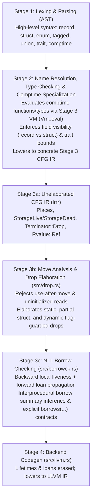

# Language & Stage 3 IR (`lrrr`) Design Document

## 1. Core Philosophy
The goal of the language is to combine:
1. **Rust-level memory safety** (ownership, move semantics, RAII destructors, and Non-Lexical Lifetimes borrow checking).
2. **Zig-level `comptime` metaprogramming** (first-class `type` values, functions that compute types, and compile-time evaluation in place of angle-bracket generics `<T>` and AST/procedural macros).
3. **Clear, orthogonal type taxonomy** (distinct keywords for distinct memory/lifecycle semantics rather than overloading a single keyword).

---

## 2. Compiler Pipeline Architecture



### Why `comptime` Specialization Happens *Before* Borrow Checking
In Rust, borrow checking happens before monomorphization on abstract generic types `<T>`, requiring complex type-system machinery (`T: 'a`, `PhantomData<T>`, `#[may_dangle]`, variance annotations).

By evaluating `comptime` parameters and type-constructing functions **first** (via [`Vm::eval`](file:///home/adam/git/lrrr/src/vm.rs#L123)) and running [`elaborate_drops`](file:///home/adam/git/lrrr/src/drop.rs#L62) and [`check_borrows`](file:///home/adam/git/lrrr/src/borrowck.rs#L30) on the resulting concrete Stage 3 functions:
- **No `PhantomData<T>` is needed**: Concrete field types and destructors (`drop tyX = fnY`) are directly visible.
- **No `T: 'a` bounds are needed**: Concrete structs containing references are tracked directly by the borrow checker.
- **`comptime` parameters are already folded** into concrete [`TypeId`](file:///home/adam/git/lrrr/src/ir.rs#L4)s and [`ConstValue`](file:///home/adam/git/lrrr/src/ir.rs#L75)s before borrow checking begins.

---

## 3. High-Level Type Taxonomy

### 3.1 Product Types: `record` vs `struct`
Both `record` and `struct` are inline value types (no implicit heap allocation or OOP inheritance) and both lower to [`Type::Struct`](file:///home/adam/git/lrrr/src/ir.rs#L35) in Stage 3, but they have distinct high-level contracts:

| Feature | `record` (Transparent Data) | `struct` (Encapsulated Invariant / Resource) |
| :--- | :--- | :--- |
| **Intent** | Plain transparent bundle of fields (`Point`, `Pair`, `Config`) | Encapsulated state with invariants or lifecycle (`Vec`, `File`, `MutexGuard`) |
| **Field Visibility** | All fields are **public** | Fields are **private** by default |
| **Methods** | Allowed (convenience helpers) | Allowed (invariant-preserving API) |
| **Custom Destructor (`drop`)** | **Forbidden** (automatically drops any fields that have destructors) | **Allowed** (`drop(self: &mut Self)`) |
| **Partial Moves (`move r.x`)** | **Always allowed** (remaining fields stay valid and are dropped individually) | **Forbidden** (preserves whole-object invariant for `drop`) |
| **Stage 3 Drop Behavior** | Decomposed into leaf fields in [`src/drop.rs`](file:///home/adam/git/lrrr/src/drop.rs#L96-L109) | Treated as an atomic drop unit if registered in [`Program::destructors`](file:///home/adam/git/lrrr/src/ir.rs#L215) |

### 3.2 Sum & Overlay Types: `enum` vs `tagged` vs `union`
Rather than overloading `enum` or `union`, three distinct keywords represent three distinct concepts:

| Keyword | Concept | Stage 3 Representation | Safety & Semantics |
| :--- | :--- | :--- | :--- |
| **`enum`** | C-style integer enumeration (`Color::Red = 0`) | Integer type (`u8`, `i32`, etc.) | Safe scalar integer constants. |
| **`tagged`** | Safe tagged union / sum type (Rust `enum` with payloads) | [`Type::Tagged { tag, variants }`](file:///home/adam/git/lrrr/src/ir.rs#L37) | Safe; tracks active variant `v0`, `v1`, ... via [`Rvalue::Discriminant`](file:///home/adam/git/lrrr/src/ir.rs#L146) and drops active variant payload. |
| **`union`** | Unsafe C-style untagged union | [`Type::Union(fields)`](file:///home/adam/git/lrrr/src/ir.rs#L36) | Unsafe field reads (`.0`, `.1`); untracked active variant for low-level layout control and FFI. |

### 3.3 The Value Lifecycle Triad: `default`, `clone`, `drop`
Creation (`default`), duplication (`clone`), and destruction (`drop`) are **language-level lifecycle constructs** (always written in **lowercase**), rather than user-implemented traits:

| Lifecycle Hook | On a `record` (Transparent Data) | On a `struct` (Encapsulated Resource / Invariant) |
| :--- | :--- | :--- |
| **`default`** | **Auto-synthesized** if all fields have `default` (or field default values). **Forbidden** to implement manually. | **No default by default.** Allowed to implement `default() -> Self`. |
| **`clone`** | **Auto-synthesized** if all fields have `clone`. **Forbidden** to implement manually. | **Not clonable by default.** Allowed to implement `clone(self: &Self) -> Self`. |
| **`drop`** | **Auto-synthesized** if any field has `drop`. **Forbidden** to implement manually. | **No custom drop by default.** Allowed to implement `drop(self: &mut Self)`. |

- **Lowercase Bounds (`comptime T: clone`, `comptime T: default`) & Matching Intrinsics (`@clone(v)`, `@default(T)`, `@drop(v)`)**:
  - Because `default`, `clone`, and `drop` are built-in language lifecycle properties (like `type`), they use lowercase keywords when constraining `comptime` type parameters (`comptime T: clone + default` or `where T: clone`). This visually distinguishes language-level lifecycle properties from user-defined `PascalCase` traits (`Hash`, `Eq`).
  - Each lifecycle hook is invoked uniformly through its matching intrinsic:
    - `@default(T) -> T` (constructs the default value of type `T`)
    - `@clone(v) -> T` (duplicates `v` via `T`'s `clone` hook or structural field-by-field clone)
    - `@drop(v)` (runs `T`'s destructor in-place on `v`)
- **Implicit Copy vs Move Semantics**:
  - Any `record` (or `tagged` / array) that contains no `struct` with a custom `drop` or `clone` is trivially bitwise-copyable (`copy`).
  - Any `struct` with a custom `drop` or `clone` (and any `record` containing one) has move semantics by default and requires explicit `@clone(x)` to duplicate.

### 3.4 Language-Level Optionals (`?T`) and Results (`E!T`)
Instead of library-level generic sum types (`Option(T)` and `Result(T, E)`), optionality and fallibility are first-class type modifiers inspired by Zig (`?T` and `E!T`), eliminating verbose `Option(T)::Some(...)` / `Option(T)::None` ceremony in a macro-less language.

#### Non-Null by Default for *Both* References and Raw Pointers
Both safe references (`&T`, `&mut T`) and raw pointers (`*const T`, `*mut T`) are **non-null by default**. Nullability is orthogonal and expressed uniformly with `?`:

| Type | Nullability | Safety / Borrow Checking | Layout (64-bit) |
| :--- | :--- | :--- | :--- |
| `&T` / `&mut T` | **Non-null** (`0` is invalid) | Safe; tracked by [`src/borrowck.rs`](file:///home/adam/git/lrrr/src/borrowck.rs) | 8 bytes |
| `?&T` / `?&mut T` | **Nullable** (`null` is `0`) | Safe; must unwrap before dereferencing; borrow-tracked | 8 bytes (null niche) |
| `*const T` / `*mut T` | **Non-null** (`0` is invalid; replaces `NonNull<T>`) | Unsafe to dereference (`*ptr`) | 8 bytes |
| `?*const T` / `?*mut T` | **Nullable** (`null` is `0`; C FFI pointer) | Must unwrap (`?*mut T -> *mut T`) before unsafe deref | 8 bytes (null niche) |

#### Dedicated Control-Flow Operators
- **`null` literal**: The empty value for any `?T`.
- **`x orelse fallback`**: Unwraps `?T` to `T`, or evaluates `fallback` (a default value, `return`, `break`, `continue`, or `unreachable`).
- **`try expr`**: Unwraps `E!T` to `T` (or `?T` to `T`), returning the error (or `null`) early from the enclosing function.
- **`if let val = opt_expr { ... }` / `while let val = iter.next() { ... }`**: Safe conditional unwrapping for `?T`.

#### Interaction with the Value Lifecycle Triad (`default`, `clone`, `drop`)
| Lifecycle Hook | `?T` (Optional) | `E!T` (Result) |
| :--- | :--- | :--- |
| **`default`** | **Always has `default` (`null`)**, even if `T` does *not* implement `default`. | Does **not** implement `default`. |
| **`clone`** | Implements `clone` if `T: clone` (clones payload if non-null). | Implements `clone` if `T: clone` and `E: clone`. |
| **`drop`** | Automatically drops `T` if active (`!= null`) and `T` has a destructor. | Automatically drops active `T` or `E` if it has a destructor. |
| **Copy vs Move** | Implicitly `copy` if `T` is `copy`; move-only if `T` has custom `drop`/`clone`. | Implicitly `copy` if both `T` and `E` are `copy`. |

#### Stage 3 (`lrrr`) Lowering & Borrow Checking
`?T` and `E!T` require no new Stage 3 IR instructions — they lower directly to [`Type::Tagged`](file:///home/adam/git/lrrr/src/ir.rs#L37) (`tagged u8 { void, T }` for `?T` and `tagged u8 { T, E }` for `E!T`):
- [`src/drop.rs`](file:///home/adam/git/lrrr/src/drop.rs) automatically checks the active discriminant (`Rvalue::Discriminant`) and drops the active variant payload (`_opt.v1`).
- [`src/borrowck.rs`](file:///home/adam/git/lrrr/src/borrowck.rs) propagates loans across variant projections (`.v0`, `.v1`), so functions returning `?&T` or `E!&mut T` work seamlessly with both explicit `borrows(_1)` contracts and automatic interprocedural borrow inference ([`infer_return_origins`](file:///home/adam/git/lrrr/src/borrowck.rs#L68-L246)).

### 3.5 Uninitialized Storage: `uninit T` and `uninit`
Just as `?T` + `null` provide language-level optional values, **`uninit T`** (type modifier) + **`uninit`** (value literal) provide zero-overhead uninitialized inline storage (replacing Rust's `MaybeUninit<T>` wrapper):

| Concept | Optional (`?T`) | Uninitialized Storage (`uninit T`) |
| :--- | :--- | :--- |
| **Type Syntax** | `?T` | `uninit T` |
| **Empty Value Literal** | `null` | `uninit` |
| **Size & Alignment** | `size_of(T) + tag` (or pointer niche) | **Identical to `T`** (`size_of(T)`, `align_of(T)`) |
| **Automatic `drop`** | Drops `T` if active (`!= null`) | **Never auto-drops** (caller manages lifecycle via `@drop`) |
| **Stage 3 (`lrrr`) Lowering** | `tagged u8 { void, T }` ([`Type::Tagged`](file:///home/adam/git/lrrr/src/ir.rs#L37)) | `union { void, T }` ([`Type::Union`](file:///home/adam/git/lrrr/src/ir.rs#L36)) |

- **Array Initialization**: An array `[uninit T; cap]` can be initialized in one shot with `uninit` (which sets variant `.0 = const void` in Stage 3 and emits zero memory writes in LLVM).
- **Overwriting Without Drop**: Assigning `slot = uninit(move val)` writes directly into the slot without running a destructor on the prior uninitialized bytes.
- **Unsafe Access & In-Place Drop**: Reading, borrowing, moving out of, or dropping the inner `T` (`slot.assume_init`, which projects `.1` on `union { void, T }` in Stage 3) requires `unsafe`.

---

## 4. `comptime` Metaprogramming & Traits (Macro-less Design)

### 4.1 Type-Generating Functions Instead of `<T, const N>`
Generic types are ordinary functions that take `comptime` parameters and return `type` ([`Type::MetaType`](file:///home/adam/git/lrrr/src/ir.rs#L32)):
```rust
fn Array(comptime T: type, comptime len: usize) -> type {
    return record {
        data: [T; len],
    };
}
```
In Stage 3 IR, `comptime` functions can dynamically construct and intern all composite types via [`Vm::eval`](file:///home/adam/git/lrrr/src/vm.rs#L123-L130):
- **Struct / Record types**: `aggregate ty_meta(copy _1, copy _2)` ([`Rvalue::Aggregate`](file:///home/adam/git/lrrr/src/ir.rs#L144))
- **Pointer / Reference types**: `&_1` / `&mut _1` ([`Rvalue::Ref`](file:///home/adam/git/lrrr/src/ir.rs#L140-L143))
- **Array types**: `[copy _1; copy _2]` ([`Rvalue::ArrayType`](file:///home/adam/git/lrrr/src/ir.rs#L151-L154))
- **Tagged union types**: `tagged(const ty_tag, copy _1, copy _2)` ([`Rvalue::TaggedType`](file:///home/adam/git/lrrr/src/ir.rs#L158-L161))
- **Untagged union types**: `union(copy _1, copy _2)` ([`Rvalue::UnionType`](file:///home/adam/git/lrrr/src/ir.rs#L156))

### 4.2 Traits in a `comptime` Language
Traits serve two roles without requiring angle brackets:
1. **Static Constraints on `comptime` Type Parameters**:
   ```rust
   trait Hash {
       fn hash(self: &Self) -> u64;
   }

   fn HashMap(comptime K: Hash + Eq, comptime V: type) -> type { ... }
   ```
   - Checked at the call site; provides full IDE autocomplete inside the body.
   - Generic traits are simply `comptime` functions returning a `trait`:
     ```rust
     fn From(comptime Src: type) -> trait {
         return trait {
             fn from(src: Src) -> Self;
         };
     }
     ```
   - `comptime` reflection replaces `#[derive(...)]` proc-macros.
2. **Dynamic Dispatch (`&dyn Trait` / `&mut dyn Trait`)**:
   - Lowers directly to a Stage 3 2-field fat pointer struct `{ data_ptr: &void, vtable_ptr: &VTable }` where `VTable` is a struct of function pointers ([`Type::FnPtr`](file:///home/adam/git/lrrr/src/ir.rs#L38)).
   - [`src/borrowck.rs`](file:///home/adam/git/lrrr/src/borrowck.rs) automatically propagates the borrow loan of `data_ptr` into the fat pointer struct via [`Rvalue::Cast`](file:///home/adam/git/lrrr/src/ir.rs#L138) and [`Rvalue::Aggregate`](file:///home/adam/git/lrrr/src/ir.rs#L144).

---

## 5. Ownership, Lifetimes, and Borrow Checking

### 5.1 The "Sweet Spot" Lifetime & `self` Elision Rules
1. **Public (`pub`) Functions & Methods**:
   - **`self` Lifetime Elision Rule**: If a method takes `self: &Self` or `self: &mut Self` (`_1` in Stage 3), any returned references automatically inherit the lifetime of `self` (`borrows(_1)`) unless explicitly annotated otherwise. This eliminates lifetime annotations on methods like `get(self: &Self, index: usize) -> ?&T` and `get_mut(self: &mut Self, index: usize) -> ?&mut T`.
   - **Single-Input Elision Rule**: A free function with a single reference parameter automatically assigns that parameter's lifetime to all returned references.
   - **Explicit Annotations**: Only needed on `pub` functions when returning references that could originate from multiple non-`self` reference parameters (or when overriding the default `self` lifetime).
   - Lowers to an explicit Stage 3 contract on [`Function::ret_borrows`](file:///home/adam/git/lrrr/src/ir.rs#L203):
     ```text
     fn0(2) borrows(_1) { ... }
     ```
   - Verified locally inside `fn0` by [`check_borrows`](file:///home/adam/git/lrrr/src/borrowck.rs#L45-L60).
2. **Internal (Private) Functions**: Lifetimes are optional and **inferred by default**.
   - Lowers to `ret_borrows: None` (`fn1(2) { ... }`).
   - [`infer_return_origins`](file:///home/adam/git/lrrr/src/borrowck.rs#L68-L246) automatically computes which parameter locals `_1..=arg_count` can flow into `_0` at `return;` across the call graph.
   - Call sites only keep the inferred subset of arguments borrowed after the call.

### 5.2 Lifetime Erasure Timeline
- **Named lifetimes (`'a`)**: Erased when lowering to Stage 3 IR (replaced by CFG structure, `StorageLive`/`StorageDead`, `Rvalue::Ref`, and `borrows(_1)`).
- **Loans & mutability (`&T` vs `&mut T`)**: Verified by [`check_borrows`](file:///home/adam/git/lrrr/src/borrowck.rs#L30) in Stage 3, then erased when lowering to Stage 4 LLVM IR ([`src/llvm.rs`](file:///home/adam/git/lrrr/src/llvm.rs)), where all pointers become `ptr`.

---

## 6. Low-Level Memory & Lifecycle Intrinsics (`Vec` & `StackVec` Reference Patterns)

Memory management and value lifecycle operations are exposed as compiler intrinsics:
- `@alloc(comptime T: type, len: usize) -> *mut T`
- `@realloc(comptime T: type, ptr: *mut T, len: usize) -> *mut T`
- `@dealloc(ptr: *mut T)`
- `@memmove(dest: *mut T, src: *const T, len: usize)`
- `@default(comptime T: type) -> T` (invokes `T`'s `default` hook or synthesizes structural default for `record`s/primitives)
- `@clone(v)` (invokes `T`'s `clone` hook or synthesizes structural field-by-field clone for `record`s/primitives)
- `@drop(v)` (lowers directly to `Terminator::Drop { place, target }` in Stage 3 — works both for early in-place drop of a stack variable and in-place drop of a raw pointer slot `self.ptr + i`)

### Safe References (`&T` / `&mut T`) vs Raw Pointers (`*const T` / `*mut T`)
1. **No Auto-Drop on Raw Pointer Overwrite**: Writing `*(self.ptr + self.len) = move value` through `*mut T` stores directly into uninitialized heap memory without running a destructor on the old uninitialized bytes.
2. **Moving Out of Raw Pointers**: While `move (*_ref)` on a safe reference `&T` / `&mut T` is rejected by [`check_borrows`](file:///home/adam/git/lrrr/src/borrowck.rs#L71-L75), moving out of a raw pointer `move *(self.ptr + i)` inside `unsafe` (e.g. in `Vec::pop` and `Vec::remove`) is permitted.
3. **In-Place Destructor Elaboration**: Dropping `*(self.ptr + i)` via `@drop` (`Terminator::Drop`) in `Vec::drop` elaborates to a destructor call if `T` has a destructor, or a zero-cost `goto` no-op if `T` is trivially droppable ([`src/drop.rs`](file:///home/adam/git/lrrr/src/drop.rs#L555-L558)).

### 6.1 Heap-Allocated Vector: `Vec(comptime T: type)`
```rust
fn Vec(comptime T: type) -> type {
    return struct {
        ptr: ?*mut T,   // Nullable when cap == 0; non-null *mut T when allocated
        len: usize,
        cap: usize,

        pub fn new() -> Self {
            return Self { ptr: null, len: 0, cap: 0 };
        }

        fn grow(self: &mut Self) -> *mut T {
            let new_cap = if self.cap == 0 { 4 } else { self.cap * 2 };
            let new_ptr: *mut T = if let old_ptr = self.ptr {
                @realloc(T, old_ptr, new_cap)
            } else {
                @alloc(T, new_cap)
            };
            self.ptr = new_ptr;
            self.cap = new_cap;
            return new_ptr;
        }

        pub fn push(self: &mut Self, value: T) {
            let p: *mut T = if self.len == self.cap {
                self.grow()
            } else {
                self.ptr orelse unreachable
            };
            unsafe {
                *(p + self.len) = move value;
            }
            self.len += 1;
        }

        pub fn pop(self: &mut Self) -> ?T {
            if self.len == 0 {
                return null;
            }
            self.len -= 1;
            let p = self.ptr orelse unreachable;
            unsafe {
                return move *(p + self.len);
            }
        }

        pub fn get(self: &Self, index: usize) -> ?&T {
            if index >= self.len {
                return null;
            }
            let p = self.ptr orelse unreachable;
            unsafe {
                return &*(p + index);
            }
        }

        pub fn get_mut(self: &mut Self, index: usize) -> ?&mut T {
            if index >= self.len {
                return null;
            }
            let p = self.ptr orelse unreachable;
            unsafe {
                return &mut *(p + index);
            }
        }

        default() -> Self {
            return Self::new();
        }

        clone(self: &Self) -> Self where T: clone {
            let src_ptr = self.ptr orelse return @default(Self);
            if self.len == 0 {
                return @default(Self);
            }
            let new_ptr: *mut T = @alloc(T, self.len);
            let mut i: usize = 0;
            while i < self.len {
                unsafe {
                    *(new_ptr + i) = @clone(*(src_ptr + i));
                }
                i += 1;
            }
            return Self {
                ptr: new_ptr,
                len: self.len,
                cap: self.len,
            };
        }

        drop(self: &mut Self) {
            if let p = self.ptr {
                let mut i: usize = 0;
                while i < self.len {
                    unsafe {
                        @drop(p + i);
                    }
                    i += 1;
                }
                unsafe {
                    @dealloc(p);
                }
            }
        }
    };
}
```

### 6.2 Stack-Allocated Fixed-Capacity Vector: `StackVec(comptime T: type, comptime cap: usize)`
Using `[uninit T; cap]` (`union { void, T }` in Stage 3), `StackVec` holds inline stack storage without requiring `T: default` or auto-dropping uninitialized slots:

```rust
pub enum CapacityError {
    Full,
}

fn StackVec(comptime T: type, comptime cap: usize) -> type {
    return struct {
        data: [uninit T; cap],
        len: usize,

        pub fn new() -> Self {
            return Self {
                data: uninit, // Zero-cost: leaves stack buffer untouched
                len: 0,
            };
        }

        pub fn try_push(self: &mut Self, value: T) -> CapacityError!void {
            if self.len == cap {
                return CapacityError::Full; // `value` is automatically dropped on error return
            }
            self.data[self.len] = uninit(move value);
            self.len += 1;
        }

        pub fn push(self: &mut Self, value: T) {
            self.try_push(move value) catch unreachable;
        }

        pub fn pop(self: &mut Self) -> ?T {
            if self.len == 0 {
                return null;
            }
            self.len -= 1;
            unsafe {
                return move self.data[self.len].assume_init;
            }
        }

        pub fn get(self: &Self, index: usize) -> ?&T {
            if index >= self.len {
                return null;
            }
            unsafe {
                return &self.data[index].assume_init;
            }
        }

        pub fn get_mut(self: &mut Self, index: usize) -> ?&mut T {
            if index >= self.len {
                return null;
            }
            unsafe {
                return &mut self.data[index].assume_init;
            }
        }

        default() -> Self {
            return Self::new();
        }

        clone(self: &Self) -> Self where T: clone {
            let mut out = Self::new();
            let mut i: usize = 0;
            while i < self.len {
                unsafe {
                    let elem_ref: &T = &self.data[i].assume_init;
                    out.data[i] = uninit(@clone(*elem_ref));
                }
                out.len += 1;
                i += 1;
            }
            return out;
        }

        drop(self: &mut Self) {
            let mut i: usize = 0;
            while i < self.len {
                unsafe {
                    @drop(&mut self.data[i].assume_init);
                }
                i += 1;
            }
        }
    };
}
```

---

## 7. Stage 3 IR (`lrrr`) Quick Reference

| Construct | Syntax Example | Implementation |
| :--- | :--- | :--- |
| **Primitives** | `void`, `bool`, `i8`..`i64`, `u8`..`u64`, `f32`, `f64`, `type` | [`Type`](file:///home/adam/git/lrrr/src/ir.rs#L19-L39) |
| **References / Pointers** | `&ty0`, `&mut ty0`, `fn(ty0) -> ty1` | [`Type::Ptr`](file:///home/adam/git/lrrr/src/ir.rs#L33), [`Type::FnPtr`](file:///home/adam/git/lrrr/src/ir.rs#L38) |
| **Composites** | `[ty0; 4]`, `{ ty0, ty1 }`, `union { ty0, ty1 }`, `tagged ty0 { ty1, ty2 }` | [`Type::Array`](file:///home/adam/git/lrrr/src/ir.rs#L34), [`Type::Struct`](file:///home/adam/git/lrrr/src/ir.rs#L35), [`Type::Union`](file:///home/adam/git/lrrr/src/ir.rs#L36), [`Type::Tagged`](file:///home/adam/git/lrrr/src/ir.rs#L37) |
| **Destructor Registration** | `drop ty2 = fn1;` | [`Program::destructors`](file:///home/adam/git/lrrr/src/ir.rs#L215) |
| **Globals & Externs** | `global [mut] gl0: ty0 = const 0;`<br/>`extern fn0(ty1) -> ty0 = "puts";` | [`Global`](file:///home/adam/git/lrrr/src/ir.rs#L205-L210), [`ExternFunc`](file:///home/adam/git/lrrr/src/ir.rs#L188-L193) |
| **Functions** | `fn0(2) borrows(_1) = "sym" { ... }` | [`Function`](file:///home/adam/git/lrrr/src/ir.rs#L196-L206) |
| **Projections** | `(*_1)`, `_1.0`, `_1.v0`, `_1[_2]` | [`Projection`](file:///home/adam/git/lrrr/src/ir.rs#L52-L57) |
| **Terminators** | `goto -> bb1;`<br/>`switchInt(copy _1) -> [0: bb1, otherwise: bb2];`<br/>`_0 = call const fn1(move _1) -> bb1;`<br/>`drop(_1) -> bb1;`<br/>`return;` / `unreachable;` | [`Terminator`](file:///home/adam/git/lrrr/src/ir.rs#L165-L186) |

